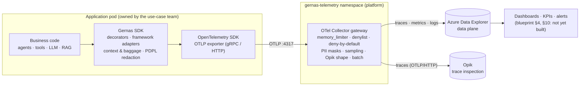

# Gernas SDK — Instrumentation Guide

This guide is for an engineer adding GERNAS telemetry to an agentic AI application:
- Microsoft Agent Framework (MAF), LangChain, LangGraph or plain Python;
- any service in front of it (API, A2A node, MCP server).

Every API below exists in `gernas-telemetry` 0.4.0. The runnable examples in `examples/` are executed by `tests/test_examples.py`. Field names follow the GERNAS Enterprise Telemetry Blueprint (`docs/BLUEPRINT_TRACEABILITY.md`).

To run the whole pipeline end to end, see `docs/GERNAS_SDK_END_TO_END_RUNBOOK.md`. For diagrams, the API catalogue and the exact Agent Mesh call sites, see `docs/GERNAS_SDK_ARCHITECTURE_AND_INSTRUMENTATION.html`, which is generated from the source.

---

## A. Architecture



| Component | Responsible for | Mandatory? |
|---|---|---|
| **Gernas SDK** (this package) | OTel provider and resource setup; spans, metrics and logs with GERNAS names; context and baggage propagation; run KPIs (steps, loops, retries, termination); PDPL redaction at source; export to the Collector only | Yes, in every producer |
| **Application** | Calling `init_gernas()` once, putting decorators or adapters on the right functions, supplying `GERNAS_*` configuration, never creating its own spans or exporters | Yes |
| **OTel Collector** (`collector/`) | Second PDPL enforcement point, sampling, vendor field shapes, fan-out to destinations, health and self-metrics | Yes. The SDK never exports to a backend directly. |
| **Azure Data Explorer** | Durable data plane for traces, metrics and logs; the source for dashboards, KPIs and FinOps | Yes (blueprint data plane) |
| **Opik** | Developer trace inspection (traces only) | Yes for this phase (developer view) |
| **Dashboards / alerts** | Blueprint §4, §10, §11 views over ADX | Required by the blueprint; **not implemented yet** (see `checklist.md`) |

**Telemetry flow:**
1. A decorated function starts a span. The SDK stamps the envelope (business domain, use case, application, environment, operation, execution status) plus the run context.
2. On exit the span ends with an outcome. Metrics are recorded at the same time.
3. The OTLP exporter batches the span to the Collector.
4. The Collector removes anything not registered, masks PII, and sends the result to ADX and Opik.

---

## B. Installation and prerequisites

| Item | Value |
|---|---|
| Python | 3.11 or later (tested on 3.14) |
| Package | `pip install gernas-telemetry` (local repo: `pip install -e ./gernas-sdk`) |
| Core dependencies | `opentelemetry-api/sdk/exporter-otlp-proto-grpc/-http` ≥ 1.24 (tested 1.45.1) |
| Optional extras | `[agent-framework]`, `[a2a]`, `[langchain]`, `[langgraph]`. The core never imports a framework. |
| Collector | otelcol-contrib 0.162.0: image `otel/opentelemetry-collector-contrib:0.162.0` in AKS, or `collector/bin/` locally |
| Dev / test | `pip install -e ./gernas-sdk[dev]` |

**Environment variables.** `GernasConfig.from_env` reads these; there are no other configuration sources. `GernasConfigError` names every missing or invalid one.

| Variable | Required | Meaning |
|---|---|---|
| `GERNAS_SERVICE_NAME` | **yes** | OTel `service.name` (one per process) |
| `GERNAS_USE_CASE_ID`, `GERNAS_APPLICATION_ID`, `GERNAS_BUSINESS_DOMAIN`, `GERNAS_ENVIRONMENT` | **yes** | Blueprint business and infrastructure context on every signal |
| `GERNAS_OTLP_ENDPOINT` | **yes** when the exporter is `otlp` | Collector, e.g. `http://gernas-otel-collector.gernas-telemetry.svc.cluster.local:4317` |
| `GERNAS_EXPORTER` | no (`otlp`) | `otlp` / `console` (local debugging) / `off` |
| `GERNAS_OTLP_TRANSPORT`, `GERNAS_OTLP_API_KEY`, `GERNAS_OTLP_TIMEOUT_S` | no | `grpc` or `http`; bearer token **to the Collector**; timeout |
| `GERNAS_SERVICE_VERSION`, `GERNAS_AGENT_VERSION` | no | Versions (agent version defaults to service version) |
| `GERNAS_CLUSTER`, `GERNAS_NAMESPACE`, `GERNAS_POD`, `GERNAS_REGION` | no | Infrastructure context (pod is derived from `HOSTNAME` in Kubernetes) |
| `GERNAS_USER_TOKEN_KEY` | no | HMAC key for `tokenized_user_id`. **Secret.** Unset means the user is not recorded. |
| `GERNAS_SAMPLING_RATE`, `GERNAS_METRIC_INTERVAL_MS`, `GERNAS_LOG_NAMESPACES` | no | Head sampling, metric interval, loggers bridged to OTel logs |
| `GERNAS_LOOP_THRESHOLD`, `GERNAS_MAX_STEPS`, `GERNAS_RATE_CARD_PATH` | no | Loop / runaway detection; cost rate card (JSON) |
| `GERNAS_SUPPRESSED_SCOPES` | no | Comma-separated tracer scopes whose spans duplicate SDK spans and must not be exported (e.g. `fastmcp` in an MCP server). Only suppress leaf scopes. |

**Secrets.** Backend credentials (`OPIK_API_KEY`, ADX identity) belong to the **Collector**, not the application:
- in AKS, a Kubernetes Secret plus Workload Identity;
- locally, `agent-mesh/.env` read by `scripts/run_collector.py`.

Never put real values in source files, examples or tickets. Use placeholders such as `<opik-api-key>`.

---

## C. Initialization, configuration, shutdown

```python
import gernas

handle = (
    gernas.init_gernas()
)  # 1. reads GERNAS_*; raises GernasConfigError; idempotent (2nd call returns the same handle)
try:
    run_application()  # 2. decorated code emits telemetry
finally:
    handle.shutdown()  # 3. flushes and closes the trace, metric and log providers (safe to call twice)
```

- Call `init_gernas()` **once per process, before** the agents, chat clients and frameworks are built.
- Use `handle.flush(timeout_millis=5000)` to push buffered telemetry without shutting down, for example before a serverless return.
- To build the config explicitly (the same validation applies): `gernas.init_gernas(gernas.GernasConfig.from_env(service_name="faq-api"))`.
- Service identity and resource attributes come from configuration only: `service.name`, `service.version`, `gernas.sdk_version`, the business envelope and the infrastructure context.
- If the Collector is down, the application keeps running. Lost spans are counted in `gernas.sdk.dropped_spans`.

---

## D. Exactly where to instrument

| Application location | Objective | Action (real API) | Verified by |
|---|---|---|---|
| Process startup | Configure telemetry once | `gernas.init_gernas()` | `test_config`, examples |
| Request / workflow entry point | Root span and correlation for the business request | `@gernas.trace_use_case(channel=..., request_type=..., outcome_from=...)` + `with gernas.request_context(session_id=..., task_id=..., user_id=..., principal_type=...)` | `test_decorators::test_use_case_is_the_root…` |
| Inbound HTTP / A2A server | Continue the caller's trace | `app.add_middleware(GernasASGIMiddleware, channel="api")` | `test_adapter_transport` |
| Agent execution | `agent.run` with run id, steps, retries, loops, termination | `@gernas.trace_agent(agent_id, agent_type=...)`, or an adapter: MAF `gernas_middleware(...)`, LangChain `instrument(...)`, LangGraph `instrument_graph(...)` | `test_decorators`, `test_adapter_*` |
| Workflow executor / graph node / plan step | `agent.step` (the "Step" level of the drill-down) | `@gernas.trace_step(step_id, step_type="workflow_executor")`. Graph nodes are automatic with `instrument_graph` | `test_adapter_langchain::test_graph_nodes…` |
| Plan generation | Planning latency | `@gernas.trace_planning()` | `test_kpi_metrics` |
| LLM invocation | Tokens, cost, TTFT, tokens/s, stop reason, errors | `@gernas.trace_llm(model_id, provider=...)` (generator ⇒ streaming), or the MAF chat middleware / LangChain handler | `test_decorators`, `test_runtime` |
| Embedding | Batch size, tokens | `@gernas.trace_embedding(model_id, provider=...)` | `test_decorators::test_embedding` |
| Tool invocation | Count, latency, failure, authorization, payload size | `@gernas.trace_tool(tool_id, tool_type="api"\|"function", dependency=...)`, or the MAF function middleware | `test_decorators` |
| MCP call (client) | Tool span with `tool_type="mcp"`; trace context into the request `_meta` | MAF: `gernas_middleware(..., mcp_server="<server>")`. Custom: `@gernas.trace_tool(name, tool_type="mcp", dependency="<server>")` | `test_adapter_agent_framework::test_mcp_server…` |
| MCP server | Server span joined to the caller's trace | fastmcp: `mcp.add_middleware(GernasFastMCPMiddleware("<server>"))`; low-level `mcp`: `with mcp_meta_context(ctx): ...` | `test_adapter_transport` |
| Agent hand-off (in process) | `agent.delegate`, parent → child, delegation path | `@gernas.trace_delegation("child_agent")` around the call into the child agent | `test_decorators::test_nested_agent…` |
| Agent hand-off (remote, A2A / HTTP) | Same trace across processes; child links to the parent run | `@gernas.trace_delegation(child_arg="name")` on the client call, plus `A2AAgent(..., auth_interceptor=GernasA2AInterceptor())` (or httpx `async_event_hooks()`); server side `GernasASGIMiddleware` | `test_context::test_cross_process_hop…`; live Agent Mesh |
| Retrieval / RAG | Result count, empty result, ranking score, source, document version, knowledge authorization | `@gernas.trace_retrieval(index_id=..., strategy=..., authorization_decision=...)` (`source_id` / `document_version` read from the top result) | `test_decorators::test_retrieval`, `test_document_processing` |
| Document ingestion | `document.process`: documents parsed / rejected / failed, chunk count; extraction (OCR) latency | `@gernas.trace_document(outcome_from=..., chunks_from=...)` per document, `@gernas.trace_step("extract", step_type="document_extraction")` on extraction. RAG: `IngestionPipeline.ingest_file` | `test_document_processing` |
| Memory read / write | Hit, stale, size | `@gernas.trace_memory("read"\|"write")` | `test_decorators::test_memory…` |
| Guardrail / policy / content safety | Decision; deny keeps status OK; blocks end the run as `policy_block` | `@gernas.trace_guardrail(policy_id)`, `@gernas.trace_content_safety(category, policy=...)`. RBAC / role checks are guardrails too (Agent Mesh: `rbac_role_check`) | `test_decorators` |
| Human approval | `hitl.approval`, intervention rate | `start_hitl(ticket, action)` / `complete_hitl(ticket, outcome)`, or `@gernas.trace_hitl(...)` | `test_runtime` |
| Quality evaluation (if enabled) | Blueprint §6 Quality scores | `gernas.record_evaluation("groundedness", 0.87, passed=True, evaluator="...")` | `test_kpi_metrics` |
| Error boundaries | ERROR status, `error_category`, PII-scrubbed exception event | Nothing extra: let exceptions propagate through decorated functions. For a handled failure that should count, re-raise it or call `gernas.record_retry()` before retrying. | `test_decorators::test_error_categories` |
| Background tasks / threads | Stay in the caller's trace and run | `gernas.gernas_task(coro)`, `threading.Thread(target=gernas.wrap_in_context(fn))` | `test_context` |
| Application logs and audit | Correlate log records with traces | `gernas.correlation()` → `trace_id`, `span_id`, `agent_run_id`, `session_id`, `task_id` | `test_context::test_correlation…` |
| Shutdown | Flush everything | `handle.shutdown()` | `test_config` |

**Framework-native telemetry must be off**, so that the SDK is the single instrumentation path:
- **MAF:** call `gernas.adapters.agent_framework.disable_native_telemetry()` after `init_gernas()`.
- **a2a-sdk:** set `OTEL_INSTRUMENTATION_A2A_SDK_ENABLED=false` **before** `a2a` is imported, because the library decides at import time.

MAF still injects trace context into MCP `_meta` through the global propagator that `init_gernas()` installs, so turning off its native telemetry does not break MCP propagation.

- **fastmcp servers:** fastmcp traces `tools/call` itself, duplicating the SDK's server `tool.call`. Set `GERNAS_SUPPRESSED_SCOPES=fastmcp` in the server process.

---

## E. Trace, context and baggage

- **Root.** The outermost decorated function (normally `trace_use_case`) creates the root span. Every decorated call inside it becomes a child, because OTel context is carried in `contextvars`. That covers sync code, `async` code, generators and streams. `trace_use_case(new_trace=True)` forces a fresh trace.
- **Run context.** `trace_agent` binds a run. Every span below it carries `gernas.agent_id` and `gernas.agent_run_id`. A nested agent records `parent_run_id` and `delegation_path` (`parent>child`).
- **Across processes.** `init_gernas()` installs a propagator that adds the current run (`parent_run_id`, `parent_agent_id`, `delegation_path`) to the baggage of **every** injection: `inject_context(headers)`, the A2A interceptor, httpx hooks, and libraries that call `propagate.inject` themselves, such as MAF's MCP client. A span executed on behalf of that run in another process (for example the MCP server's `tool.call`) therefore carries the caller's `agent_id` / `agent_run_id`. `attach_headers(headers)` (or `GernasASGIMiddleware`) restores them. The A2A interceptor and httpx hooks call `inject_context` for you.
- **Baggage carries identity only.** Set it with `request_context`: `session_id`, `task_id`, `channel`, tokenized user, `principal_type` (`human` / `agent` / `service`), `tenant`, `department`. Only these allow-listed keys are copied onto spans. Never put payloads, raw user ids, account numbers or tokens in baggage: headers travel to every downstream service.
- **Custom attributes.** Use `gernas.annotate({Ctx.COMPUTE_UNITS: 2.5})` with **registered** keys. Unregistered keys are removed by the Collector. Values pass the same redaction as SDK attributes.
- **Async.** `asyncio.create_task(coro)` copies context automatically in most cases. `gernas.gernas_task(coro)` makes that explicit and also keeps the Gernas run bound.

Correct and incorrect instrumentation:

```python
# ✅ one span per operation; the child is nested automatically
@gernas.trace_tool("lookup")
def lookup(q): ...


@gernas.trace_agent("faq", agent_type="worker")
def run(q):
    return lookup(q)


# ❌ double instrumentation: decorator + MAF function middleware on the same tool → two tool.call spans.
#    Fix: gernas_middleware(..., trace_functions=False) or drop the decorator.
#    `gernas conformance` reports this as a "duplicate" violation.

# ❌ manual spans / own exporter in the application
from opentelemetry import trace

with trace.get_tracer("app").start_as_current_span("my.step"):  # bypasses GERNAS names, envelope and PDPL
    ...

# ❌ thread without context → the span becomes a new root, the parent-child link is broken
threading.Thread(target=lookup, args=("q",)).start()
# ✅
threading.Thread(target=gernas.wrap_in_context(lookup), args=("q",)).start()

# ❌ sensitive data in attributes or baggage
gernas.annotate({"customer.email": email})  # unregistered: removed by the Collector, flagged by conformance
# ✅ pass the user id to request_context; only an HMAC token is recorded
with gernas.request_context(user_id=user_id, principal_type="human"):
    ...
```

Never recorded:
- prompts, completions, tool arguments and results, retrieved text;
- the raw user id;
- credentials.

Only sizes, ids and decisions are recorded. Exception messages and logs are PII-scrubbed, and values are capped at 1024 characters.

---

## F. Examples (all executed by `tests/test_examples.py`)

| File | Shows |
|---|---|
| `examples/custom_agent.py` | init/shutdown, `trace_use_case` + `request_context`, `trace_agent`, `trace_step`, sync and streaming `trace_llm`, `trace_tool` (API and MCP), `trace_retrieval`, `trace_guardrail`, nested agent via `trace_delegation`, async fan-out, handled tool failure with `record_retry`, `record_evaluation` |
| `examples/maf_agent.py` | MAF `Agent` with `gernas_middleware` (agent / chat / function), workflow step |
| `examples/langchain_agent.py` | `instrument(prompt \| model)`: chain, tool and retriever |
| `examples/langgraph_agent.py` | `instrument_graph(...)`: node steps and a guardrail inside a node |

Run any of them with the console exporter:

```powershell
$env:GERNAS_SERVICE_NAME="demo"; $env:GERNAS_USE_CASE_ID="UC-DEMO"; $env:GERNAS_APPLICATION_ID="demo-app"
$env:GERNAS_BUSINESS_DOMAIN="demo"; $env:GERNAS_ENVIRONMENT="dev"; $env:GERNAS_EXPORTER="console"
python gernas-sdk/examples/custom_agent.py
```

Minimal snippets:

```python
# MCP server (fastmcp)
from gernas.adapters.mcp import GernasFastMCPMiddleware

mcp.add_middleware(GernasFastMCPMiddleware("crm_mcp"))

# A2A client + server
from gernas.adapters.a2a import GernasA2AInterceptor
from gernas.adapters.asgi import GernasASGIMiddleware

agent = A2AAgent(name="peer", url=url, auth_interceptor=GernasA2AInterceptor())
app.add_middleware(GernasASGIMiddleware, channel="a2a")


# Exception recording (automatic)
@gernas.trace_tool("core_banking", tool_type="api")
def pay():
    raise ConnectionError("down")  # tool.call: status ERROR, error_category=dependency, scrubbed exception event


# Offline evaluation job joining the evaluated run
gernas.record_evaluation("faithfulness", 0.74, evaluator="ragas_v1", agent_id="faq", agent_run_id=run_id)
```

---

## G. Configuration and troubleshooting

| Symptom | Likely cause | Check / fix |
|---|---|---|
| `GernasConfigError: Missing required Gernas configuration: …` | Identity variable unset | Set the listed `GERNAS_*` variables |
| No traces at all | Exporter `off`, or wrong endpoint | `gernas doctor` (configuration, collector, export, context) |
| `doctor`: collector FAIL | Collector not running or not reachable | `curl http://<collector>:13133/` returns "Server available"; check NetworkPolicy and namespace label |
| Spans arrive but attributes are missing | Key not registered (deny-by-default) | Add it to `registry/domains/*.yaml` and run `python registry/generate.py` |
| Broken parent-child links | Context lost across a thread, process or queue | `wrap_in_context`, `gernas_task`, `inject_context` / `attach_headers`, A2A interceptor + ASGI middleware |
| Duplicate spans | Decorator and adapter on the same call, or framework-native telemetry on | `trace_functions=False` / `trace_tools=False`; `disable_native_telemetry()`; `OTEL_INSTRUMENTATION_A2A_SDK_ENABLED=false`; `gernas conformance` |
| Foreign spans in Opik (`invoke_agent`, `a2a.server.*`, `tools/call …`) | Framework or library-native tracing on | As above; for fastmcp, `GERNAS_SUPPRESSED_SCOPES=fastmcp` |
| Failed exports | Collector or backend down | SDK: `gernas.sdk.dropped_spans`. Collector: `otelcol_exporter_send_failed_spans` on `:8888/metrics` |
| Opik 401 / 403 | Collector's Opik secret or headers wrong | Check `OPIK_API_KEY`, `OPIK_WORKSPACE`, `OPIK_PROJECT_NAME` in the Collector's Secret |
| ADX ingestion fails | Workload Identity not federated, or missing Ingestor role | `docs/collector-aks-deployment.md` §2 |
| Collector refuses to start: `clusterURI config is mandatory` | `ADX_CLUSTER_URI` unset | Set it, or locally use `scripts/run_collector.py` (file overlay) |

Validation commands:

```powershell
gernas doctor                                            # SDK config + Collector + test span
collector\bin\otelcol-contrib validate --config collector\otel-collector-config.yaml   # needs ADX_CLUSTER_URI set
python scripts\run_collector.py --validate               # local mode
gernas conformance --file collector\out\dataplane-traces.json --service <svc> --gernas-only
python scripts\opik_verify.py --task-id <request id>     # what Opik stored: hierarchy, conformance, foreign spans
```

---

## H. Adopting Gernas SDK in a new use case

1. Add `gernas-telemetry` (plus your framework extra) to the application's dependencies.
2. Agree the identity values with the platform team: `GERNAS_USE_CASE_ID`, `GERNAS_APPLICATION_ID`, `GERNAS_BUSINESS_DOMAIN`, `GERNAS_ENVIRONMENT`, one `GERNAS_SERVICE_NAME` per process. Point `GERNAS_OTLP_ENDPOINT` at the Collector Service and label the namespace `gernas.fab/telemetry-producer=true`.
3. Call `init_gernas()` at startup and `handle.shutdown()` at exit. If you use MAF, call `disable_native_telemetry()`; if you use A2A, set `OTEL_INSTRUMENTATION_A2A_SDK_ENABLED=false`.
4. Instrument the locations in §D: the entry point (`trace_use_case` + `request_context`), agents (adapter or `trace_agent`), steps, LLM, tools, MCP, retrieval, guardrails, hand-offs, HITL.
5. Remove any other tracer, exporter, metric or span code from the application. Use `gernas.correlation()` for log correlation.
6. Run `gernas doctor`, then exercise one request and run `gernas conformance` and `scripts/opik_verify.py --task-id <id>`. Expect: one trace per request, every parent link resolved, no violations, only Gernas spans.
7. Do **not** add application-specific code to the SDK. If a blueprint field is missing, propose it in `registry/` (it is FAB-owned IP) and regenerate.
