# GERNAS RAG Service — End-to-End Call Graph

Multimodal RAG service (`gernas_rag`) on FastAPI. Retrieval is orchestrated by a **Microsoft Agent Framework (MAF) workflow** of six executors. The same core classes are also driven by an MCP tool server, standalone CLI scripts and an offline 4-stage eval suite.

- **Branch:** `feat/multimodal-rag-poc-maf`. Traced against HEAD `a840f0a` plus the uncommitted working tree as of 2026-09-10.
- **Path convention:** a path with no prefix is relative to `src/gernas_rag/`. Paths starting `eval/`, `scripts/`, `mcp_integration/`, `tests/`, `config/`, `docker_files/` or `.venv/` are relative to the repo root.
- **Legend:** 🔥 HOT = runs on every request of that flow · ❄ COLD = startup, first call or rare · `[async]` coroutine · `[sync]` plain function · `[thread pool]` = `run_in_executor(None, …)` · `[async-def, sync body]` = declared `async` but does blocking work inline · `@retry×3` = `utils/retry.py:14 async_retry(max_attempts=3, backoff 1s/2s)`

---
## 0. What changed since the previous CALL_GRAPH.md

| Area | Previous branch | This branch |
|---|---|---|
| Retrieval orchestration | `RetrievalPipeline.retrieve` ran encode → search → rerank → freshness → parent-expand inline | `RetrievalPipeline.retrieve` (`retrieval/pipeline.py:94`) builds a **MAF `Workflow` per request** (`pipeline.py:52`) and runs it. Each stage is an `Executor` in `workflow/executors.py`, wired by `workflow/build.py:38` |
| Shared request state | local variables | `RagState` dataclass (`workflow/state.py:26`), mutated in place as it moves down the edge chain |
| Stage timeouts | none | `RetrievalConfig.{encode,search,rerank,parent_expand}_timeout_s` (`config/retrieval.py:68-71`, all default `None`), applied by `_within()` (`workflow/executors.py:44`). Rerank and parent-expand degrade on timeout; encode and search propagate the error |
| Freshness threshold | constant in `retrieval/pipeline.py` | `FRESHNESS_WARNING_THRESHOLD = 0.7` in `config/retrieval.py:16`, imported by the executors and by `eval/stage4_generation/retrieval_reuse.py:42` |
| Telemetry | tracer provider with no exporter | optional OTLP span export driven by `OTEL_EXPORTER_OTLP_ENDPOINT` / `OTEL_EXPORTER_OTLP_PROTOCOL` (`utils/telemetry.py:59`). Collects MAF's `workflow.build`, `workflow.run`, `executor.process` and `message.send` spans |
| New dependency | — | `agent-framework-core>=1.10.0` (1.17.0 installed). `workflow/` is the only package that imports it |
| New CLI | — | `scripts/retrieval_parity.py`: replays the gold set through the served `retrieve()` and diffs the result against a frozen stage 3 baseline |
| Corrections to the old doc | "All non-health routes go through `verify_auth`" | **Wrong.** `GET /api/v1/ingest/{job_id}` (`api/routers/ingest.py:79`) has no auth dependency |

---
## 1. ENTRY POINTS

### 1.1 HTTP endpoints (FastAPI; routers mounted at `main.py:85-89`)

Served by `uvicorn gernas_rag.main:app` (`docker_files/Dockerfile:24`, `docker_files/docker-compose.yml:41`).

| Method | Path | Handler signature | file:line | Auth | Hot/Cold |
|---|---|---|---|---|---|
| POST | `/api/v1/retrieve` | `retrieve(request, background_tasks, pipeline, generator, cache, history_store, x_username, _)` | `api/routers/retrieve.py:58-59` | `verify_auth` | 🔥 primary |
| POST | `/api/v1/ingest` | `ingest_document(background_tasks, file, document_type, product_applicability, effective_date, pipeline, _)` | `api/routers/ingest.py:31-32` | `verify_auth` | 🔥 per upload |
| GET | `/api/v1/ingest/{job_id}` | `get_ingestion_status(job_id)` | `api/routers/ingest.py:79-80` | ⚠ **none** | polled |
| GET | `/api/v1/search-history` | `list_search_history(username, store, _)` | `api/routers/search_history.py:16-17` | `verify_auth` | UI sidebar |
| GET | `/api/v1/search-history/{search_id}` | `get_search_history_entry(search_id, username, store, _)` | `api/routers/search_history.py:27-28` | `verify_auth` | UI |
| PATCH | `/api/v1/search-history/{search_id}` | `rename_search_history_entry(search_id, body, store, _)` | `api/routers/search_history.py:46-47` | `verify_auth` | UI |
| DELETE | `/api/v1/search-history/{search_id}` | `delete_search_history_entry(search_id, username, store, _)` | `api/routers/search_history.py:66-67` | `verify_auth` | UI |
| POST | `/api/v1/admin/reindex` | `reindex(request, _)` | `api/routers/admin.py:12-13` | `verify_auth` | ❄ |
| DELETE | `/api/v1/admin/collection` | `delete_collection(request, vectordb, _)` | `api/routers/admin.py:31-32` | `verify_auth` | ❄ |
| GET | `/health` | `health()` | `api/routers/health.py:11-12` | none | probe |
| GET | `/ready` | `ready(request)` | `api/routers/health.py:17-18` | none | probe |
| GET | `/docs` | FastAPI Swagger UI, only when `settings.debug` | `main.py:73` | none | ❄ |

`verify_auth` (`api/auth.py:10`) is `[called from 8 sites]` (every route above except `/health`, `/ready`, `/docs` and `GET /ingest/{job_id}`).

### 1.2 ASGI lifecycle (❄ COLD)
- **Startup:** `lifespan(app)` at `main.py:25-59` builds every singleton and stores it on `app.state` (see Flow F).
- **Shutdown:** `main.py:61-63` calls `cache.close()` (`cache/redis_cache.py:57`).

### 1.3 Module-level code that runs on import
| Where | What runs |
|---|---|
| `main.py:95` | `app = create_app()` (`main.py:66`), which calls `get_settings()` (`config/settings.py:139`, `@lru_cache`, reads YAML + `.env`) and `configure_logging()` (`utils/logging.py:32`; creates `./logs/` and installs a `RotatingFileHandler` on the root logger). It then adds CORS/RequestID/StructuredLogging middleware (`main.py:76-83`), includes the routers (`main.py:85-89`) and calls `instrument_fastapi(app)` (`utils/telemetry.py:102`). Heavy objects (models, DB clients) are **not** built here; that is deferred to `lifespan`. |
| `api/routers/ingest.py:28` | `_jobs: dict[str, IngestionResult \| str] = {}` is the process-local job table. Nothing persists it; a restart loses it. |
| `mcp_integration/server.py:25-49` | `sys.path.insert(src)`, `load_dotenv(.env)` (`:30`), read `RAG_GENERATE_ANSWER`/`MCP_TRANSPORT`/`MCP_HOST`/`MCP_PORT` (`:34-42`), `mcp = FastMCP("gernas-rag-search", …)` (`:44`), `_init_lock = asyncio.Lock()` (`:49`) |
| `scripts/*.py` | `sys.path.insert(0, "src")`. The path is relative to the working directory, so the scripts must be run from the repo root. |
| every module | `logger = get_logger(__name__)` (`utils/logging.py:81`). Cheap: it only binds a structlog field. |

### 1.4 CLI commands (`if __name__ == "__main__"` → `asyncio.run(main…)`)
| Entry | file:line | Purpose | Drives |
|---|---|---|---|
| `python scripts/ingest_docs.py --path … [--document-type …]` | `scripts/ingest_docs.py:20` (`__main__` `:50`) | Batch-ingest a file or directory without the API | `IngestionPipeline.ingest_file` / `ingest_directory` |
| `python scripts/setup_vectordb.py` | `scripts/setup_vectordb.py:17` (`:28`) | Create or verify the collection and its payload indexes | `vectordb.create_collection`, `health_check` |
| `python -u scripts/retrieval_parity.py [--baseline] [--id] [--out]` | `scripts/retrieval_parity.py:185` (`:311`) | **New.** Replays the gold set through the real `retrieve()` (all 6 executors) and diffs rank-by-rank against `eval/baselines/stage3_retrieval_run.json` | `RetrievalPipeline.retrieve` |
| `python scripts/run_agent_on_gold.py` | `scripts/run_agent_on_gold.py:93` (`:115`) | Retrieve + generate an answer for every gold question | `retrieve` + `generator.generate` |
| `python scripts/compare_with_judge.py` | `scripts/compare_with_judge.py:235` (`:269`) | LLM-judge the output of `run_agent_on_gold` | `llm.generate` |
| `python scripts/build_gold_set.py [--validate]` | `scripts/build_gold_set.py:455` (`:474`) | Write `data/eval/gold_qa.json`; optionally validate it against Qdrant | own `AsyncQdrantClient` (`:426-428`) |
| `python scripts/verify_chunks.py` / `view_chunks.py` / `view_media_chunks.py` | `:15` / `:11` / `:55` | Debug dumps of the collection | own `AsyncQdrantClient` (hard-coded `./qdrant_storage` in the first two) |
| `python -m eval {stage1\|stage2a\|stage2b\|stage3\|stage4\|all}` | `eval/__main__.py:55` (`:83`) | Eval suite dispatcher. `_dispatch()` (`:47`) imports the stage module and calls its `build_parser()` then `main(args)` | see Flow H |
| `python -m eval.stageN_….run…` | `eval/stage1_extraction/run.py:74`, `eval/stage2_enrichment/run_integrity.py:29`, `run_captions.py:46`, `eval/stage3_retrieval/run.py:69`, `eval/stage4_generation/run.py:116` | Each stage is also runnable on its own via `run_stage()` (`eval/core/runner.py:99`) | — |
| `python -m eval.stage4_generation.diagnose_ragas` | `eval/stage4_generation/diagnose_ragas.py:150` (`:165`) | Debug RAGAS scoring on one question | `GenerationRunner`, RAGAS |

### 1.5 MCP tool server (event listener; JSON-RPC over stdio, streamable HTTP or SSE)
| Entry | file:line |
|---|---|
| `@mcp.tool() search_documents(query, top_k=5, generate_answer=DEFAULT_GENERATE_ANSWER)` | `mcp_integration/server.py:134-135` |
| Transport selection in `__main__`: `streamable-http` / `sse` / stdio (default) | `mcp_integration/server.py:179-186` |
| Smoke-test client `main()`: spawns the server as a stdio subprocess and calls the tool | `mcp_integration/client.py:17` (`:46`) |

### 1.6 Background work (FastAPI `BackgroundTasks`, runs after the response is sent)
| Queued at | Task |
|---|---|
| `api/routers/ingest.py:75` | `run_ingestion()` closure (`ingest.py:54`), i.e. the whole ingestion pipeline |
| `api/routers/retrieve.py:104` | `cache.set(cache_key, response_json)` |
| `api/routers/retrieve.py:55` (reached from `:85` and `:106`) | `store.save(entry)` search-history write |

### 1.7 Not present
There are no cron, APScheduler or Celery tasks, no WebSocket handlers and no MQ consumers. SSE exists only as an MCP transport option. The only `asyncio.create_task` calls are inside the MAF runner (library internal, §6).

### 1.8 Tests (pytest, `asyncio_mode=auto`)
`tests/unit/test_retrieval_workflow.py` is the executable spec for the MAF path. Key cases: `test_workflow_is_built_per_request_components_are_not` (`:120`), `test_executor_exception_propagates` (`:279`), `test_stage3_private_attrs_survive` (`:302`), `test_concurrent_requests_do_not_cross_contaminate` (`:334`), the timeout cases (`:387`, `:419`, `:443`, `:461`), and `test_umbrella_agent_framework_is_not_installed` (`:470`).

---
## 2. CALL CHAINS

### Flow A — `POST /api/v1/retrieve` — 🔥 HOT PATH

#### A.0 ASGI stack and router
```
HTTP POST /api/v1/retrieve
└─ OpenTelemetryMiddleware (FastAPIInstrumentor)              utils/telemetry.py:107      [async]  server span
   └─ StructuredLoggingMiddleware.dispatch(request, call_next) api/middleware.py:36        [async]  logs "Request started/completed" + latency
      └─ RequestIDMiddleware.dispatch(request, call_next)      api/middleware.py:21        [async]  binds request_id contextvar, echoes X-Request-ID
         └─ CORSMiddleware → FastAPI router
            └─ retrieve(request, background_tasks, pipeline, generator, cache, history_store, x_username, _)
                                                               api/routers/retrieve.py:58  [async] 🔥
               ├─ Depends(get_retrieval_pipeline)(request)      api/deps.py:30   [sync] → app.state.retrieval_pipeline
               ├─ Depends(get_generator)(request)               api/deps.py:38   [sync] → app.state.generator
               ├─ Depends(get_cache)(request)                   api/deps.py:42   [sync] → app.state.cache
               ├─ Depends(get_search_history_store)(request)    api/deps.py:50   [sync] → app.state.search_history_store
               ├─ Depends(verify_auth)(request, x_api_key, authorization)
               │                                                api/auth.py:10   [async] [called from 8 sites]
               │    ├─ settings.jwt_secret set → _validate_jwt(token, secret, algorithm)
               │    │                                           api/auth.py:43   [sync] → jose.jwt.decode
               │    │                                           [raises HTTPException 401 "Missing bearer token" / "Invalid token"]
               │    ├─ settings.api_key set → X-API-Key == api_key   api/auth.py:32-36 [raises HTTPException 401]
               │    └─ neither set → open dev mode              api/auth.py:39-40
               ├─ RetrieveRequest body validation (pydantic)    models/retrieval.py:16  [raises 422: query 3-2000 chars, top_k 1-20]
               ├─ cache.make_key(request)                       cache/redis_cache.py:35 [sync] "gernas:retrieve:" + sha256(request.model_dump_json())
               ├─ search_id = str(uuid.uuid4())                 retrieve.py:78
               ├─ await cache.get(cache_key)                    cache/redis_cache.py:40 [async] [cache: Redis GET]
               │    [Exception caught redis_cache.py:45 → None, i.e. treated as a miss]
               │
               ├─ CACHE HIT                                     retrieve.py:82-86
               │    ├─ RetrieveResponse.model_validate_json(cached).model_copy(cache_hit=True, search_id=search_id)
               │    ├─ _save_history(...)                       retrieve.py:85 → :27
               │    └─ return                                   (skips the pipeline, the generator and cache.set)
               │
               ├─ CACHE MISS  try:                              retrieve.py:89
               │    ├─ await pipeline.retrieve(request)         → A.1  retrieval/pipeline.py:94
               │    └─ if request.generate_answer and response.chunks:
               │         ├─ await generator.generate(request.query, response.chunks)   → A.2  generation/generator.py:160
               │         └─ response = response.model_copy(update={"answer": answer})  retrieve.py:95
               │    except Exception → logger.error + raise HTTPException(500, "Retrieval failed")   retrieve.py:96-101
               │
               ├─ background_tasks.add_task(cache.set, cache_key, response.model_dump_json())   retrieve.py:104  [fire-and-forget]
               │    └─ RAGCache.set(key, value)                 cache/redis_cache.py:49 [async] [cache: Redis SET ex=redis_cache_ttl_seconds]
               │         [Exception caught redis_cache.py:54 → logged]
               ├─ response = response.model_copy(update={"search_id": search_id})   retrieve.py:105
               │    (runs after the cache blob is serialised, so a cached blob never carries a search_id)
               └─ _save_history(background_tasks, history_store, request, response, search_id, x_username)
                                                                retrieve.py:27  [sync] [called from 2 sites: :85, :106]
                    ├─ no X-Username → return                   retrieve.py:42-43
                    └─ SearchHistoryEntry(...) → background_tasks.add_task(store.save, entry)   retrieve.py:44-55
                         └─ LocalSearchHistoryStore.save(entry) storage/search_history_store.py:67
                                                                [async-def, sync body] [file write ./data/search_history/{search_id}.json] ⚠
```

#### A.1 `RetrievalPipeline.retrieve()` → MAF workflow (6 supersteps)
```
RetrievalPipeline.retrieve(request)                            retrieval/pipeline.py:94   [async] 🔥
│   [called from 5 non-test sites: api/routers/retrieve.py:90, mcp_integration/server.py:167,
│    eval/stage4_generation/runner.py:111, scripts/run_agent_on_gold.py:70, scripts/retrieval_parity.py:234]
├─ from ..workflow.state import RagState                       pipeline.py:107  (function-local import; see §4 cycle)
├─ self._build_workflow()                                      pipeline.py:52   [sync] 🔥 a new graph PER REQUEST (~1.9 ms)
│    ├─ from ..workflow.build import build_retrieval_workflow  pipeline.py:82   (function-local: breaks the retrieval ↔ workflow cycle)
│    └─ build_retrieval_workflow(embedder=self._embedder, vectordb=self._vectordb, searcher=self._searcher,
│         reranker=self._reranker, freshness=self._freshness,
│         pre_rerank_top_k=settings.retrieval.pre_rerank_top_k, timeouts=settings.retrieval)
│                                                              workflow/build.py:38   [sync]
│         ├─ EncodeExecutor(embedder, timeout_s=encode_timeout_s, id="encode")                     workflow/executors.py:74
│         ├─ HybridSearchExecutor(searcher, pre_rerank_top_k, timeout_s=search_timeout_s, id="hybrid_search")
│         │                                                                                        workflow/executors.py:106
│         ├─ RerankExecutor(reranker, timeout_s=rerank_timeout_s, id="rerank")                     workflow/executors.py:148
│         ├─ FreshnessExecutor(freshness, id="freshness")                                         workflow/executors.py:186
│         ├─ ParentExpandExecutor(vectordb, timeout_s=parent_expand_timeout_s, id="parent_expand") workflow/executors.py:203
│         ├─ AssembleResponseExecutor(id="assemble")                                              workflow/executors.py:241
│         └─ WorkflowBuilder(start_executor=encode, name="rag_retrieval_pipeline", output_from=[assemble])
│              .add_edge(encode,search).add_edge(search,rerank).add_edge(rerank,fresh)
│              .add_edge(fresh,expand).add_edge(expand,assemble).build()                          workflow/build.py:80-95
│              └─ [MAF lib] graph + handler-type validation; OTel span "workflow.build"
│                                                              .venv/…/agent_framework/_workflows/_workflow_builder.py:809
│
├─ events = await workflow.run(RagState(request=request))      pipeline.py:109  [async]
│    └─ [MAF lib] Workflow.run: OTel span "workflow.run"       _workflows/_workflow.py:519
│         └─ Runner.run_until_convergence()                    _workflows/_runner.py:106
│              one superstep per edge hop: asyncio.create_task(_run_iteration()) (_runner.py:127),
│              events polled via asyncio.wait_for(next_event, 0.05) (_runner.py:132);
│              each handler call is wrapped in an "executor.process" span, each send_message in a "message.send" span
│
│    ── superstep 1 ── EncodeExecutor.run(state, ctx)          workflow/executors.py:82   [async] 🔥
│    │   ├─ state.started_at = time.perf_counter()             :83
│    │   ├─ await _within(embedder.embed_query(state.request.query), timeout_s, stage="encode")
│    │   │                                                     :88 → :44  [async]
│    │   │    ├─ timeout_s None (default) → plain await        :57-58
│    │   │    ├─ else asyncio.wait_for(awaitable, timeout_s)   :60  [raises asyncio.TimeoutError, logged :62]
│    │   │    └─ BGEM3Embedder.embed_query(text)               embeddings/bgem3.py:75   [async]
│    │   │         └─ embed_documents([text])                  bgem3.py:71  [async] [called from 3 sites: embed_query,
│    │   │              │                                        ingestion/pipeline.py:216, eval/stage4_generation/ragas_metrics.py:61]
│    │   │              └─ loop.run_in_executor(None, partial(_sync_encode, texts))   bgem3.py:73  [thread pool]
│    │   │                   └─ _sync_encode(texts)            bgem3.py:45  [sync, CPU-bound]
│    │   │                        ├─ _load_model()             bgem3.py:34  ❄ first call only: BGEM3FlagModel("BAAI/bge-m3")
│    │   │                        │                              [HTTP GET huggingface.co if not cached]
│    │   │                        └─ model.encode(sentences, batch_size, max_length=512, return_sparse=True)
│    │   │                             → dense_vecs[1024] + lexical_weights{token_id: weight}
│    │   │   [TimeoutError / encoder error NOT caught → propagates out of workflow.run → HTTP 500]
│    │   ├─ state.dense_vector / sparse_indices / sparse_values = embedding.*[0]   :91-93
│    │   └─ await ctx.send_message(state)                      :95
│    │
│    ── superstep 2 ── HybridSearchExecutor.run(state, ctx)    workflow/executors.py:119  [async] 🔥
│    │   ├─ await _within(searcher.search(dense_vector=…, sparse_indices=…, sparse_values=…,
│    │   │        filters=state.request.filters, pre_rerank_top_k=40), timeout_s, stage="hybrid_search")   :122-132
│    │   │    └─ HybridSearcher.search(...)                    retrieval/hybrid_search.py:23  [async]
│    │   │         │                                           [called from 2 sites: executor, eval/stage3_retrieval/runner.py:81]
│    │   │         ├─ asyncio.gather(                          hybrid_search.py:39   ← parallel
│    │   │         │    QdrantVectorDB.dense_search(dense_vector, dense_top_k=40, filters)
│    │   │         │         vectordb/qdrant_client.py:108-109  [async] @retry×3
│    │   │         │         ├─ _build_filter(filters)         qdrant_client.py:166  deprecated==False + MatchAny(document_type |
│    │   │         │         │                                   product_applicability | modality)
│    │   │         │         ├─ client.query_points(using="dense", limit=40, with_payload=True)
│    │   │         │         │                                 qdrant_client.py:115  [DB query: Qdrant]
│    │   │         │         └─ _to_results(points)            qdrant_client.py:191  → list[SearchResult]
│    │   │         │    _sparse()                              hybrid_search.py:31
│    │   │         │         └─ QdrantVectorDB.sparse_search(indices, values, sparse_top_k=40, filters)
│    │   │         │              qdrant_client.py:125-126  [async] @retry×3
│    │   │         │              └─ client.query_points(query=SparseVector, using="sparse")
│    │   │         │                                        qdrant_client.py:137  [DB query: Qdrant]
│    │   │         │  )
│    │   │         └─ _rrf_merge(dense, sparse, top_k=40)      hybrid_search.py:52  [sync, CPU] score = Σ 1/(rrf_k + rank)
│    │   │   [TimeoutError or Qdrant error after 3 retries NOT caught → HTTP 500]
│    │   └─ await ctx.send_message(state)                      :133
│    │
│    ── superstep 3 ── RerankExecutor.run(state, ctx)          workflow/executors.py:156  [async] 🔥
│    │   ├─ if self._reranker and state.candidates:            :158
│    │   │    await _within(reranker.rerank(query=…, results=state.candidates, top_n=request.top_k), timeout_s, "rerank")
│    │   │                                                     :160-166
│    │   │    └─ Reranker.rerank(query, results, top_n)        retrieval/reranker.py:60  [async]
│    │   │         │                                           [called from 2 sites: executor, eval/stage3_retrieval/runner.py:91]
│    │   │         ├─ not results or self._unavailable → results[:top_n]   reranker.py:63-64
│    │   │         └─ loop.run_in_executor(None, partial(_sync_rerank, query, results, top_n))   reranker.py:67  [thread pool]
│    │   │              └─ _sync_rerank(...)                   reranker.py:45  [sync, CPU-bound]
│    │   │                   ├─ _load()                        reranker.py:37  ❄ first call: FlagReranker("BAAI/bge-reranker-v2-m3")
│    │   │                   │                                   [HTTP GET huggingface.co if not cached]
│    │   │                   └─ model.compute_score([[query, text]…], normalize=True) → sort desc → top_n   :50-58
│    │   │         [Exception caught reranker.py:70 → self._unavailable = True (sticky until restart) → results[:top_n]]
│    │   │    [asyncio.TimeoutError caught executors.py:167 → state.candidates[:top_k] (RRF order)]
│    │   ├─ else (reranker None: embedding.provider == sentence_transformer, pipeline.py:45-49)
│    │   │    → state.candidates[:top_k]                       :174-175
│    │   └─ await ctx.send_message(state)                      :176
│    │
│    ── superstep 4 ── FreshnessExecutor.run(state, ctx)       workflow/executors.py:191  [async] 🔥
│    │   ├─ FreshnessFilter.apply(state.candidates)            retrieval/freshness.py:25  [sync, CPU]
│    │   │    │                                                [called from 3 sites: executor, eval/stage3_retrieval/runner.py:95,
│    │   │    │                                                 eval/stage4_generation/retrieval_reuse.py:97]
│    │   │    ├─ freshness_penalty_enabled False → return unchanged   :26-27
│    │   │    ├─ _freshness_score(effective_date, now)         :49 → _parse_date(value) :64
│    │   │    └─ score *= 1 − (1−freshness)·0.3; metadata["freshness_score"]; re-sort; rewrite rank   :31-47
│    │   └─ await ctx.send_message(state)                      :193
│    │
│    ── superstep 5 ── ParentExpandExecutor.run(state, ctx)    workflow/executors.py:211  [async] 🔥
│    │   ├─ if state.request.include_parent:                   :212
│    │   │    ├─ parent_ids = [r.metadata["parent_chunk_id"] …] :213-217
│    │   │    ├─ await _within(vectordb.get_by_ids(list(set(parent_ids))), timeout_s, "parent_expand")   :219-227
│    │   │    │    └─ QdrantVectorDB.get_by_ids(ids)           vectordb/qdrant_client.py:147  [async] (no @retry)
│    │   │    │         │                                      [called from 3 sites: executor, retrieval_reuse.py:114, :117]
│    │   │    │         ├─ make_point_uuid(i)                  utils/hashing.py:19  (UUIDv5)
│    │   │    │         ├─ client.retrieve(ids=point_ids, with_payload=True)   qdrant_client.py:151  [DB query: Qdrant]
│    │   │    │         └─ _payload_to_chunk(payload)          qdrant_client.py:208
│    │   │    │    [asyncio.TimeoutError caught executors.py:228 → parents = []]
│    │   │    │    [any other Qdrant error NOT caught → HTTP 500]
│    │   │    └─ state.parent_map = {p.id: p.text for p in parents}   :235
│    │   ├─ else state.parent_map = {}                         :237
│    │   └─ await ctx.send_message(state)                      :238
│    │
│    ── superstep 6 ── AssembleResponseExecutor.run(state, ctx) workflow/executors.py:253  [async] 🔥 terminal
│        ├─ latency_ms = (perf_counter() − state.started_at)·1000   :254
│        ├─ [RetrievedChunk(text, source=document_name, section_heading, clause_reference, score, effective_date,
│        │     freshness_warning = freshness_score < FRESHNESS_WARNING_THRESHOLD (0.7, config/retrieval.py:16),
│        │     parent_text = parent_map[parent_chunk_id], modality, artifact_ref) for r in candidates]   :255-270
│        ├─ state.response = RetrieveResponse(chunks, total_results, latency_ms, freshness_warning_global)   :278-283
│        └─ await ctx.yield_output(state)                      :284  (WorkflowContext[Never, RagState])
│
├─ for output in reversed(events.get_outputs()): if RagState with .response → return output.response   pipeline.py:111-113
└─ raise RuntimeError("…produced no RetrieveResponse output…")  pipeline.py:118  (reachable only if assemble were dropped from output_from)
```
Exception contract: `workflow.run()` re-raises an executor's exception unchanged (docstring `pipeline.py:102-105`; covered by `tests/unit/test_retrieval_workflow.py:279`). `RetrievalPipeline.retrieve` deliberately catches nothing. The HTTP router maps any exception to 500 (`retrieve.py:96`); the MCP server maps it to `{"error": …}` (`server.py:175`).

#### A.2 `ResponseGenerator.generate()` (only when `generate_answer=True` and chunks exist)
```
ResponseGenerator.generate(query, chunks)                      generation/generator.py:160  [async]
│   [called from 3 sites: api/routers/retrieve.py:94, mcp_integration/server.py:170, scripts/run_agent_on_gold.py:71]
└─ generate_with_trace(query, chunks)                          generator.py:164  [async] (also called directly from eval/stage4_generation/runner.py:70)
     ├─ no chunks → canned "could not find…" + GenerationTrace()   :168-173
     ├─ _build_context(chunks)                                 :81  [sync]  "[i] Source: … · Section: … · [Figure] · Effective: … · ⚠ STALE"
     │                                                          + parent_text + "[Matched passage: …]"
     ├─ user_text = "Context: … Question: … Answer using only …"   :176-181
     ├─ eligible = Σ _should_hydrate(c)                        :182 → :130  [sync]
     ├─ hydration.enabled → await _hydrate(chunks)             :184 → :139  [async]
     │    └─ for each chunk where _should_hydrate(c), de-duplicated by artifact_ref:
     │         ├─ artifact_store.get_bytes(c.artifact_ref)     storage/artifact_store.py:56
     │         │                                               [async-def, sync body] [file read ./artifacts/{sha256}.{ext}] ⚠
     │         ├─ len(data) > max_image_bytes → skip           :152-153
     │         └─ ImagePart(bytes, mime_type, ref)             llm/base.py:22
     │         [Exception caught generator.py:156 → text-only]
     │
     ├─ VISION PATH  (image_parts and self._vision_llm)        :185-202
     │    ├─ messages = [Message(system, _SYSTEM_PROMPT), Message(user, [TextPart(user_text), *ImagePart])]
     │    ├─ await self._vision_llm.generate(messages)         :191
     │    │    └─ AnthropicLLM.generate(messages)              llm/anthropic_llm.py:26-27  [async] @retry×3 (vision_provider="anthropic")
     │    │         ├─ flatten_text(system)                    llm/base.py:38
     │    │         ├─ to_anthropic_content(content)           llm/base.py:45  (base64 image blocks)
     │    │         └─ client.messages.create(model="claude-sonnet-5", system, messages, temperature, max_tokens)
     │    │                                                    anthropic_llm.py:36  [HTTP POST api.anthropic.com/v1/messages]
     │    └─ _validate_citations(answer, len(chunks), query)   :195 → :108  [sync] logs a warning for out-of-range [N]
     │
     └─ TEXT PATH (default)                                    :205-218
          ├─ await self._llm.generate(messages)                :209  [called from 4 sites incl. eval judges]
          │    ├─ GroqLLM.generate (default provider)          llm/groq_llm.py:22-23  @retry×3
          │    │    └─ client.chat.completions.create(model="openai/gpt-oss-120b", …)  groq_llm.py:24  [HTTP POST api.groq.com]
          │    ├─ AnthropicLLM.generate                        llm/anthropic_llm.py:26  [HTTP POST api.anthropic.com]
          │    ├─ OpenAICompatLLM.generate                     llm/openai_compat.py:28  [HTTP POST {openai_base_url}/chat/completions]
          │    └─ HuggingFaceLLM.generate                      llm/huggingface_llm.py:52 → run_in_executor(_sync_generate :36) [thread pool]
          └─ _validate_citations(answer, len(chunks), query)   :211
     [LLM error after 3 retries → propagates → caught api/routers/retrieve.py:96 → HTTP 500; the retrieved chunks are discarded]
```

### Flow B — `POST /api/v1/ingest` + background ingestion — 🔥 per upload (CPU-heavy)
```
ingest_document(background_tasks, file, document_type, product_applicability, effective_date, pipeline, _)
                                                               api/routers/ingest.py:32  [async]
├─ Depends(get_ingestion_pipeline)                             api/deps.py:34
├─ Depends(verify_auth)                                        api/auth.py:10  [raises 401]
├─ job_id = uuid4(); _jobs[job_id] = "running"                 ingest.py:42-43  [in-memory dict]
├─ tempfile.NamedTemporaryFile(delete=False) + shutil.copyfileobj(file.file, tmp)
│                                                              ingest.py:47-49  [file write, sync inside async] ⚠ blocks loop
├─ products = [p.strip() for p in product_applicability.split(",")]   :51
├─ background_tasks.add_task(run_ingestion)                    :75
└─ return {"job_id": job_id, "status": "accepted"}  → HTTP 202 :76

run_ingestion()   [closure; BackgroundTask, runs after the 202]  ingest.py:54  [async]
├─ await pipeline.ingest_file(tmp_path, document_type, products, effective_date, original_name=original_name)
│    IngestionPipeline.ingest_file                             ingestion/pipeline.py:74  [async]
│    │  [called from 3 sites: api/routers/ingest.py:56, ingestion/pipeline.py:143 (ingest_directory), scripts/ingest_docs.py:37]
│    │
│    ├─ Step 1  await self._extractor.extract(file_path)       :90
│    │    └─ DoclingExtractor.extract(file_path)               extraction/docling_extractor.py:254  [async]
│    │         └─ loop.run_in_executor(None, partial(_sync_extract, file_path))   :257  [thread pool]
│    │              └─ _sync_extract(file_path)                :187  [sync, CPU-bound]
│    │                   ├─ _pdf_has_text_layer(file_path)     :92   [file read, pypdfium2] → do_ocr = avg chars/page < 50
│    │                   │    [Exception caught :118 → assume scanned, OCR on]
│    │                   ├─ _get_converter(do_ocr)             :62   ❄ cached per do_ocr; first build loads Docling layout/TableFormer
│    │                   │                                       (and OCR) models [HTTP GET huggingface.co if not cached]
│    │                   ├─ converter.convert(str(file_path))  :192  [docling lib: layout + tables (+ OCR)]
│    │                   ├─ for item, level in doc.iterate_items():   :196
│    │                   │    ├─ HEADING → current_heading      :200-201
│    │                   │    ├─ FIGURE & enrichment → _capture_image(item, doc) :126 → _pil_to_png_bytes :29;
│    │                   │    │                        _bbox_of :168; _caption_of :141
│    │                   │    ├─ TABLE → table_confidence; if < 0.7 & enrichment → capture/bbox/caption   :212-223
│    │                   │    └─ ExtractedElement(element_type, text ("" for FIGURE/TABLE), level, page_number=_page_of(item) :178,
│    │                   │         metadata{label, nearest_heading, docling_caption?, table_confidence?}, image_bytes, bbox)
│    │                   └─ ExtractionResult(elements, raw_markdown=doc.export_to_markdown(), page_count, file_path)   :247-252
│    │
│    ├─ Step 2  (enrichment.enabled) await self._enrich(extraction)   :93-94 → :147  [async]
│    │    ├─ candidates = FIGURE/TABLE with image_bytes ≥ min_image_bytes (2048)   :154-160
│    │    ├─ semaphore = asyncio.Semaphore(enrichment.max_concurrent = 4)          :164
│    │    └─ await asyncio.gather(*(_process(el) for el in candidates))            :205   ← parallel (bounded)
│    │         └─ _process(el)                                 :166  [async]
│    │              ├─ await artifact_store.put_bytes(el.image_bytes, "image/png")   storage/artifact_store.py:47
│    │              │    ├─ hash_bytes(data)                   utils/hashing.py:29  (sha256)
│    │              │    └─ path.write_bytes(data) if absent   artifact_store.py:52-53  [async-def, sync body] [file write ./artifacts] ⚠
│    │              │    [Exception caught pipeline.py:171 → skip element]
│    │              ├─ await enricher.enrich(EnrichmentInput(image_bytes, "image/png", element_type,
│    │              │        context_text=_context_text(el) (:25), confidence=table_confidence))   :174-182
│    │              │    └─ TableEnricher.enrich(item)          enrichment/table_enricher.py:19  [async]
│    │              │         ├─ table & confidence ≥ threshold → EnrichmentOutput(ok=False), no VLM call   :20-26
│    │              │         └─ VisionLLMEnricher.enrich(item) enrichment/vision_llm_enricher.py:157  [async]
│    │              │              ├─ prompt = _TRANSCRIBE_PROMPT.format(element_type) + context_text   :158-169
│    │              │              ├─ _load()                   :143  ❄ AsyncOpenAI(api_key, base_url) :151 | anthropic.AsyncAnthropic :155
│    │              │              ├─ b64 = base64(image_bytes) :172
│    │              │              ├─ provider openai/openai_compat → _call_openai(b64, mime_type, prompt)   :228-229  @retry×3
│    │              │              │    └─ client.chat.completions.create(model, max_tokens, timeout, messages,
│    │              │              │         reasoning_effort="low" if _is_gemini() :261)   :240
│    │              │              │         [HTTP POST {enrichment.base_url}, e.g. generativelanguage.googleapis.com/v1beta/openai/]
│    │              │              ├─ provider anthropic → _call_anthropic(b64, mime_type, prompt)   :206-207  @retry×3
│    │              │              │    └─ client.messages.create(model="claude-haiku-4-5-20251001", …)   :208  [HTTP POST api.anthropic.com]
│    │              │              ├─ truncated (max_tokens / length) → loud warning   :177-187
│    │              │              └─ EnrichmentOutput(caption_text, model_name, ok)
│    │              │              [Exception caught vision_llm_enricher.py:193 → EnrichmentOutput(ok=False)]
│    │              ├─ ok → el.text = caption; else warn when el.text is empty   pipeline.py:183-199
│    │              └─ el.metadata["artifact_ref"] = ref; ["enrichment_model"]; el.image_bytes = None   :200-203
│    │
│    ├─ Step 3a self._metadata.build_base_metadata(file_path, document_type, product_applicability, effective_date,
│    │          raw_text=extraction.raw_markdown, original_name=original_name)   :97-104 → ingestion/metadata.py:43  [sync]
│    │    ├─ infer_document_type(Path(original_name))           metadata.py:28  (filename keyword table :11-17)
│    │    └─ infer_effective_date(raw_text)                     metadata.py:35  (regex, first 2000 chars)
│    │
│    ├─ Step 3b self._chunker.chunk(extraction, base_metadata)  :105 → HierarchicalChunker.chunk  chunking/hierarchical.py:85  [sync, CPU]
│    │    ├─ _parent_splitter.split_text(text)                  :99   [langchain RecursiveCharacterTextSplitter, 1500 tok × 4 chars]
│    │    │    ├─ _extract_heading(parent_text)                 chunking/base.py:18
│    │    │    ├─ _extract_clause_ref(parent_text, heading)     chunking/base.py:24
│    │    │    ├─ make_chunk_id(doc_name, f"parent_{pi}")       utils/hashing.py:10  (MD5)
│    │    │    └─ for child in _splitter.split_text(parent_text):   :117   (400 tok, 64 overlap)
│    │    │         ├─ skip if words < min_chunk_size // 4      :118
│    │    │         ├─ _repair_fragmented_table(child_text, parent_text)   :120 → :39 → _is_fragmented_table :32
│    │    │         └─ _extract_heading / _extract_clause_ref / make_chunk_id(doc_name, f"p{pi}_c{ci}") → Chunk(parent_chunk_id=…)
│    │    └─ _build_media_chunks(extraction.elements, base_metadata, parent_id_by_heading)   :161 → :167
│    │         └─ per element with artifact_ref and non-empty text → Chunk(modality, artifact_ref, bbox, source_page,
│    │              enrichment_model, parent_chunk_id via heading match); id = make_chunk_id(doc_name, f"{modality}:{ref}")
│    │
│    ├─ Step 4  await self._embed_chunks_in_batches(chunks)     :108 → :210  [async]
│    │    └─ for each batch of embedding.batch_size: await embedder.embed_documents(texts)   :216 → bgem3.py:71  [thread pool]
│    │         (batches run sequentially)
│    │
│    ├─ Step 5  await self._vectordb.upsert(embedded_chunks)    :111 → vectordb/qdrant_client.py:80-81  @retry×3
│    │    ├─ PointStruct(id=make_point_uuid(chunk.id), vector={"dense", "sparse"}, payload={**metadata, text, is_parent, chunk_id})   :84-99
│    │    └─ client.upsert(collection_name, points)             :103  [DB write: Qdrant, one call for every point in the document]
│    │
│    ├─ return IngestionResult(status="success", chunks_created=count)   :113-117
│    └─ [Exception caught ingestion/pipeline.py:118 → IngestionResult(status="error", error=str(exc))]
├─ _jobs[job_id] = result                                      ingest.py:63
├─ [defensive except :64 → IngestionResult(status="error")]
└─ finally tmp_path.unlink(missing_ok=True)                    ingest.py:73  [file delete]

get_ingestion_status(job_id)                                   api/routers/ingest.py:80  [async] ⚠ no verify_auth
└─ _jobs.get(job_id): missing → HTTPException 404; "running" → {"status": "running"}; else IngestionResult fields
```

### Flow C — Search-history CRUD (`/api/v1/search-history…`)
```
list_search_history(username, store, _)                       api/routers/search_history.py:17  [async]
└─ LocalSearchHistoryStore.list(username, limit=200)           storage/search_history_store.py:80  [async-def, sync body] ⚠
     └─ for path in root.glob("*.json"): read_text → SearchHistoryEntry.model_validate_json → filter username
                                                               :82-100  [file read × ALL entries of ALL users, O(N)]
        → SearchHistorySummary list, sorted by created_at desc, [:200]   :101-102

get_search_history_entry(search_id, username?, store, _)       search_history.py:28
├─ store.get(search_id)                                        search_history_store.py:70  [file read]  [corrupt file caught :76 → None]
├─ None → HTTPException 404                                    :36-37
└─ username given and not store.check_owner(entry, username) → 403   :38-42 → search_history_store.py:47
   (ownership is only checked when the caller supplies ?username=)

rename_search_history_entry(search_id, body, store, _)         search_history.py:47
├─ store.get → 404 / check_owner(entry, body.username) → 403   :54-61
└─ store.rename(search_id, body.title)                         search_history_store.py:104 → get :70 → save :67  [file write]

delete_search_history_entry(search_id, username, store, _)     search_history.py:67
├─ store.get → check_owner → 403                               :74-79
└─ store.delete(search_id)                                     search_history_store.py:112  [file delete]
```
`_path_for()` (`search_history_store.py:63`) sanitises `search_id` with `[^A-Za-z0-9_-] → _`, which blocks path traversal.

### Flow D — Admin and probes — ❄ COLD
```
reindex(request, _)                                            api/routers/admin.py:13  [async]
├─ vectordb.delete_collection(name)                            vectordb/qdrant_client.py:75  [DB: drop collection]
│    [Exception caught admin.py:24 → logged, continues]
└─ vectordb.create_collection(name, embedder.dense_dim)        qdrant_client.py:42  [DB: collection_exists :50, create_collection :56,
                                                                 5 × create_payload_index :65-72]
                                                               [called from 5 sites: main.py:46, admin.py:26, server.py:80,
                                                                scripts/ingest_docs.py:31, scripts/setup_vectordb.py:23]

delete_collection(request, vectordb, _)                        admin.py:32
└─ vectordb.delete_collection(name)                            [Exception → HTTPException 500 (admin.py:42-46)]

ready(request) → vectordb.health_check()                       health.py:18 → qdrant_client.py:158 → client.get_collections() [DB]
health() → {"status": "ok"}                                    health.py:12
```

### Flow E — MCP tool `search_documents` — 🔥 per agent tool call
```
search_documents(query, top_k, generate_answer)                mcp_integration/server.py:135  [async]
├─ top_k = clamp(1, 20)                                        :159
├─ await _ensure_pipeline()                                    :162 → :53  [async] lazy singleton behind asyncio.Lock (:60)
│    ├─ fast path: _pipeline set → return                      :57-58
│    ├─ _init_error set → raise RuntimeError (init failure is sticky for the process lifetime)   :64-65
│    └─ ❄ first call: get_settings → get_embedder → get_vectordb → get_llm →
│         vectordb.create_collection → RetrievalPipeline(settings, embedder, vectordb) → build_generator(settings, llm)   :75-85
│         [Exception → _init_error = str(exc); re-raise]        :86-88
├─ RetrieveRequest(query=query, top_k=top_k, generate_answer=False)   :166
├─ await pipeline.retrieve(request)                            :167  → identical to Flow A.1 (all 6 executors)
├─ generate_answer and response.chunks → await generator.generate(query, response.chunks)   :169-171 → Flow A.2
└─ _format_chunks(response.model_dump())                       :173 → :93  [sync] prefers parent_text; de-duplicates on
                                                                 (source, text[:200]); → {results, total_results, freshness_warning, latency_ms, answer?}
[outer except Exception → {"error": "RAG pipeline error: …"}]   :175-176
```
This path bypasses the FastAPI app entirely: no Redis cache, no search history, no `verify_auth`. It builds its own `RetrievalPipeline` and `ResponseGenerator` in-process and shares only `Settings` (via `.env`) and the core classes.

### Flow F — Service startup (`lifespan`) — ❄ COLD
```
lifespan(app)                                                  main.py:26  [async]
├─ get_settings()                                              config/settings.py:139  [lru_cache]
│    ├─ _load_yaml_overrides()                                 :104  [file read config/default.yaml → {ENVIRONMENT}.yaml → local.yaml → $CONFIG_FILE]
│    ├─ Settings()                                             :45   [env + .env via pydantic-settings]
│    └─ _deep_merge(yaml, env.model_dump(exclude_unset=True))  :129
├─ configure_logging(settings.log_level)                       utils/logging.py:32  (a second call; the first was in create_app)
├─ configure_telemetry(settings.service_name)                  utils/telemetry.py:59
│    ├─ TracerProvider(Resource{service.name})                 :77-78
│    ├─ OTEL_EXPORTER_OTLP_ENDPOINT set → _build_span_exporter(endpoint, protocol)   :80-83 → :33
│    │    └─ OTLPSpanExporter (grpc default; http needs an extra package) → BatchSpanProcessor   :87
│    │    [ImportError caught :49 → export disabled, warning]
│    ├─ trace.set_tracer_provider(provider)                    :95
│    └─ [any Exception caught :98 → telemetry disabled]
├─ get_embedder(settings.embedding)                            embeddings/factory.py:7 → BGEM3Embedder.__init__ bgem3.py:25  (model loaded lazily)
├─ get_vectordb(settings.vectordb)                             vectordb/factory.py:7 → QdrantVectorDB.__init__ qdrant_client.py:27 → AsyncQdrantClient(path | url)
├─ get_llm(settings.llm)                                       llm/factory.py:7 → GroqLLM.__init__ groq_llm.py:14 → AsyncGroq
├─ RAGCache(redis_url, ttl, enabled)                           cache/redis_cache.py:21 → redis.asyncio.from_url :29  (lazy connect)
├─ build_generator(settings, llm)                              generation/factory.py:60
│    ├─ resolve_generation_settings(settings, None)            :23
│    ├─ build_artifact_store(effective)                        :40 → get_artifact_store storage/artifact_store.py:64 (only if hydration or enrichment enabled)
│    ├─ build_vision_llm(effective)                            :47 → get_llm(llm_config with provider/model swapped) :57 (only if hydration enabled)
│    └─ ResponseGenerator(effective, llm, artifact_store, vision_llm)   :85 → generator.py:68
├─ await vectordb.create_collection(collection_name, embedder.dense_dim)   main.py:46  [DB]
├─ IngestionPipeline(settings, embedder, vectordb)             main.py:54 → ingestion/pipeline.py:55
│    ├─ get_chunker(settings.chunking)                         chunking/factory.py:7 → HierarchicalChunker.__init__ hierarchical.py:67
│    ├─ MetadataExtractor()                                    ingestion/metadata.py:25
│    ├─ (enrichment) get_enricher(enrichment, llm)             enrichment/factory.py:10 → VisionLLMEnricher + TableEnricher
│    ├─ (enrichment) get_artifact_store(artifact_store)        storage/artifact_store.py:64
│    └─ get_extractor(chunking, Path("placeholder.pdf"), enrichment)   extraction/factory.py:10 → DoclingExtractor.__init__ :51
├─ RetrievalPipeline(settings, embedder, vectordb)             main.py:55 → retrieval/pipeline.py:36
│    ├─ HybridSearcher(settings.retrieval, vectordb)           hybrid_search.py:19
│    ├─ Reranker.from_embedding_config(settings.embedding)     reranker.py:28  (None if provider == sentence_transformer)
│    └─ FreshnessFilter(settings.retrieval)                    freshness.py:22
│    (no workflow is built here; it is built per request in Flow A.1)
├─ get_search_history_store(settings.search_history)          storage/search_history_store.py:116 → LocalSearchHistoryStore :59 (mkdir)
└─ app.state.{settings, embedder, vectordb, llm, cache, ingestion_pipeline, retrieval_pipeline, generator, search_history_store}   main.py:49-57
```
The embedder, the reranker, the Docling converters and the VLM client all **lazy-load on first use**. The first `/retrieve` therefore pays the BGE-M3 and cross-encoder load (and a possible HF download), and the first `/ingest` pays the Docling model load.

### Flow G — CLI ingestion and collection setup — ❄ COLD
```
scripts/ingest_docs.py main()                                  scripts/ingest_docs.py:20  [async]
├─ argparse --path --document-type --product-applicability --effective-date   :21-26
├─ get_settings → get_embedder → get_vectordb → vectordb.create_collection(...)   :28-31
├─ IngestionPipeline(settings, embedder, vectordb)             :33
├─ file → pipeline.ingest_file(doc_path, document_type, products, effective_date)   :37 → Flow B Steps 1-5
└─ dir  → pipeline.ingest_directory(doc_path, document_type)   :45 → ingestion/pipeline.py:127
          ├─ files = glob("**/*{ext}") for ext in ingestion.supported_extensions   :134-137
          ├─ semaphore = asyncio.Semaphore(max_concurrent or ingestion.max_concurrent_documents)   :138-139
          └─ asyncio.gather(*[ingest_with_sem(f)])             :145  ← parallel (bounded); each → ingest_file(f, document_type)

scripts/setup_vectordb.py main()                               scripts/setup_vectordb.py:17
└─ create_collection(name, dense_dim) → health_check()         :23-24
```

### Flow H — Offline eval suite and eval-adjacent scripts — ❄ COLD
```
python -m eval <alias> [args]  → main()                        eval/__main__.py:55
├─ configure_stdout()                                          eval/core/runner.py:22
└─ _dispatch(alias, argv)                                      eval/__main__.py:47 → importlib → module.build_parser().parse_args → asyncio.run(module.main(args))
   ("all" runs stage2a → stage2b → stage3 → stage4, :62-75)

stage1  eval/stage1_extraction/run.py:74 main(args)
├─ audit_mod.build_extractor(settings.enrichment, capture_images)   eval/stage1_extraction/audit.py:75 → DoclingExtractor(enrichment forced on)
├─ for path: audit_mod.audit_document(extractor, path)         audit.py:85 → extractor.extract(file_path) :98 → Flow B Step 1
├─ load_manifest / merge_scaffold / save_manifest              (eval/stage1_extraction/manifest.py) [file read/write]
└─ audit_mod.score(...) → emit(report, args, paths)            eval/core/runner.py:72 [file write data/eval/runs/*.json, reports/*.md]

stage2a eval/stage2_enrichment/run_integrity.py:29 main(args)
├─ ChunkIndex.load(settings)                                   eval/core/corpus.py:140 → _scroll_qdrant :172  (OWN AsyncQdrantClient; scroll 256/page) [DB]
├─ get_artifact_store(settings.artifact_store)                 storage/artifact_store.py:64
└─ integrity.check_artifacts (:40, store.get_bytes) / check_orphan_artifacts / check_identity_and_mapping / check_text_chunks / check_captions_shallow

stage2b eval/stage2_enrichment/run_captions.py:46 main(args)
├─ ChunkIndex.load(settings)                                   corpus.py:140 [DB]
├─ (--export-images) store.get_bytes(ref) → write PNGs         :63-78 [file read/write]
├─ get_llm(settings.llm) → llm.health_check() → CaptionJudge   :84-85
└─ captions.score(index, transcriptions, report, judge)        eval/stage2_enrichment/captions.py:199 → llm.generate :129 [HTTP LLM]

stage3  eval/stage3_retrieval/run.py:69 main(args)
├─ ChunkIndex.load(settings) → derive(gold, index) → save_qrels   :90-92  [DB scroll] [file write qrels]
├─ get_embedder / get_vectordb → RetrievalRunner(settings, embedder, vectordb, rank_depth)   :122-124
│    └─ RetrievalPipeline(settings, embedder, vectordb)        eval/stage3_retrieval/runner.py:62  (components only; the MAF workflow is never run)
├─ for question: await runner.run(question)                    run.py:128 → runner.py:69
│    ├─ embedder.embed_query(query)                            runner.py:75
│    ├─ pipeline._searcher.search(..., pre_rerank_top_k)       runner.py:81   (same instance as HybridSearchExecutor)
│    ├─ pipeline._reranker.rerank(query, fused, top_n=rank_depth)   runner.py:91   (rank_depth 10, not request.top_k)
│    └─ pipeline._freshness.apply(list(reranked))              runner.py:95
├─ write_json(run_path, RetrievalRun(config, records))         run.py:158
└─ scoring.score(run, qrels, report) → emit                    run.py:171-172

stage4  eval/stage4_generation/run.py:116 main(args)
├─ get_embedder / get_vectordb / get_llm / ChunkIndex.load     :152-156
├─ (--reuse-retrieval) config_mismatches(stage3_run.config, settings)   :172 → eval/stage4_generation/retrieval_reuse.py:65 [raises SystemExit on drift]
├─ GenerationRunner(settings, embedder, vectordb, llm, top_k, force_hydration, chunk_index, reused_hits, reuse_meta)   :190
│    ├─ RetrievalPipeline(...)                                 eval/stage4_generation/runner.py:48
│    └─ build_generator(settings, llm, force_hydration=…)      runner.py:49 → generation/factory.py:60  (same wiring as the API)
├─ for item: await runner.run(id, question)                    run.py:220 → runner.py:64
│    ├─ _retrieve(question_id, question)                       runner.py:102
│    │    ├─ reused → build_reused_chunks(hits, top_k, vectordb, settings)   runner.py:108 → retrieval_reuse.py:101
│    │    │    ├─ vectordb.get_by_ids(chunk_ids) / get_by_ids(parent_ids)   :114, :117  [DB]
│    │    │    └─ _freshness_warning(effective_date, FreshnessFilter)       :89 → freshness.apply([probe]) :97
│    │    └─ live → pipeline.retrieve(RetrieveRequest(query, top_k, generate_answer=False))   runner.py:111 → Flow A.1
│    └─ generator.generate_with_trace(question, chunks)        runner.py:70 → Flow A.2
│    [per-question Exception caught run.py:221 → recorded as failed, run continues; results flushed after every question :232]
├─ (--judge) AnswerJudge(get_llm(settings.llm), max_concurrent).judge_all(targets)   :258-261
│    └─ asyncio.as_completed([judge_one(...)])                 eval/stage4_generation/judge.py:133
│         └─ judge_one → Semaphore → llm.generate(messages) with its own 3-try retry loop   judge.py:90, :108  [HTTP LLM]
├─ (--ragas) ragas_metrics.run_ragas(run, selected, settings, embedder)   :283 → eval/stage4_generation/ragas_metrics.py:173  [sync inside async] ⚠
│    ├─ make_ragas_llm(settings)                               :86 → ChatGroq | ChatOpenAI(ollama/openai)   [HTTP LLM]
│    ├─ make_ragas_embeddings(settings, embedder)              :68 → _EmbeddingsBridge (:45) → _run(): ThreadPoolExecutor(1) + asyncio.run(embed_documents) :56-58
│    └─ ragas.evaluate(Dataset, metrics=[faithfulness, answer_relevancy, context_precision, context_recall], RunConfig(...))   :201
└─ scoring.score(...) → optional compare_runs → emit           :304-315

scripts/retrieval_parity.py main(args)                         scripts/retrieval_parity.py:185
├─ load baseline eval/baselines/stage3_retrieval_run.json      :191   [file read]; refuse if collection differs (:214-220)
├─ RetrievalPipeline(settings, embedder, vectordb)             :226
├─ for record: pipeline.retrieve(RetrieveRequest(query, filters=DocumentFilter(), top_k=rank_depth, include_parent=False))   :234 → Flow A.1
├─ compare(question_id, baseline_hits, response.chunks)        :242 → :108  (identity = source, clause, modality, full text; score delta)
└─ write_report(...) after every question (temp file + atomic replace)   :253 → :142   → exit 0 / 1 / 2

scripts/run_agent_on_gold.py main → run()                      scripts/run_agent_on_gold.py:93 → :43
└─ per gold item: pipeline.retrieve(request) :70 → generator.generate(question, chunks) :71   (build_generator :64)

scripts/compare_with_judge.py main → run()                     scripts/compare_with_judge.py:235 → :110
└─ get_llm(settings.llm) :133 → _judge(llm, …) :92 → llm.generate(messages) :100   [HTTP LLM]
```

---
## 3. DATA FLOW SUMMARY

### 3.1 Retrieve (HTTP)
```
JSON body
  → [validation]  RetrieveRequest {query: str(3..2000), filters: DocumentFilter{document_type[], product_applicability[],
                   effective_date_from, deprecated, modality[]}, top_k: 1..20 (5), include_parent: bool (True), generate_answer: bool (False)}
                   + headers X-API-Key | Authorization: Bearer, X-Username, X-Request-ID
  → [cache key]   "gernas:retrieve:" + sha256(request.model_dump_json())      (username deliberately NOT in the key)
  → [business]    RagState flows through 6 executors (table 3.2)
  → [answer]      prompt string (numbered context blocks) [+ ImagePart bytes] → LLM text → RetrieveResponse.answer
  → [persistence] background: response JSON (without search_id) → Redis SET ex=900s;
                  SearchHistoryEntry{search_id, username, title, query, filters, top_k, generate_answer, response, created_at}
                    → ./data/search_history/{search_id}.json
  → Response      RetrieveResponse {chunks: [RetrievedChunk], total_results, latency_ms, freshness_warning_global,
                   answer?, cache_hit, search_id}   + X-Request-ID header
```

### 3.2 `RagState` field lifecycle (`workflow/state.py:26`)
| Executor | Reads | Writes | Shape after the stage |
|---|---|---|---|
| (`pipeline.py:109`) | — | `request` | `RetrieveRequest` |
| `encode` | `request.query` | `started_at`, `dense_vector`, `sparse_indices`, `sparse_values` | `list[float]` (1024), `list[int]`, `list[float]` (SPLADE weights) |
| `hybrid_search` | vectors, `request.filters` | `candidates` | `list[SearchResult(chunk_id, text, score=RRF≈0.01-0.03, metadata=Qdrant payload, rank)]` ≤ 40 |
| `rerank` | `candidates`, `request.query`, `request.top_k` | `candidates` | ≤ `top_k`; `score` = cross-encoder (normalised 0-1), or still RRF if the reranker is off or degraded |
| `freshness` | `candidates[].metadata.effective_date` | `candidates` | score × (1 − penalty); `metadata.freshness_score` added; re-sorted, rank rewritten |
| `parent_expand` | `candidates[].metadata.parent_chunk_id`, `request.include_parent` | `parent_map` | `dict[chunk_id → parent text]` |
| `assemble` | everything | `response` | `RetrieveResponse` (no image bytes, only `artifact_ref` strings) |

Because `score` means RRF, cross-encoder or penalised cross-encoder depending on configuration and on whether the reranker degraded, scores are **not comparable across deployments**.

### 3.3 Ingest
```
multipart UploadFile (+ form document_type, product_applicability "a,b", effective_date)
  → temp file on disk
  → ExtractionResult {elements: [ExtractedElement{element_type, text, level, page_number, metadata{label, nearest_heading,
                      docling_caption?, table_confidence?}, image_bytes?, bbox?}], raw_markdown, page_count, file_path}
  → [enrich] image_bytes → artifact store "sha256:<hex>.png" (file); VLM caption → element.text;
             metadata.artifact_ref / enrichment_model; image_bytes cleared
  → base_metadata {document_name (original filename stem), document_type (given | inferred), product_applicability[],
                   effective_date (given | regex)}
  → list[Chunk{id=MD5(doc::ref), text, metadata: ChunkMetadata{…, parent_chunk_id, modality, artifact_ref, bbox,
             source_page, enrichment_model}, is_parent}]
  → list[EmbeddedChunk{chunk, dense_vector[1024], sparse_indices[], sparse_values[]}]
  → Qdrant PointStruct{id=UUIDv5(chunk.id), vector{dense, sparse}, payload = metadata ∪ {text, is_parent, chunk_id}}
  → IngestionResult{file_path, chunks_created, status, error?} → _jobs[job_id] (memory only)
  → GET /ingest/{job_id} → {job_id, status, chunks_created, error}
```

### 3.4 MCP
`{query, top_k, generate_answer}` → `RetrieveRequest(generate_answer=False)` → `RetrieveResponse` → `model_dump()` → `_format_chunks` → `{results: [{source, clause, section, effective_date, stale, score(4dp), text (parent_text preferred)}], total_results, freshness_warning, latency_ms, answer?}` or `{error}`.

### 3.5 Eval artefacts
- stage3: `RetrievalRunRecord{id, question, hits: [RankedHit{chunk_id, rank, score, document, modality, clause_reference, is_parent, text}], latency_ms}` → `data/eval/runs/stage3_retrieval_run.json`
- stage4: `GenerationRunRecord{id, question, answer, contexts: [GenerationContext{index, chunk_id, document, modality, clause_reference, artifact_ref, text, parent_text, score}], images_hydrated, vision_used, hydration_eligible, retrieval/generation latency, top_k, retrieval_source: "live"|"reused"}`
- parity: `{baseline, status: in_progress|complete, compared, identical, differing, differing_ids, max_score_delta, questions[]}`

---
## 4. CROSS-MODULE DEPENDENCY MAP

| From | → | To | Functions / classes used |
|---|---|---|---|
| `main.py` | → | `api/routers/*`, `api/middleware.py` | `include_router` ×5, `RequestIDMiddleware`, `StructuredLoggingMiddleware` |
| `main.py` | → | `embeddings/factory`, `vectordb/factory`, `llm/factory`, `generation/factory` | `get_embedder`, `get_vectordb`, `get_llm`, `build_generator` |
| `main.py` | → | `retrieval/pipeline`, `ingestion/pipeline`, `cache/redis_cache`, `storage/search_history_store` | `RetrievalPipeline`, `IngestionPipeline`, `RAGCache`, `get_search_history_store` |
| `main.py` | → | `utils/logging`, `utils/telemetry`, `config/settings` | `configure_logging`, `configure_telemetry`, `instrument_fastapi`, `get_settings` |
| `api/deps.py` | → | `app.state.*`, `api/auth.py` | re-exports `verify_auth`; getters for every singleton |
| `api/routers/retrieve.py` | → | `retrieval/pipeline`, `generation/generator`, `cache/redis_cache`, `storage/search_history_store`, `models/*` | `pipeline.retrieve`, `generator.generate`, `cache.make_key/get/set`, `store.save`, `SearchHistoryEntry` |
| `api/routers/ingest.py` | → | `ingestion/pipeline`, `models/ingestion` | `ingest_file`, `IngestionResult`, `IngestionStatus` |
| `api/routers/search_history.py` | → | `storage/search_history_store`, `models/search_history` | `list/get/rename/delete/check_owner` |
| `api/routers/admin.py`, `health.py` | → | `app.state.vectordb` | `delete_collection`, `create_collection`, `health_check` |
| `retrieval/pipeline.py` | → | `retrieval/{hybrid_search,reranker,freshness}`, `config/embedding` | constructs `HybridSearcher`, `Reranker`, `FreshnessFilter` |
| `retrieval/pipeline.py` | → *(function-local)* | `workflow/build`, `workflow/state` | `build_retrieval_workflow`, `RagState` |
| `workflow/build.py` | → | `workflow/executors`, `agent_framework` | 6 executors, `WorkflowBuilder` |
| `workflow/executors.py` | → | `retrieval/{hybrid_search,reranker,freshness}`, `embeddings/base`, `vectordb/base`, `models/retrieval`, `config/retrieval`, `agent_framework` | `search`, `rerank`, `apply`, `embed_query`, `get_by_ids`, `RetrievedChunk`, `RetrieveResponse`, `FRESHNESS_WARNING_THRESHOLD`, `Executor`, `WorkflowContext`, `handler` |
| `workflow/state.py` | → | `models/retrieval`, `vectordb/base` | `RetrieveRequest`, `RetrieveResponse`, `SearchResult` |
| `retrieval/hybrid_search.py` | → | `vectordb/base` | `dense_search`, `sparse_search` |
| `generation/factory.py` | → | `llm/factory`, `storage/artifact_store`, `generation/generator` | `get_llm`, `get_artifact_store`, `ResponseGenerator` |
| `generation/generator.py` | → | `llm/base`, `storage/artifact_store` | `Message`, `TextPart`, `ImagePart`, `llm.generate`, `get_bytes` |
| `ingestion/pipeline.py` | → | `extraction/factory`, `enrichment/factory`, `chunking/factory`, `ingestion/metadata`, `storage/artifact_store`, `embeddings/base`, `vectordb/base` | `extract`, `enrich`, `chunk`, `build_base_metadata`, `put_bytes`, `embed_documents`, `upsert` |
| `chunking/hierarchical.py` | → | `chunking/base`, `utils/hashing`, `langchain_text_splitters` | `_extract_heading`, `_extract_clause_ref`, `make_chunk_id`, `RecursiveCharacterTextSplitter` |
| `enrichment/factory.py` | → | `enrichment/{table_enricher,vision_llm_enricher}`, `config/llm` | reuses LLM API keys for the VLM |
| `vectordb/qdrant_client.py` | → | `utils/{hashing,retry}`, `models/chunk`, `qdrant_client` | `make_point_uuid`, `async_retry`, `AsyncQdrantClient` |
| `llm/*_llm.py`, `enrichment/vision_llm_enricher.py` | → | `utils/retry` | `@async_retry(3, 2.0)` |
| `*/factory.py` | → | concrete implementations | `match`-based with function-local imports, so optional heavy SDKs load only when selected |
| `config/settings.py` | → | every `config/*.py` | composes `Settings` |
| `mcp_integration/server.py` | → | `config/settings`, factories, `retrieval/pipeline`, `generation/factory`, `models/retrieval` | same wiring as `main.py` lifespan, in its own process |
| `scripts/{ingest_docs,setup_vectordb,retrieval_parity,run_agent_on_gold,compare_with_judge}.py` | → | `config/settings`, factories, pipelines | standalone processes |
| `eval/stage3_retrieval/runner.py` | → | `retrieval/pipeline` **private attrs** `_searcher`, `_reranker`, `_freshness` | kept stable on purpose (`pipeline.py:40-43`; test `:302`) |
| `eval/stage4_generation/*` | → | `retrieval/pipeline`, `generation/factory`, `config/retrieval`, `retrieval/freshness`, `llm/base` | `retrieve`, `build_generator`, `FRESHNESS_WARNING_THRESHOLD`, `FreshnessFilter`, `Message` |
| `eval/stage1_extraction/audit.py` | → | `extraction/docling_extractor` | `DoclingExtractor`, `_LABEL_MAP` (private) |
| `eval/core/corpus.py`, `scripts/{build_gold_set,verify_chunks,view_chunks,view_media_chunks}.py` | → | `qdrant_client` **directly** | own `AsyncQdrantClient` (bypasses `BaseVectorDB`) |

**Circular imports**
- ⚠ **Latent cycle `retrieval` ↔ `workflow`:** `retrieval/__init__.py:3` imports `retrieval/pipeline`, and `workflow/build.py:24` imports `retrieval.freshness`, which re-enters `retrieval/__init__`. It is broken only by the **function-local** imports in `retrieval/pipeline.py:82` and `:107`. Moving either import to module scope brings the cycle back.
- There are no other cycles. Direction is `api → pipelines → workflow → {retrieval components, embeddings, vectordb, llm, storage, cache} → config / models / utils`. `workflow/` is the only package that imports `agent_framework`.

---
## 5. EXTERNAL INTEGRATIONS

| Direction | Protocol | Target | Auth method | Called from (file:line) |
|---|---|---|---|---|
| inbound | HTTP (FastAPI) | `/api/v1/*` REST | `X-API-Key` **or** `Authorization: Bearer <JWT>` (python-jose, `jwt_algorithm` default RS256) **or** open when neither is configured | `api/auth.py:10` |
| inbound | HTTP | `GET /api/v1/ingest/{job_id}`, `/health`, `/ready` | ⚠ none | `api/routers/ingest.py:80`, `health.py:12,18` |
| inbound | MCP JSON-RPC (stdio \| streamable HTTP \| SSE) | tool `search_documents`, `http://MCP_HOST:MCP_PORT/mcp` | ⚠ none; relies on transport locality (default bind 127.0.0.1) | `mcp_integration/server.py:135`, `:179-186` |
| outbound | subprocess stdio | MCP server child process | inherits env | `mcp_integration/client.py:20-26` |
| outbound | HTTP (groq SDK) | `api.groq.com` chat completions (default answer LLM) | `RAG__LLM__GROQ_API_KEY` | `llm/groq_llm.py:18`, `:24` |
| outbound | HTTP (anthropic SDK) | `api.anthropic.com/v1/messages`: answer LLM, hydration vision LLM (`claude-sonnet-5`), enrichment VLM (`claude-haiku-4-5-20251001`) | `RAG__LLM__ANTHROPIC_API_KEY` (shared by all three) | `llm/anthropic_llm.py:22,36`; `enrichment/vision_llm_enricher.py:155,208` |
| outbound | HTTP (openai SDK) | any OpenAI-compatible endpoint (vLLM/TGI/Qwen-VL) | `RAG__LLM__OPENAI_API_KEY` (or `"not-needed"`) | `llm/openai_compat.py:22,30` |
| outbound | HTTP (openai SDK) | Gemini `generativelanguage.googleapis.com/v1beta/openai/` (enrichment VLM, `openai_compat`) | `RAG__LLM__OPENAI_API_KEY` reused as the Gemini key | `enrichment/vision_llm_enricher.py:151,240` |
| outbound | HTTP (huggingface_hub) | `huggingface.co`: BAAI/bge-m3, bge-reranker-v2-m3, Docling models, optional HF LLM, eval MiniLM | implicit HF cache / token | `embeddings/bgem3.py:39`, `retrieval/reranker.py:41`, `extraction/docling_extractor.py:85`, `llm/huggingface_llm.py:30`, `eval/stage4_generation/ragas_metrics.py:83` |
| outbound | HTTP/gRPC (qdrant-client) or **in-process embedded** (`qdrant_path`) | Qdrant collection `fab_gernas_docs` | `RAG__VECTORDB__QDRANT_API_KEY` (server mode) | `vectordb/qdrant_client.py:33/35` (query `:115,:137`, retrieve `:151`, upsert `:103`, admin `:50-76`, health `:160`) |
| outbound | gRPC (pymilvus, sync SDK) | Milvus | `RAG__VECTORDB__MILVUS_TOKEN` | `vectordb/milvus_client.py:30` (via `_run` `:37`) |
| outbound | HTTP / local (chromadb, sync SDK) | ChromaDB | none | `vectordb/chromadb_client.py:25` (via `_run` `:35`) |
| outbound | RESP (redis.asyncio) | Redis / Valkey `REDIS_URL` | none (put it in the URL if needed) | `cache/redis_cache.py:29` (GET `:44`, SET `:53`) |
| outbound | OTLP gRPC (or http/protobuf, not installed) | OTel collector `OTEL_EXPORTER_OTLP_ENDPOINT` | none configured | `utils/telemetry.py:56`, `:87` |
| outbound | filesystem | artifact store `./artifacts/{sha256}.{png,jpg}` | FS permissions | `storage/artifact_store.py:53` (write), `:59` (read) |
| outbound | filesystem | search history `./data/search_history/{id}.json` | FS permissions | `storage/search_history_store.py:68,75,82-84,113` |
| outbound | filesystem | upload temp file (OS temp dir) | FS permissions | `api/routers/ingest.py:47-48`, `:73` |
| outbound | filesystem | `./logs/app.log` (10 MB × 5 rotation) | FS permissions | `utils/logging.py:67-71` |
| outbound | filesystem | config YAML + `.env` | FS permissions | `config/settings.py:123`, pydantic-settings `env_file=".env"`, `mcp_integration/server.py:30` |
| outbound (eval) | HTTP (langchain_groq / langchain_openai) | RAGAS judge: Groq \| Ollama `localhost:11434/v1` \| OpenAI-compatible | `RAG__LLM__GROQ_API_KEY` / `RAG__EVALUATION__JUDGE_API_KEY` | `eval/stage4_generation/ragas_metrics.py:100,117,132` |
| outbound (eval) | HTTP / embedded Qdrant | direct scroll clients | as above | `eval/core/corpus.py:177-185`, `scripts/build_gold_set.py:426-428`, `scripts/view_media_chunks.py:70-72`, `scripts/verify_chunks.py:17`, `scripts/view_chunks.py:12` |

Fail-soft pattern: Redis (`redis_cache.py:30,45,54`), reranker (`reranker.py:70`), rerank and parent-expand timeouts (`executors.py:167`, `:228`), VLM enrichment (`vision_llm_enricher.py:193`), artifact write (`ingestion/pipeline.py:171`), hydration (`generator.py:156`), telemetry (`telemetry.py:49`, `:98`). Hard-fail: encode, hybrid search, non-timeout parent-expand errors and LLM generation, all of which surface as HTTP 500.

---
## 6. ASYNC CONCURRENCY MAP

### 6.1 `asyncio.gather()` sites
| Site | What runs in parallel | Bound | Path |
|---|---|---|---|
| `retrieval/hybrid_search.py:39` | Qdrant dense ANN ‖ Qdrant sparse search | 2 | 🔥 every retrieve |
| `ingestion/pipeline.py:205` | VLM enrichment `_process(el)` per figure/table | `Semaphore(enrichment.max_concurrent=4)` (`:164`) | per ingested doc |
| `ingestion/pipeline.py:145` | `ingest_file` per file in a directory | `Semaphore(max_concurrent_documents=3)` (`:139`) | CLI only |
| MAF `_runner.py:222,229` (library) | message delivery per edge runner | 1 edge per superstep here (linear chain), so effectively sequential | 🔥 |

Related: `asyncio.as_completed` in `eval/stage4_generation/judge.py:133` streams judge results, bounded by `Semaphore(max_concurrent)` (`judge.py:87`).

### 6.2 `asyncio.create_task()` sites
- **Application code: none.** Fire-and-forget work uses FastAPI `BackgroundTasks` (`retrieve.py:55,104`, `ingest.py:75`). These are awaited by Starlette after the response is sent, in the same event loop, sequentially per request.
- **MAF library:** `Runner.run_until_convergence` creates one task per superstep (`.venv/…/_workflows/_runner.py:127`) and awaits it. It is not fire-and-forget. While a superstep runs, the runner polls for events with `asyncio.wait_for(next_event, timeout=0.05)` (`_runner.py:132`). ⚠ **Worth measuring:** once a superstep's last event has been consumed, the runner can sit in that 50 ms wait before it notices the task finished. Across 6 supersteps that is up to ~300 ms of idle time per request on top of the ~1.9 ms graph build. To check, compare the `workflow.run` span duration with the sum of its six `executor.process` spans.

### 6.3 Thread-pool offload (`loop.run_in_executor(None, …)`, the loop's shared default `ThreadPoolExecutor`)
| Site | Work | Path |
|---|---|---|
| `embeddings/bgem3.py:73` | BGE-M3 encode (query and ingest batches) | 🔥 |
| `retrieval/reranker.py:67` | cross-encoder scoring | 🔥 (when a reranker is configured) |
| `embeddings/sentence_transformer.py:53` | alternative embedder | 🔥 if selected |
| `extraction/docling_extractor.py:257` | Docling conversion (+ OCR) | per ingest |
| `extraction/unstructured_extractor.py:77`, `extraction/pymupdf_extractor.py:53` | alternative extractors | per ingest |
| `llm/huggingface_llm.py:54` | local HF generation | if selected |
| `vectordb/milvus_client.py:39`, `vectordb/chromadb_client.py:37` | sync vector-DB SDKs wrapped by `_run()` | if selected |
| `eval/stage4_generation/ragas_metrics.py:57` | a new `ThreadPoolExecutor(1)` plus `asyncio.run` per RAGAS embedding call | eval |

⚠ **Shared pool contention.** Retrieval (embed, rerank) and ingestion (Docling, batch embedding) use the same default executor (`min(32, cpu+4)` workers). A large ingest can therefore queue behind, or slow down, live `/retrieve` calls.

⚠ **Timeouts do not stop threads.** `asyncio.wait_for` in `_within()` (`executors.py:60`) cancels the awaiting coroutine, but the executor thread running `_sync_encode` or `_sync_rerank` keeps going to completion. After a rerank timeout the request falls back to RRF order while the cross-encoder still holds a worker thread and CPU.

⚠ **Lazy-load races.** `BGEM3Embedder._load_model` (`bgem3.py:34`), `Reranker._load` (`reranker.py:37`) and `DoclingExtractor._get_converter` (`docling_extractor.py:62`) use an unlocked check-then-set. Two concurrent first calls can both load the model (double memory, slower cold start). The first two run in executor threads, so real parallel loads are possible.

### 6.4 Blocking calls inside `async def` (⚠ may block the event loop)
| Site | Blocking work | Exposure |
|---|---|---|
| `api/routers/ingest.py:48` | `shutil.copyfileobj` of the whole upload | request path of `POST /ingest` (large files) |
| `storage/artifact_store.py:59` (`get_bytes`) | `Path.read_bytes()` of up to 5 MB images | 🔥 retrieve path when hydration is on (`generator.py:151`) |
| `storage/artifact_store.py:53` (`put_bytes`) | `Path.write_bytes()` | ingest background task |
| `storage/search_history_store.py:80-100` (`list`) | globs and parses **every** history JSON file | `GET /search-history` request path, grows O(N) with total entries |
| `storage/search_history_store.py:68,75` (`save`, `get`) | small `write_text` / `read_text` | background task / request path |
| `utils/logging.py:68` | `RotatingFileHandler` is a synchronous file write on every log call | 🔥 every request (several log lines per retrieve) |
| `vectordb/qdrant_client.py:33` with `qdrant_path` set (embedded mode, the `.env.example` default) | qdrant-client's local engine does its search work in-process, so `await client.query_points` probably blocks the loop (worth confirming against the qdrant-client source) | 🔥 every retrieve in local/dev setups |
| `retrieval/hybrid_search.py:52`, `retrieval/freshness.py:25`, `generator._build_context` (`:81`) | pure CPU over ≤ 40 items | negligible at current sizes |
| `eval/stage4_generation/run.py:283` | `run_ragas()` (sync `ragas.evaluate`) called from `async main` | CLI only |

### 6.5 Shared mutable state under concurrency
- `RagState` is created per request and never shared. Concurrent `/retrieve` calls are safe **because** the workflow graph is rebuilt per request (`pipeline.py:52`; the MAF guard at `_workflows/_workflow.py:776` rejects concurrent runs on one instance). Covered by the test at `tests/unit/test_retrieval_workflow.py:334`.
- `Reranker._unavailable` (`reranker.py:25`) is process-wide and sticky: one scoring exception disables reranking for every later request until restart.
- `_jobs` (`ingest.py:28`) is a process-local dict that grows without bound. With `--workers > 1`, a `GET /ingest/{job_id}` can reach a worker that does not know the job.
- `mcp_integration/server.py:47-50`: lazy singletons behind `asyncio.Lock`, and `_init_error` is sticky.

---
## 7. CONFIGURATION & ENVIRONMENT WIRING

### 7.1 Precedence (`get_settings()`, `config/settings.py:139`)
```
hard-coded field defaults (config/*.py)
  < config/default.yaml
  < config/{ENVIRONMENT}.yaml         (ENVIRONMENT / RAG__ENVIRONMENT read raw via os.getenv, settings.py:109)
  < config/local.yaml
  < $CONFIG_FILE                      (settings.py:115)
  < .env file  < process environment  (pydantic-settings; prefix RAG__, nested delimiter __, case-insensitive; settings.py:46-52)
```
Top-level service fields accept both `NAME` and `RAG__NAME` (`_aliases`, `settings.py:40`). The result is `@lru_cache`d, so the first call wins for the life of the process.

### 7.2 Source → reader → consumer
| ENV VAR / file key | Config field | Read by | Consumed in |
|---|---|---|---|
| `ENVIRONMENT`, `CONFIG_FILE` | yaml layer selection | `_load_yaml_overrides` `config/settings.py:104` | `get_settings` |
| `LOG_LEVEL` | `Settings.log_level` | `create_app` `main.py:68`, `lifespan` `main.py:29` | `configure_logging` `utils/logging.py:32` |
| `SERVICE_NAME` | `Settings.service_name` | `lifespan` `main.py:30` | `configure_telemetry` → OTel `Resource` `telemetry.py:77` |
| `DEBUG` | `Settings.debug` | `create_app` `main.py:73` | enables `/docs` |
| `CORS_ORIGINS` | `Settings.cors_origins` | `create_app` `main.py:78` | `CORSMiddleware` |
| `API_KEY`, `JWT_SECRET`, `JWT_ALGORITHM` | `Settings.api_key/jwt_secret/jwt_algorithm` | `verify_auth` `api/auth.py:21-36` | `_validate_jwt` `auth.py:43` |
| `REDIS_URL`, `REDIS_CACHE_TTL_SECONDS`, `REDIS_ENABLED` | `Settings.redis_*` | `lifespan` `main.py:36-38` | `RAGCache.__init__/set` `redis_cache.py:21,53` |
| `OTEL_EXPORTER_OTLP_ENDPOINT` **(new)** | — (raw `os.getenv`) | `configure_telemetry` `utils/telemetry.py:80` | `_build_span_exporter` `:33` → `BatchSpanProcessor` `:87` |
| `OTEL_EXPORTER_OTLP_PROTOCOL` **(new)** | — (raw `os.getenv`, default `grpc`) | `utils/telemetry.py:82` | exporter package choice `:41-48` |
| `RAG__EMBEDDING__*` | `EmbeddingConfig` (`config/embedding.py:14`) | `get_embedder` `embeddings/factory.py:7` | `BGEM3Embedder._load_model/_sync_encode` `bgem3.py:34,45`; `provider`, `device` and `use_fp16` also select or configure the reranker (`retrieval/pipeline.py:45-49`, `reranker.py:28`) |
| `RAG__VECTORDB__*` | `VectorDBConfig` (`config/vectordb.py:14`) | `get_vectordb` `vectordb/factory.py:7` | `QdrantVectorDB.__init__` `:27`, every query (collection_name), `create_collection` (distance, on_disk_payload, replication_factor) |
| `RAG__LLM__*` | `LLMConfig` (`config/llm.py:15`) | `get_llm` `llm/factory.py:7` | provider `__init__`/`generate`; API keys are also reused by `get_enricher` (`enrichment/factory.py:16-22`) and `build_vision_llm` (`generation/factory.py:51`); `groq_api_key` by the RAGAS judge (`ragas_metrics.py:114`) |
| `RAG__RETRIEVAL__DENSE_TOP_K`, `SPARSE_TOP_K`, `RRF_K` | `RetrievalConfig` | `HybridSearcher.__init__` `hybrid_search.py:19` | `search` `:35,40`, `_rrf_merge` `:55` |
| `RAG__RETRIEVAL__PRE_RERANK_TOP_K` | `RetrievalConfig.pre_rerank_top_k` | `_build_workflow` `retrieval/pipeline.py:90` | `HybridSearchExecutor` `executors.py:128` |
| `RAG__RETRIEVAL__FRESHNESS_*` | `RetrievalConfig.freshness_*` | `FreshnessFilter.__init__` `freshness.py:22` | `apply` `:26,33`, `_freshness_score` `:56` |
| `RAG__RETRIEVAL__{ENCODE,SEARCH,RERANK,PARENT_EXPAND}_TIMEOUT_S` **(new)** | `RetrievalConfig.*_timeout_s` (`config/retrieval.py:68-71`) | `_build_workflow` `pipeline.py:91` (`timeouts=settings.retrieval`) | `build_retrieval_workflow` `workflow/build.py:61-74` (`getattr`) → `_within` `executors.py:44` |
| — (module constant) | `FRESHNESS_WARNING_THRESHOLD = 0.7` `config/retrieval.py:16` | `workflow/executors.py:29`, `eval/stage4_generation/retrieval_reuse.py:42` | `AssembleResponseExecutor` `:263-264`, `_freshness_warning` `retrieval_reuse.py:98` |
| `RAG__RETRIEVAL__FINAL_TOP_K` | `RetrievalConfig.final_top_k` | **eval only** (`eval/stage3_retrieval/runner.py:67`, `eval/stage4_generation/run.py:195`) | the API uses `request.top_k` instead |
| `RAG__CHUNKING__*` | `ChunkingConfig` | `get_chunker` `chunking/factory.py:7`, `get_extractor` `extraction/factory.py:10` | `HierarchicalChunker.__init__/chunk` `hierarchical.py:67,98,118`; `extraction_strategy` |
| `RAG__INGESTION__MAX_CONCURRENT_DOCUMENTS`, `SUPPORTED_EXTENSIONS` | `IngestionConfig` | `ingest_directory` `ingestion/pipeline.py:134,138` | `Semaphore` |
| `RAG__ENRICHMENT__*` | `EnrichmentConfig` (`config/enrichment.py:13`) | `IngestionPipeline.__init__` `ingestion/pipeline.py:63-71`, `get_enricher`, `DoclingExtractor.__init__` `:51-60` | `_enrich` `:159,164`; VLM `_call_*` (model, max_tokens, timeout, base_url) |
| `RAG__HYDRATION__*` | `HydrationConfig` (`config/hydration.py:13`) | `build_generator` / `build_vision_llm` `generation/factory.py:42,49-57` | `ResponseGenerator._should_hydrate/_hydrate` `generator.py:130-158` |
| `RAG__ARTIFACT_STORE__*` | `ArtifactStoreConfig` | `get_artifact_store` `storage/artifact_store.py:64` | `LocalArtifactStore(root)` |
| `RAG__SEARCH_HISTORY__BACKEND`, `LOCAL_PATH` | `SearchHistoryConfig` | `get_search_history_store` `search_history_store.py:116` | `LocalSearchHistoryStore(root)` |
| `RAG__EVALUATION__*` | `EvaluationConfig` (`config/evaluation.py:6`) | `make_ragas_llm/embeddings`, `run_ragas` `eval/stage4_generation/ragas_metrics.py:68-215` | RAGAS `RunConfig` |
| `MCP_TRANSPORT`, `MCP_HOST`, `MCP_PORT`, `RAG_GENERATE_ANSWER` | — (raw `os.getenv` after `load_dotenv`) | `mcp_integration/server.py:34-42` | `FastMCP(...)` `:44`, `__main__` `:180-186`, `search_documents` default |
| `HF_HOME`, `HF_TOKEN` (implicit) | — | huggingface_hub / transformers / docling | model download location and auth for the lazy loads in Flow A.1 and Flow B |

### 7.3 Declared but never consumed (dead knobs)
`RetrievalConfig.include_parent_chunks` (`request.include_parent` is used instead), `dense_weight`, `sparse_weight`; `RerankerConfig.enabled`, `top_n`; `SearchHistoryConfig.enabled` (history is written whenever `X-Username` is present), `max_list_results` (`list()` hard-codes `limit=200`); `IngestionConfig.docs_path`, `batch_size` (`embedding.batch_size` is used instead); `ChunkingConfig.max_chunk_size`; `Settings.api_host/api_port/api_workers` (uvicorn CLI flags are used instead); `DocumentFilter.effective_date_from` and `DocumentFilter.deprecated` (the Qdrant filter hard-codes `deprecated == False`, `qdrant_client.py:169`). `EnrichmentConfig.max_media_chunk_tokens` is read only by eval (`eval/stage2_enrichment/integrity.py:196`).

### 7.4 Wiring gotchas
- `.env.example` is committed under the misspelled name **`.env.examp,e`**. It also sets `RAG__RETRIEVAL__PRE_RERANK_TOP_K=20` / `FINAL_TOP_K=3`. Environment variables beat YAML, so copying it silently undoes the `pre_rerank_top_k: 40` raise in `config/default.yaml`. The same applies to `RAG__EVALUATION__JUDGE_MAX_TOKENS=1024` (YAML: 4096). It also sets `RAG__EVALUATION__SINGLE_ANSWER_MAX_CONTEXT_CHARS`, which matches no field and is silently ignored.
- `jwt_algorithm` defaults to `RS256` while the key field is named `jwt_secret`. With RS256 it must contain a PEM **public key**; an HMAC-style secret needs `JWT_ALGORITHM=HS256`.
- `mcp_integration/client.py` docstring (`:5-6`) still mentions `RAG_API_URL` / `RAG_API_KEY`. The server has been self-contained since it stopped proxying to the REST API, so those variables are unused.

---
## 8. Observations surfaced while tracing (non-exhaustive)

1. **Unauthenticated job status:** `GET /api/v1/ingest/{job_id}` (`api/routers/ingest.py:79`) has no `Depends(verify_auth)`.
2. **Self-asserted identity in search history:** `username` arrives as a query param or `X-Username` header and is never tied to the API key or JWT. `GET /search-history/{id}` skips the owner check entirely when `?username=` is omitted (`search_history.py:38`).
3. **Stale comments contradicting the per-request build:** `workflow/__init__.py:8-10` ("builds this workflow once at construction") and `scripts/retrieval_parity.py:225` ("Constructing this builds the MAF workflow"). The authoritative account is `retrieval/pipeline.py:52-81`.
4. **Call-site count:** the `retrieval/pipeline.py:8-10` docstring says "seven call sites … both eval runners". The stage 3 runner never calls `retrieve()`; it drives the private components (this is exactly why `scripts/retrieval_parity.py` exists). Actual count: 5 non-test call sites.
5. **Span count:** `utils/telemetry.py:6-8` says "six per retrieval request". MAF actually emits `workflow.build` + `workflow.run` + 6 × `executor.process` + one `message.send` per edge hop, per request (plus the FastAPI server span).
6. **Log context gap:** `StructuredLoggingMiddleware` is registered last, so it is the **outer** of the two (`main.py:82-83`). Its "Request started/completed" lines are emitted before or after `RequestIDMiddleware` binds `request_id`, so they carry no request id.
7. `QdrantVectorDB.get_by_ids` (`qdrant_client.py:147`) has no `@async_retry`, unlike `dense_search`, `sparse_search` and `upsert`. A transient Qdrant error during parent expansion is a 500, while a timeout there degrades gracefully.

---
## 9. Mermaid — most important flow: `POST /api/v1/retrieve` through the MAF workflow

```mermaid
flowchart TD
    A["POST /api/v1/retrieve<br/>retrieve() · api/routers/retrieve.py:58"] --> MW["OTel → StructuredLogging → RequestID → CORS<br/>api/middleware.py:36 / :21"]
    MW --> AU{"verify_auth<br/>api/auth.py:10"}
    AU -->|"401"| E401["HTTPException 401"]
    AU -->|"ok"| CK["cache.make_key + cache.get<br/>cache/redis_cache.py:35 / :40 · Redis GET"]
    CK -->|"hit"| HIT["model_validate_json + cache_hit=True<br/>retrieve.py:83-84"]
    CK -->|"miss / Redis down"| RP["RetrievalPipeline.retrieve<br/>retrieval/pipeline.py:94"]

    RP --> BW["_build_workflow per request<br/>pipeline.py:52 → workflow/build.py:38"]
    BW --> RUN["workflow.run(RagState)<br/>pipeline.py:109 · MAF supersteps"]

    subgraph MAF ["MAF workflow 'rag_retrieval_pipeline' (workflow/executors.py)"]
        direction TB
        S1["1 · EncodeExecutor :82<br/>embed_query → BGE-M3 (thread pool)<br/>timeout → propagate"]
        S2["2 · HybridSearchExecutor :119<br/>HybridSearcher.search · hybrid_search.py:23"]
        D["Qdrant dense_search<br/>qdrant_client.py:109"]
        SP["Qdrant sparse_search<br/>qdrant_client.py:126"]
        RRF["_rrf_merge → ≤40 candidates<br/>hybrid_search.py:52"]
        S3{"3 · RerankExecutor :156<br/>reranker set and candidates?"}
        RR["Reranker.rerank · reranker.py:60<br/>cross-encoder (thread pool)"]
        TR["truncate to top_k<br/>(no reranker / timeout / model error)"]
        S4["4 · FreshnessExecutor :191<br/>FreshnessFilter.apply · freshness.py:25"]
        S5{"5 · ParentExpandExecutor :211<br/>include_parent?"}
        GB["vectordb.get_by_ids(parent_ids)<br/>qdrant_client.py:147<br/>timeout → no parents"]
        S6["6 · AssembleResponseExecutor :253<br/>RetrievedChunk[] + RetrieveResponse<br/>ctx.yield_output"]
        S1 --> S2
        S2 --> D
        S2 --> SP
        D --> RRF
        SP --> RRF
        RRF --> S3
        S3 -->|"yes"| RR
        S3 -->|"no"| TR
        RR -->|"ok"| S4
        RR -->|"timeout / error"| TR
        TR --> S4
        S4 --> S5
        S5 -->|"yes"| GB
        S5 -->|"no"| S6
        GB --> S6
    end

    RUN --> S1
    S6 --> OUT["events.get_outputs() → RetrieveResponse<br/>pipeline.py:111"]
    OUT --> GA{"generate_answer and chunks?<br/>retrieve.py:93"}
    GA -->|"no"| BG
    GA -->|"yes"| GEN["generate_with_trace<br/>generation/generator.py:164"]
    GEN --> CTX["_build_context · numbered [N] blocks<br/>generator.py:81"]
    CTX --> HY{"hydration.enabled?"}
    HY -->|"yes"| HYD["_hydrate → artifact_store.get_bytes<br/>generator.py:139 · file read"]
    HY -->|"no"| TXT
    HYD --> VIS{"images and vision_llm?"}
    VIS -->|"yes"| VLM["AnthropicLLM.generate (vision)<br/>anthropic_llm.py:27 · HTTP"]
    VIS -->|"no"| TXT["GroqLLM.generate (text, default)<br/>groq_llm.py:23 · HTTP"]
    VLM --> CIT["_validate_citations<br/>generator.py:108"]
    TXT --> CIT
    CIT --> BG

    RP -.->|"exception in any executor or LLM"| E500["HTTPException 500<br/>retrieve.py:96-101"]
    GEN -.->|"LLM error after 3 retries"| E500

    BG["BackgroundTasks<br/>cache.set (Redis SET, TTL) · retrieve.py:104<br/>store.save if X-Username · retrieve.py:55"] --> RESP["JSON RetrieveResponse + search_id<br/>+ X-Request-ID header"]
    HIT --> HB["BackgroundTasks: store.save only"] --> RESP
```



---
**Scope covered:** the FastAPI service (`src/gernas_rag`) including the new MAF `workflow/` package, the MCP tool server, all CLI scripts, and the eval suite, with stages 3 and 4 traced into the retrieval and generation cores and stages 1, 2a and 2b down to their calls into `gernas_rag`. MAF internals are collapsed to the runner and span level (`agent_framework` 1.17.0, `.venv/Lib/site-packages/agent_framework/_workflows/`). Alternate backends (Milvus, Chroma, Unstructured, PyMuPDF, SentenceTransformer, HuggingFace LLM) appear at the entry-method and thread-pool level only.
