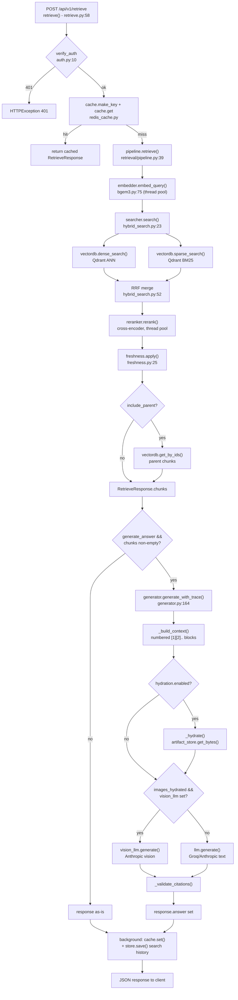

# GERNAS RAG Service — End-to-End Call Graph

This is a multimodal RAG service (`gernas_rag`) built on FastAPI, with an offline eval suite, an MCP tool server, and standalone CLI scripts sharing the same core pipeline classes.

---
## 1. ENTRY POINTS

### HTTP endpoints (FastAPI, mounted in `src/gernas_rag/main.py:85-89`)

| Method/Path | Handler | Location |
|---|---|---|
| GET /health | `health()` | `src/gernas_rag/api/routers/health.py:12` |
| GET /ready | `ready(request)` | `src/gernas_rag/api/routers/health.py:18` |
| POST /api/v1/retrieve | `retrieve(request, background_tasks, ...)` | `src/gernas_rag/api/routers/retrieve.py:58` |
| POST /api/v1/ingest | `ingest_document(background_tasks, file, ...)` | `src/gernas_rag/api/routers/ingest.py:32` |
| GET /api/v1/ingest/{job_id} | `get_ingestion_status(job_id)` | `src/gernas_rag/api/routers/ingest.py:80` |
| POST /api/v1/admin/reindex | `reindex(request)` | `src/gernas_rag/api/routers/admin.py:13` |
| DELETE /api/v1/admin/collection | `delete_collection(request, vectordb)` | `src/gernas_rag/api/routers/admin.py:32` |
| GET /api/v1/search-history | `list_search_history(username, store)` | `src/gernas_rag/api/routers/search_history.py:17` |
| GET /api/v1/search-history/{search_id} | `get_search_history_entry(...)` | `src/gernas_rag/api/routers/search_history.py:28` |
| PATCH /api/v1/search-history/{search_id} | `rename_search_history_entry(...)` | `src/gernas_rag/api/routers/search_history.py:47` |
| DELETE /api/v1/search-history/{search_id} | `delete_search_history_entry(...)` | `src/gernas_rag/api/routers/search_history.py:67` |

All non-health routes go through `verify_auth` (`src/gernas_rag/api/auth.py:10`) as a `Depends`.

### Module-level code on import
- `src/gernas_rag/main.py:95` — `app = create_app()` runs at import time (what `uvicorn gernas_rag.main:app` loads). `create_app()` itself (`main.py:66`) wires middleware + routers but defers all heavy singleton construction to the `lifespan` context manager (`main.py:25`), which runs on ASGI startup, not on import.
- `get_settings()` (`config/settings.py:139`) is `@lru_cache`d — first call builds the singleton `Settings`, every later call anywhere in the process returns the same object.

### CLI commands (argparse `main()` + `if __name__ == "__main__"`)
| Script | Purpose |
|---|---|
| `scripts/ingest_docs.py:20` `main()` | Batch-ingest a file or directory outside the API |
| `scripts/setup_vectordb.py:17` `main()` | Create/verify the vector collection |
| `scripts/verify_chunks.py`, `scripts/view_chunks.py`, `scripts/view_media_chunks.py` | Inspection/debug utilities over an existing collection |
| `scripts/build_gold_set.py`, `scripts/compare_with_judge.py`, `scripts/run_agent_on_gold.py` | Eval-adjacent utilities |
| `eval/__main__.py:55` `main()` | `python -m eval {stage1\|stage2a\|stage2b\|stage3\|stage4\|all}` — dispatches to each stage module's own `build_parser()`/`main(args)` |

### MCP tool (event listener — stdio/HTTP/SSE JSON-RPC)
- `mcp_integration/server.py:135` `search_documents(query, top_k, generate_answer)` — registered via `@mcp.tool()`. Transport chosen by `MCP_TRANSPORT` at `server.py:180-186`.
- `mcp_integration/client.py:17` `main()` — smoke-test client that spawns the server as a subprocess over stdio.

### Background tasks (fire-and-forget, not cron — FastAPI `BackgroundTasks`)
- `run_ingestion()` closure, queued at `api/routers/ingest.py:75` — runs the actual ingestion after the 202 response is sent.
- `cache.set(...)` queued at `api/routers/retrieve.py:104` and `store.save(entry)` queued in `_save_history()` at `retrieve.py:55` — both run after the response is already returned to the client.

No cron/APScheduler/Celery/WebSocket/SSE consumers exist in this codebase.

---
## 2. CALL CHAINS

### Flow A — POST /api/v1/retrieve (hybrid retrieval + optional LLM answer) — **HOT PATH**

```
retrieve(request, background_tasks, ...)                        [retrieve.py:58]  [async]
  ├─ verify_auth(request, x_api_key, authorization)               [auth.py:10]     [async]  [raises 401 HTTPException]
  ├─ cache.make_key(request)                                      [redis_cache.py:35] (sha256 of request JSON) [sync]
  ├─ cache.get(cache_key)                                         [redis_cache.py:40] [async] [cache: Redis GET]
  │    └─ (hit) RetrieveResponse.model_validate_json(cached) → return  [cache-hit path]
  │
  └─ (miss) pipeline.retrieve(request)                            [pipeline.py:39]  [async]
       ├─ embedder.embed_query(request.query)                     [bgem3.py:75]     [async]
       │    └─ embed_documents([text]) → run_in_executor(_sync_encode)  [thread pool, CPU-bound]
       ├─ searcher.search(dense_vector, sparse_*, filters, pre_rerank_top_k)  [hybrid_search.py:23] [async]
       │    └─ asyncio.gather(                                    [hybrid_search.py:39]
       │         vectordb.dense_search(...)   [qdrant_client.py:109]  [async] [DB query — Qdrant "dense" named vector]
       │         _sparse() → vectordb.sparse_search(...) [qdrant_client.py:126] [async] [DB query — Qdrant "sparse"]
       │       )
       │    └─ _rrf_merge(dense, sparse, pre_rerank_top_k)         [hybrid_search.py:52] [sync — Reciprocal Rank Fusion]
       ├─ reranker.rerank(query, candidates, top_n=request.top_k)  [reranker.py:60]  [async]  (only if provider != sentence_transformer)
       │    └─ run_in_executor(_sync_rerank) → FlagReranker.compute_score  [thread pool, CPU-bound]
       │         [raises Exception → caught in reranker.py:70 → degrades to fused-rank truncation]
       ├─ freshness.apply(candidates)                              [freshness.py:25] [sync — staleness score/penalty, re-sorts]
       ├─ vectordb.get_by_ids(parent_ids)                          [qdrant_client.py:147] [async] [DB query, only if include_parent] [called from N sites: retrieve.py path + eval stage3]
       └─ build RetrieveResponse(chunks=[RetrievedChunk...])       [retrieval/pipeline.py:83-98]
       ↑ back in retrieve():
  ├─ (if request.generate_answer and chunks) generator.generate(query, chunks)  [generator.py:160] [async]
  │    └─ generate_with_trace(query, chunks)                       [generator.py:164] [async]
  │         ├─ _build_context(chunks)                              [generator.py:81]  [sync]
  │         ├─ _hydrate(chunks) → ImagePart[]                      [generator.py:139] [async]  (only if hydration.enabled)
  │         │    └─ artifact_store.get_bytes(artifact_ref)         [artifact_store.py:56] [async] [file read, local disk]
  │         ├─ (image_parts & vision_llm) vision_llm.generate(messages)   [async] [HTTP — vision LLM provider]
  │         │    else → llm.generate(messages)                     [anthropic_llm.py:27 / groq_llm.py / ...] [async] [HTTP — LLM provider, @async_retry x3]
  │         └─ _validate_citations(answer, len(chunks), query)      [generator.py:108] [sync] [logs warning on out-of-range [N]]
  ├─ background_tasks.add_task(cache.set, cache_key, response.model_dump_json())  [retrieve.py:104] [fire-and-forget]  [cache: Redis SET, ex=ttl]
  └─ _save_history(background_tasks, history_store, request, response, search_id, x_username)  [retrieve.py:27]
       └─ background_tasks.add_task(store.save, entry)             [search_history_store.py:67] [fire-and-forget] [file write, local disk] — no-op if no X-Username header
```
Exception handling: any exception inside the try/except at `retrieve.py:89-101` is logged and re-raised as `HTTPException(500)`.

### Flow B — POST /api/v1/ingest (async document ingestion) — **HOT PATH** (per-document; less frequent than retrieve)

```
ingest_document(background_tasks, file, document_type, ...)      [ingest.py:32]  [async]
  ├─ verify_auth(...)                                              [auth.py:10]  [async]
  ├─ shutil.copyfileobj(file.file, tmp)                            [ingest.py:48] [sync] [file write — temp file]
  └─ background_tasks.add_task(run_ingestion)                      [ingest.py:75] — returns 202 immediately, job status polled via GET /ingest/{job_id}

  run_ingestion() [closure]                                        [ingest.py:54]  [async, backgrounded]
    └─ pipeline.ingest_file(tmp_path, document_type, products, effective_date, original_name)  [pipeline.py:74] [async]
         ├─ extractor.extract(file_path)                           [docling_extractor.py:254] [async]
         │    └─ run_in_executor(_sync_extract)                    [docling_extractor.py:187] [thread pool, CPU-bound]
         │         ├─ _pdf_has_text_layer(file_path)  [pypdfium2]  [sync]  → decides do_ocr
         │         ├─ DocumentConverter.convert(...)  [docling lib] → collapsed to one line
         │         └─ per element: _capture_image / _caption_of / _bbox_of / _page_of  [sync helpers]
         ├─ (if enrichment.enabled) self._enrich(extraction)        [pipeline.py:147] [async]
         │    └─ asyncio.gather(*(_process(el) for el in candidates))  [pipeline.py:205]  — bounded by asyncio.Semaphore(enrichment.max_concurrent)
         │         └─ _process(el)                                 [pipeline.py:166] [async]
         │              ├─ artifact_store.put_bytes(el.image_bytes, "image/png")  [artifact_store.py:47] [async] [file write, content-addressed]
         │              │    [raises Exception → caught pipeline.py:171 → skip element, fail-soft]
         │              └─ enricher.enrich(EnrichmentInput(...))    [table_enricher.py:19] [async]
         │                   └─ (low-confidence table OR figure) vlm.enrich(item)  [vision_llm_enricher.py:157] [async]
         │                        └─ _call_anthropic / _call_openai [vision_llm_enricher.py:207 / 229] [async] [HTTP — vision LLM, @async_retry x3]
         │                        [Exception → caught vision_llm_enricher.py:193 → fail-soft, empty caption]
         ├─ metadata.build_base_metadata(file_path, document_type, ..., raw_text=extraction.raw_markdown)  [metadata.py:43] [sync]
         │    ├─ infer_document_type(...)   [metadata.py:28]
         │    └─ infer_effective_date(raw_text)  [metadata.py:35]  (regex over first 2000 chars)
         ├─ chunker.chunk(extraction, base_metadata)               [hierarchical.py:85] [sync]
         │    ├─ RecursiveCharacterTextSplitter.split_text (parent, then child)  [langchain lib] → collapsed
         │    ├─ _repair_fragmented_table(child_text, parent_text) [hierarchical.py:39] [sync]
         │    └─ _build_media_chunks(elements, base_metadata, parent_id_by_heading)  [hierarchical.py:167] [sync] — one chunk per enriched figure/table
         ├─ self._embed_chunks_in_batches(chunks)                   [pipeline.py:210] [async]
         │    └─ per batch: embedder.embed_documents(texts)         [bgem3.py:71] [async] → run_in_executor(_sync_encode) [thread pool]
         └─ vectordb.upsert(embedded_chunks)                        [qdrant_client.py:81] [async] [DB write — Qdrant upsert, @async_retry x3]
    → _jobs[job_id] = IngestionResult(...)   [in-memory dict, ingest.py:28 — NOT persisted, lost on restart]
    [outer except Exception → caught ingest.py:64 → IngestionResult(status=ERROR)]
    finally: tmp_path.unlink(missing_ok=True)                       [ingest.py:73] [file delete]
```

### Flow C — POST /api/v1/admin/reindex — **COLD PATH**
```
reindex(request)                                                  [admin.py:13] [async]
  ├─ verify_auth(...)
  ├─ vectordb.delete_collection(name)                              [qdrant_client.py:75] [async] [DB — drop collection] [Exception caught admin.py:24, logged, ignored]
  └─ vectordb.create_collection(name, embedder.dense_dim)          [qdrant_client.py:42] [async] [DB — create collection + 5 payload indexes]
```

### Flow D — MCP tool `search_documents` — **HOT PATH** (agent-invoked)
```
search_documents(query, top_k, generate_answer)                   [server.py:135] [async, MCP tool handler]
  ├─ _ensure_pipeline()                                            [server.py:53] [async, lazy singleton behind asyncio.Lock]
  │    └─ (first call only) get_settings / get_embedder / get_vectordb / get_llm / vectordb.create_collection / build_generator
  ├─ pipeline.retrieve(RetrieveRequest(query, top_k, generate_answer=False))  → same as Flow A's pipeline.retrieve
  ├─ (if generate_answer) generator.generate(query, response.chunks)          → same as Flow A's generator.generate
  └─ _format_chunks(response.model_dump())                        [server.py:93] [sync] — dedups sibling chunks resolving to the same parent section
  [outer except Exception → caught server.py:175 → {"error": ...} instead of raising]
```
Note: this path bypasses the FastAPI app entirely — it constructs its own `RetrievalPipeline`/`ResponseGenerator` in-process, sharing only `Settings` and the pipeline *classes*, not the running API's `app.state` instances.

### Flow E — CLI `python scripts/ingest_docs.py` — **COLD PATH**
```
main()                                                             [ingest_docs.py:20] [async]
  ├─ get_settings() → get_embedder(settings.embedding) → get_vectordb(settings.vectordb)
  ├─ vectordb.create_collection(...)
  └─ pipeline.ingest_file(...)  or  pipeline.ingest_directory(...)  [pipeline.py:74 / 127]
       └─ ingest_directory bounds concurrency with asyncio.Semaphore(max_concurrent_documents) + asyncio.gather  [pipeline.py:139-145]
```

---
## 3. DATA FLOW SUMMARY

**Retrieve flow:**
```
JSON body → RetrieveRequest (Pydantic, validated: query 3-2000 chars, top_k 1-20)
  → RAGCache.make_key (sha256 digest string)
  → [cache miss] query string → BGEM3 dense[1024]+sparse{idx:val} vectors
  → Qdrant payload dicts (SearchResult: chunk_id, text, score, metadata dict, rank)
  → RRF-merged/reranked/freshness-adjusted list[SearchResult]
  → list[RetrievedChunk] (Pydantic: text, source, section_heading, score, modality, artifact_ref, ...)
  → RetrieveResponse (chunks, total_results, latency_ms, answer?, cache_hit, search_id)
  → [optional] chunks + query → prompt string → LLM text → answer field
  → JSON response body
  → [background] response JSON → Redis (TTL) ; SearchHistoryEntry → local JSON file
```

**Ingest flow:**
```
multipart UploadFile → temp file on disk
  → ExtractionResult (raw_markdown str + list[ExtractedElement] with element_type/text/image_bytes/bbox/metadata)
  → [enrichment] image_bytes → artifact_store (sha256-keyed file) ; VLM caption text written back onto element.text
  → base_metadata dict (document_name, document_type, product_applicability, effective_date)
  → list[Chunk] (Pydantic: id (MD5 hash), text, ChunkMetadata, is_parent)
  → list[EmbeddedChunk] (chunk + dense_vector[1024] + sparse_indices/values)
  → Qdrant PointStruct (id=UUIDv5, vector={dense, sparse}, payload=flattened metadata+text)
  → IngestionResult (chunks_created, status, error?) stored in in-memory `_jobs` dict
```

Schema chain for a single answer: raw bytes (PDF) → Docling `DoclingDocument` → `ExtractedElement` → `Chunk`/`ChunkMetadata` → `EmbeddedChunk` → Qdrant point → `SearchResult` (retrieval) → `RetrievedChunk` (API model) → prompt context block → LLM string → `RetrieveResponse.answer`.

---
## 4. CROSS-MODULE DEPENDENCY MAP

| From | Calls -> | To | Functions used |
|---|---|---|---|
| `main.py` | -> | `api/routers/*` | `include_router` (health, retrieve, ingest, admin, search_history) |
| `main.py` | -> | `embeddings/factory.py`, `vectordb/factory.py`, `llm/factory.py`, `generation/factory.py` | `get_embedder`, `get_vectordb`, `get_llm`, `build_generator` (lifespan startup) |
| `api/routers/retrieve.py` | -> | `retrieval/pipeline.py`, `generation/generator.py`, `cache/redis_cache.py`, `storage/search_history_store.py` | `pipeline.retrieve`, `generator.generate`, `cache.get/set/make_key`, `store.save` |
| `api/routers/ingest.py` | -> | `ingestion/pipeline.py` | `pipeline.ingest_file` |
| `api/deps.py` | -> | `request.app.state.*` | pulls all singletons built in `main.py`'s lifespan |
| `retrieval/pipeline.py` | -> | `retrieval/hybrid_search.py`, `retrieval/reranker.py`, `retrieval/freshness.py`, `embeddings/base.py`, `vectordb/base.py` | `searcher.search`, `reranker.rerank`, `freshness.apply`, `embedder.embed_query`, `vectordb.get_by_ids` |
| `ingestion/pipeline.py` | -> | `extraction/factory.py`, `enrichment/factory.py`, `chunking/factory.py`, `ingestion/metadata.py`, `storage/artifact_store.py` | `extractor.extract`, `enricher.enrich`, `chunker.chunk`, `metadata.build_base_metadata`, `artifact_store.put_bytes` |
| `generation/generator.py` | -> | `storage/artifact_store.py`, `llm/base.py` | `artifact_store.get_bytes`, `llm.generate` / `vision_llm.generate` |
| `generation/factory.py` | -> | `llm/factory.py`, `storage/artifact_store.py` | `get_llm`, `get_artifact_store` — the single place API lifespan *and* eval scripts both call, closing the drift bug the module docstring describes |
| `*/factory.py` modules | -> | concrete impls (`qdrant_client.py`, `bgem3.py`, `anthropic_llm.py`, `docling_extractor.py`, `hierarchical.py`) | lazy `match`-based construction, imports deferred inside branches |
| `config/settings.py` | -> | every `config/*.py` sub-config | composes `Settings` from `EmbeddingConfig`, `VectorDBConfig`, `LLMConfig`, etc. |
| `mcp_integration/server.py` | -> | `config/settings.py`, factories, `retrieval/pipeline.py`, `generation/factory.py` | independently re-wires the same core objects `main.py` wires, via `build_generator` (no drift, per its own docstring) |
| `scripts/ingest_docs.py`, `scripts/setup_vectordb.py` | -> | `config/settings.py`, factories, `ingestion/pipeline.py` | same core classes as the API, standalone process |
| `eval/*` | -> | `gernas_rag` core modules (embedder, vectordb, generator, extractor) | eval stages re-run pipeline stages offline against a gold set |

No circular imports detected — dependency direction is strictly `api -> pipelines -> {chunking,extraction,embeddings,enrichment,llm,vectordb,storage,cache} -> config/models/utils`. All `factory.py` modules use *function-local* imports specifically to avoid importing every optional heavy dependency (Docling, FlagEmbedding, qdrant/milvus/chromadb clients, anthropic/openai SDKs) unless that provider is actually selected.

---
## 5. EXTERNAL INTEGRATIONS

| Direction | Protocol | Target | Auth method | Called from |
|---|---|---|---|---|
| outbound | HTTP (SDK) | Groq API (LLM, default) | `RAG__LLM__GROQ_API_KEY` | `llm/groq_llm.py` |
| outbound | HTTP (SDK) | Anthropic Messages API | `RAG__LLM__ANTHROPIC_API_KEY` | `llm/anthropic_llm.py:22` |
| outbound | HTTP (OpenAI-compat SDK) | Gemini `generativelanguage.googleapis.com` (enrichment VLM) | `RAG__LLM__OPENAI_API_KEY` (reused) | `enrichment/vision_llm_enricher.py:151` |
| outbound | HTTP (SDK) | HuggingFace / local model | model weights / `hf_device` | `llm/huggingface_llm.py` |
| outbound | gRPC/HTTP (qdrant_client SDK) | Qdrant (or local embedded engine at `qdrant_path`) | `RAG__VECTORDB__QDRANT_API_KEY` | `vectordb/qdrant_client.py:27` |
| outbound | gRPC (pymilvus SDK) | Milvus | `milvus_token` | `vectordb/milvus_client.py` |
| outbound | HTTP/local (chromadb SDK) | ChromaDB | none/local | `vectordb/chromadb_client.py` |
| outbound | RESP (redis.asyncio) | Redis/Valkey (`REDIS_URL`) | none configured | `cache/redis_cache.py:29` |
| outbound | filesystem | Local artifact store (`config.local_path`) | filesystem perms | `storage/artifact_store.py:35` |
| outbound | filesystem | Local search-history store (JSON files) | filesystem perms | `storage/search_history_store.py:58` |
| inbound | HTTP (FastAPI) | `/api/v1/*` REST API | `X-API-Key` header or Bearer JWT (`verify_auth`) | `api/auth.py:10` |
| inbound | MCP (stdio/HTTP/SSE) | `search_documents` tool | none (relies on transport-level trust; HTTP mode has no auth layer visible here) | `mcp_integration/server.py:135` |
| outbound (model weights) | HTTP (huggingface_hub) | BAAI/bge-m3, bge-reranker-v2-m3 model downloads | HF token (implicit, cached locally) | `embeddings/bgem3.py:39`, `retrieval/reranker.py:41` |

Fail-soft pattern used consistently: Redis cache (`redis_cache.py:26-32`), reranker (`reranker.py:70-80`), VLM enrichment (`vision_llm_enricher.py:193-199`), and hydration (`generator.py:156-157`) all degrade gracefully rather than failing the request.

---
## 6. ASYNC CONCURRENCY MAP

**`asyncio.gather()` sites — parallel work:**
- `retrieval/hybrid_search.py:39` — dense ANN search + sparse BM25 search run concurrently against Qdrant (every retrieve call, **hot path**).
- `ingestion/pipeline.py:145` — `ingest_directory` fans out `ingest_file` across files, bounded by `asyncio.Semaphore(max_concurrent_documents)`.
- `ingestion/pipeline.py:205` — media element enrichment (`_process`) fanned out per figure/table, bounded by `asyncio.Semaphore(enrichment.max_concurrent)`.

**No `asyncio.create_task()` fire-and-forget sites** — the codebase uses FastAPI's `BackgroundTasks` instead (`retrieve.py:104`, `retrieve.py:55`, `ingest.py:75`), which is functionally similar but scoped to the request lifecycle rather than raw tasks.

**Thread pool offload (`run_in_executor`) — CPU-bound work kept off the event loop:**
- `embeddings/bgem3.py:73` — BGE-M3 dense+sparse encoding (**hot path**, every embed call).
- `embeddings/sentence_transformer.py:53` — alt embedder.
- `retrieval/reranker.py:67` — cross-encoder scoring (**hot path** when reranker active).
- `extraction/docling_extractor.py:257`, `extraction/unstructured_extractor.py:77`, `extraction/pymupdf_extractor.py:53` — document parsing (cold path, per ingest).
- `llm/huggingface_llm.py:54` — local HF model generation.
- `vectordb/chromadb_client.py:37`, `vectordb/milvus_client.py:39` — these two vector DB clients are *sync* SDKs wrapped in `run_in_executor` (unlike Qdrant, which has a native async client).

**Potential blocking-call flags:**
- `api/routers/ingest.py:48` `shutil.copyfileobj(file.file, tmp)` runs synchronously inside an `async def` request handler (`ingest_document`), before the upload is backgrounded — a large file blocks the event loop during the copy.
- `storage/search_history_store.py:68`, `storage/artifact_store.py:53` — synchronous `Path.write_bytes`/`write_text` file I/O inside `async def` methods (no executor offload). Low risk in practice since both are only ever invoked from `BackgroundTasks`, off the request-serving path, but still technically blocks whatever else is scheduled on the loop while it runs.
- `retrieval/freshness.py:25` and `retrieval/hybrid_search.py:52` `_rrf_merge` are pure CPU-bound sync functions called directly (not offloaded) — fine at current corpus scale (~100 chunks per `.env` comments) but would need executor offload if candidate counts grew large.

---
## 7. CONFIGURATION & ENVIRONMENT WIRING

Config precedence (`get_settings()`, `config/settings.py:139`): hardcoded field defaults -> YAML (`config/default.yaml` -> `config/<environment>.yaml` -> `config/local.yaml` -> `$CONFIG_FILE`) -> environment variables / `.env` (highest precedence). Nested fields use `RAG__<SECTION>__<FIELD>` (double underscore delimiter, `settings.py:48`).

| ENV VAR (from `.env`) | Consumed by | Used in |
|---|---|---|
| `API_KEY`, `JWT_SECRET`, `JWT_ALGORITHM` | `Settings.api_key/jwt_secret/jwt_algorithm` | `verify_auth()` `api/auth.py:23-36` |
| `RAG__LLM__PROVIDER`, `*_API_KEY` | `LLMConfig` | `get_llm()` `llm/factory.py:7` -> concrete LLM `__init__` |
| `RAG__ENRICHMENT__*` | `EnrichmentConfig` | `IngestionPipeline.__init__` `ingestion/pipeline.py:63-68` -> `get_enricher()` |
| `RAG__EMBEDDING__*` | `EmbeddingConfig` | `get_embedder()` `embeddings/factory.py:7` -> `BGEM3Embedder.__init__` |
| `RAG__VECTORDB__*` | `VectorDBConfig` | `get_vectordb()` `vectordb/factory.py:7` -> `QdrantVectorDB.__init__` |
| `RAG__CHUNKING__*` | `ChunkingConfig` | `get_chunker()` / `get_extractor()` |
| `RAG__RETRIEVAL__*` | `RetrievalConfig` | `RetrievalPipeline.__init__` `retrieval/pipeline.py:27` — `dense_top_k`, `pre_rerank_top_k`, `rrf_k`, freshness knobs |
| `RAG__INGESTION__MAX_CONCURRENT_DOCUMENTS` | `IngestionConfig` | `ingest_directory()` semaphore `ingestion/pipeline.py:138` |
| `RAG__EVALUATION__*` | `EvaluationConfig` | eval stage runners/judge |
| `REDIS_URL`, `REDIS_ENABLED`, `REDIS_CACHE_TTL_SECONDS` | `Settings` top-level | `RAGCache.__init__` `main.py:36-38` |
| `MCP_TRANSPORT`, `MCP_HOST`, `MCP_PORT`, `RAG_GENERATE_ANSWER` | read directly via `os.getenv` (not through `Settings`) | `mcp_integration/server.py:34-42` — the MCP server is a separate process and only shares `Settings` for the RAG pipeline itself, not its own transport config |
| `RAG__LLM__ANTHROPIC_API_KEY` (reused) | vision-hydration path | `build_vision_llm()` `generation/factory.py:47-57` reuses primary LLM credentials, swapping only `provider`/`model_name` from `HydrationConfig` |

Note: `.env` currently holds real-looking Groq/Gemini API keys in plaintext, including two commented-out alternates. It's correctly listed in `.gitignore:40` and isn't tracked by git, so this isn't a repo-exposure issue — just flagging since the file was open in the editor.

---
## Mermaid — most important flow: `POST /api/v1/retrieve` with answer generation + hydration



---

**Scope covered:** the FastAPI service (`src/gernas_rag`), the MCP tool server, the CLI ingestion scripts, and the offline eval suite entry point. Deep line-by-line tracing was done for the two hot paths (retrieve, ingest) plus admin/MCP/CLI; the eval suite (`eval/`) reuses the same core pipeline classes offline and was covered at the entry-point level rather than fully traced, since it's cold-path tooling rather than a user-facing flow.
