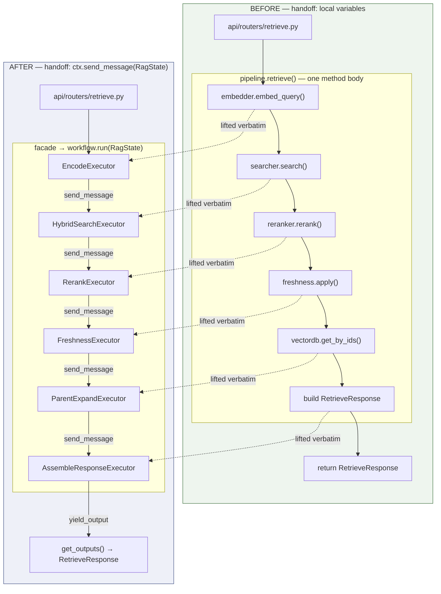
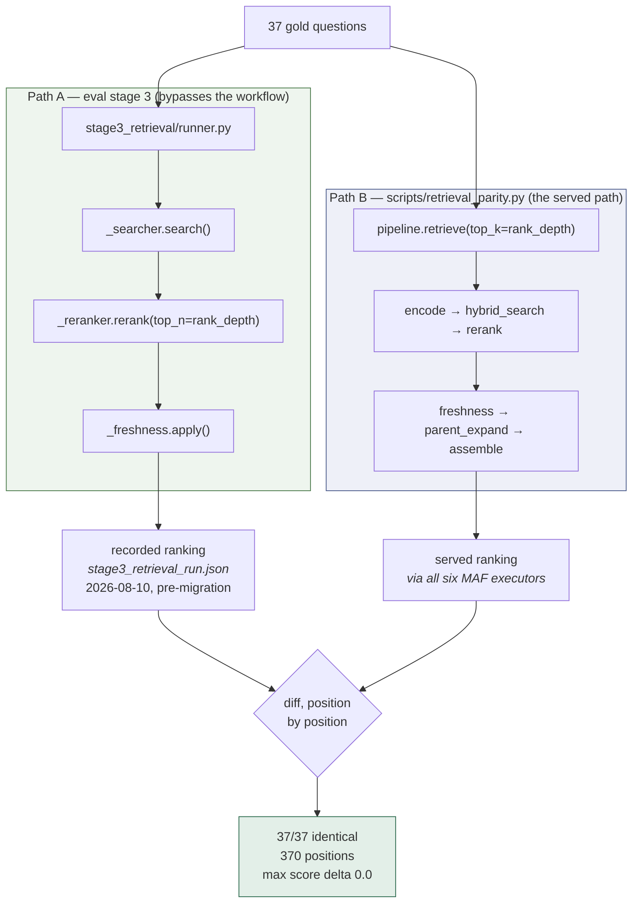
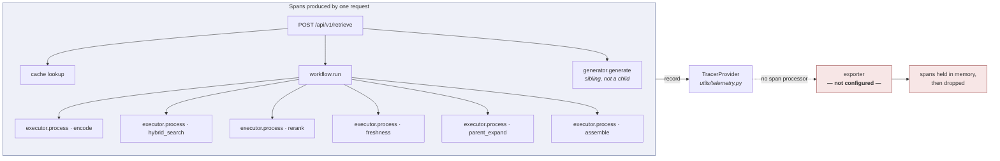

# Retrieval on the Microsoft Agent Framework — What Changed and What It Bought

---

## Table of contents

1. [The verdict, before the detail](#1-the-verdict-before-the-detail)
2. [What was actually migrated](#2-what-was-actually-migrated)
3. [The six executors](#3-the-six-executors)
4. [Old construct → new construct](#4-old-construct--new-construct)
5. [Is it more feasible than before?](#5-is-it-more-feasible-than-before)
6. [What is proven, and what is not](#6-what-is-proven-and-what-is-not)
7. [The trace that goes nowhere](#7-the-trace-that-goes-nowhere)
8. [What to add to make this stable](#8-what-to-add-to-make-this-stable)
9. [Rollback, as it stands today](#9-rollback-as-it-stands-today)
10. [Summary](#10-summary)

---

## At a glance

| Measure                 | Value                      | What it means                                                                         |
| ----------------------- | -------------------------- | ------------------------------------------------------------------------------------- |
| **Retrieval parity**    | **37 / 37 identical** | Every gold question through the live MAF path returns the pre-migration ranking, score delta `0.0` |
| Call sites changed      | **0 of 7**           | Router, MCP server, two eval runners, gold-set script and both test modules untouched |
| Packages added          | **2**                | Taking the umbrella package instead would have installed 132 and removed 14           |
| Workflow contract tests | **19 / 19** in 8.3 s | Full suite: 173 pass, 4 pre-existing failures                                         |
| Spans exported          | **0**                | MAF emits per-stage spans; nothing in the service collects them yet                   |

---

## 1. The verdict, before the detail

Stated up front so the rest of the document reads as evidence rather than as a pitch.

The migration is **structurally better and behaviourally neutral**. The retrieval flow is
now a declared graph instead of an implied statement order, every stage is an injectable,
individually testable unit, and the dependency cost was held to two packages by rejecting
the obvious install.

**The retrieval-quality question is now settled.** All 37 gold questions were replayed
through the live `retrieve()` path — all six executors — and diffed against the ranking
recorded before the migration. 370 ranked positions, every one identical, maximum score
delta exactly `0.0` (§6). The thing this pipeline exists to do, it still does, unchanged.

What remains open is the *payoff*, not the correctness. The headline benefit — per-stage
traces — is **still not being realised**, because the service configures a tracer provider
with no span processor attached (§7). The seams the migration created for timeouts and
retries are still empty.

> **Net: correctness proven, structure gained, payoff still unclaimed. The remaining work
> is small and is listed in §8.**

---

## 2. What was actually migrated

The premise the work started from turned out to be wrong, and that correction shapes
everything else.
LangChain appears in exactly two places in `src/`, both importing
`RecursiveCharacterTextSplitter`, which is a string utility with no chain, graph or model
involvement.

> **In plain terms**
>
> There was no old framework to replace. Retrieval was a single 72-line `async` method that
> called five components in order. The work was **adding** an orchestration layer to a
> pipeline that had none — not swapping one out.
>
> That matters, because the usual justification for a migration ("get rid of the old
> thing") does not apply here. The case has to be made on what the new layer *adds*.

### 2.1 The same six steps, a different container

Nothing inside the stage boxes changed. The RRF merge, the cross-encoder, the freshness
curve and the response mapping were lifted verbatim. What changed is the **edge**: a local
variable passed down a call frame became a `RagState` object sent along a declared edge,
and the `return` statement became an output collected from the run result.



The final hop differs from the other five: the terminal executor calls `yield_output`, not
`send_message`. That is what makes its message visible to `events.get_outputs()`.

---

## 3. The six executors

Each is a class with a single `@handler` method. Components are **injected**, never
constructed inside the executor — which is what keeps `eval/stage3_retrieval/runner.py`
working, since it reaches into `_searcher`, `_reranker` and `_freshness` directly.

| Executor                     | Does                                                                               | Reads from state                               | Writes to state                                                         |
| ---------------------------- | ---------------------------------------------------------------------------------- | ---------------------------------------------- | ----------------------------------------------------------------------- |
| `EncodeExecutor`           | Dense + sparse query encoding; stamps the latency clock                            | `request.query`                              | `dense_vector`, `sparse_indices`, `sparse_values`, `started_at` |
| `HybridSearchExecutor`     | Dense ANN and sparse BM25 run concurrently, merged by RRF inside`HybridSearcher` | vectors,`request.filters`                    | `candidates`                                                          |
| `RerankExecutor`           | Cross-encoder rerank, or plain truncation when no reranker is configured           | `candidates`, `request.top_k`              | `candidates` (rebound)                                                |
| `FreshnessExecutor`        | Staleness penalty, re-sort, rank rewrite                                           | `candidates`                                 | `candidates` (rebound)                                                |
| `ParentExpandExecutor`     | Small-to-big parent lookup, de-duplicated before the fetch                         | `candidates`, `request.include_parent`     | `parent_map`                                                          |
| `AssembleResponseExecutor` | Maps results to chunks, computes latency and the global freshness flag             | `candidates`, `parent_map`, `started_at` | `response` → yielded as output                                       |

`RagState` is created once per `retrieve()` call and mutated in place as it moves down the
chain, so no locking is needed. It deliberately carries **no image bytes** — only
`artifact_ref` strings — which is what keeps image data out of the Redis cache. 

### 3.1 Two branches deliberately did not become edges

MAF supports conditional edges. Both branches in the original flow —
`if self._reranker and candidates` and `if request.include_parent` — were kept as ordinary
`if` statements **inside** their executors instead.

The reason is worth keeping: the reranker also fails soft internally (it sets `_unavailable`
and truncates when the model fails to load or score), so the decision is not purely
edge-level. Splitting it across an edge condition *and* an in-executor fallback would put
the same logic in two places.

Keeping it inside also means **every request emits the same event sequence**, whichever
branch it takes — which is what makes traces comparable across requests.

---

## 4. Old construct → new construct

| What the code did                                      | What it does now                               | Equivalence                                                                                                                |
| ------------------------------------------------------ | ---------------------------------------------- | -------------------------------------------------------------------------------------------------------------------------- |
| Five numbered steps in one method                      | 6`Executor` classes                          | **Exact.** Bodies lifted verbatim; six not five because response assembly became its own stage                       |
| Local vars (`candidates`, `parent_map`, `start`) | Fields on a`RagState` dataclass              | **Exact.** One instance per request, mutated in place, never cached or shared                                        |
| Order implied by statement order                       | `.add_edge(a, b)` chain                      | **Exact.** Same linear order, now declared rather than inferred                                                      |
| `return RetrieveResponse(...)`                       | `output_from` + `events.get_outputs()`     | **Adapted.** MAF has no typed return; the façade filters outputs by type and is the only place that knows this      |
| `time.perf_counter()` around the method              | `started_at` on the state                    | **Near-exact.** Now includes MAF dispatch in the measured span — estimated under 1 ms, never measured in production |
| Router`try/except` → HTTP 500                       | Unchanged; workflow re-raises                  | **Verified.** `workflow.run()` propagates the original exception with type and message intact                      |
| `_searcher` / `_reranker` / `_freshness`         | Still on the pipeline, injected into executors | **Mandatory.** Stage-3 eval reaches into all three; they had to survive                                              |
| Checkpointer, reducers, thread IDs, HITL               | —                                             | **Never existed.** The service is stateless per request; nothing to migrate                                          |

### 4.1 Why nothing downstream broke

`RetrievalPipeline` was kept as a **façade**. Its constructor still builds and exposes the
same three private components, and `retrieve()` still takes a `RetrieveRequest` and returns
a `RetrieveResponse`. Everything MAF-shaped — building the state, running the workflow,
unwrapping the outputs — is contained in that one method.

This is why all seven call sites survived untouched, **including the two eval runners that
*are* the parity harness**. A naïve port that replaced the pipeline class would have broken
the very tools needed to prove the port was correct.

| # | Call site                                                                | Changed? |
| - | ------------------------------------------------------------------------ | -------- |
| 1 | `api/routers/retrieve.py` — the HTTP endpoint                         | No       |
| 2 | `mcp_integration/server.py` — the MCP tool the MAF `RAGAgent` calls | No       |
| 3 | `eval/stage3_retrieval/runner.py` — reaches into private attrs        | No       |
| 4 | `eval/stage4_generation/runner.py`                                     | No       |
| 5 | `scripts/run_agent_on_gold.py`                                         | No       |
| 6 | `tests/integration/test_retrieve_endpoint.py`                          | No       |
| 7 | `tests/unit/test_retrieve_history.py`                                  | No       |

---

## 5. Is it more feasible than before?

Dimension by dimension, including the rows where the answer is "no change" or "worse".

| Dimension                   | Before                                            | After                                                                        | Verdict                                                      |
| --------------------------- | ------------------------------------------------- | ---------------------------------------------------------------------------- | ------------------------------------------------------------ |
| Stage boundaries            | Comments (`# Step 3`) inside one method         | Six named classes with typed handoffs                                        | ✅**Better**                                           |
| Adding a stage              | Edit the method; risk touching neighbouring logic | New executor + one`add_edge` line                                          | ✅**Better**                                           |
| Testing one stage           | Only through the whole method                     | Executor constructed and driven directly                                     | ✅**Better**                                           |
| Timeout / retry / span seam | No natural place to put it                        | Clean seam at every executor boundary                                        | ✅**Better**                                          |
| Traces                      | structlog lines only                              | structlog**plus** native `workflow.run` / `executor.process` spans | ⚠️**Latent** — spans produced, nothing exports them |
| Monorepo consistency        | Two orchestration styles across services          | Retrieval matches`agent-mesh`'s house pattern                              | ✅**Better**                                           |
| Retrieval quality           | Baseline                                          | Same components, same config, same order                                     | ✅ **Verified identical** — 37/37 questions, 370 positions, score delta 0.0 (§6) |
| Request / response contract | Baseline                                          | Byte-identical; MCP`search_documents` unchanged                            | ➖ No change*by design*                                    |
| Latency                     | 5 inline awaits                                   | 6 executor dispatches                                                        | ➖ Under 1 ms est.                                           |

### 5.1 The best decision in the whole migration

The plan said to install `agent-framework` **and** `agent-framework-core`.
`agent-framework` is an umbrella package. Resolving it *before* installing is what saved
this change from doing real damage.

| Resolution                       | `agent-framework` + core                                                                     | `agent-framework-core` alone                                                       |
| -------------------------------- | ---------------------------------------------------------------------------------------------- | ------------------------------------------------------------------------------------ |
| Packages installed               | **132**                                                                                  | **2**                                                                          |
| Packages uninstalled             | **14**                                                                                   | **0**                                                                          |
| `redis`                        | **8.0.0 → 7.1.1 (downgrade)** — this service caches on Redis                           | unchanged                                                                            |
| `openai`                       | **2.41.1 → 3.8.0 (major bump)**                                                         | unchanged                                                                            |
| `wrapt`                        | 2.2.1 → 1.17.3 (downgrade)                                                                    | unchanged                                                                            |
| Also pulled in                   | Full Azure SDK, boto3, google-genai, mistralai, ollama, pythonnet/.NET interop, a WASM sandbox | —                                                                                   |
| Provides what the workflow needs | Yes                                                                                            | **Yes** — `Executor`, `WorkflowBuilder`, `WorkflowContext`, `handler` |

> ⚠️ Following the plan literally would have **silently downgraded the Redis client and
> major-bumped the OpenAI SDK in a bank service** — to add a workflow wrapper around six
> function calls. The shipped dependency is `agent-framework-core` only.

---

## 6. What is proven, and what is not

The distinction matters more than the pass counts.

| Gate                            | Result                       | What it actually proves                                                                                                                                                                                                                                             |
| ------------------------------- | ---------------------------- | --------------------------------------------------------------------------------------------------------------------------------------------------------------------------------------------------------------------------------------------------------------- |
| **Retrieval parity, live path** | ✅ **37 / 37 identical** | Every gold question through `retrieve()` returns the pre-migration ranking: same chunks, same order, same scores. 370 ranked positions, max score delta `0.0`                                                                                                  |
| Workflow contract suite         | ✅**19 / 19** in 8.3 s | Response shape, determinism across repeated calls, descending score order, freshness threshold behaviour, multimodal metadata pass-through, parent expansion both ways, empty corpus, reranker-disabled truncation, exception propagation, stage-3 private attributes |
| Full test suite                 | ⚠️ **173 pass · 4 fail** | The 4 failures are pre-existing and unrelated — a missing `app.state.search_history_store` in integration fixtures, verified against a clean tree                                                                                                              |
| App startup                     | ✅**15 routes**        | `create_app()` succeeds; the public surface of `RetrievalPipeline` is `retrieve` and nothing else                                                                                                                                                              |
| Production latency              | ❌ **Never measured**  | The staged rollout was skipped; the budget (p95 must not rise by more than 5 ms or 2%) still exists only on paper                                                                                                                                              |

### 6.1 Why stage 3 could not answer this, and what did

The eval suite is split by **concern**, not by code path — and the stage named "retrieval" is
the one stage that does not exercise the retrieval *path*.
`eval/stage3_retrieval/runner.py:81-95` drives `_searcher` / `_reranker` / `_freshness`
directly and never calls `retrieve()`. The MAF workflow is built in the constructor and never
run.

That is not a defect. It is a deliberate speed choice, and it has a useful side effect: the
stage 3 runner is a **hand-inlined copy of the pre-migration `retrieve()` body**, which is why
it survived the migration untouched — and why its recorded output is a legitimate
pre-migration oracle.



`scripts/retrieval_parity.py` replays the gold questions through the real `retrieve()` and
diffs against that recording. No LLM, no judge, no second checkout — the pipeline imports no
generator, and generation is invoked by the *router* (`api/routers/retrieve.py:93`), never by
`retrieve()`. The two models that do run (BGE-M3 and the cross-encoder) are local and
deterministic, which is what makes an exact diff meaningful.

```
python -u scripts/retrieval_parity.py \
  --baseline data/eval_last_run/runs/stage3_retrieval_run.json \
  --out data/eval/runs/retrieval_parity.json
```

**Result — `data/eval/runs/retrieval_parity.json`, 2026-09-09:**

| Measure                   | Value                                                                     |
| ------------------------- | ------------------------------------------------------------------------- |
| Baseline                  | `data/eval_last_run/runs/stage3_retrieval_run.json`, recorded 2026-08-10 |
| Questions compared        | 37 / 37 (`status: complete`)                                            |
| Identical                 | **37**                                                              |
| Differing                 | **0**                                                               |
| Ranked positions verified | **370** (depth 10 per question)                                     |
| Max score delta           | **0.0** — exact float equality, not a tolerance                     |

Two alignment details make this comparison valid rather than merely favourable:

- **Depth is matched.** Stage 3 reranks to `rank_depth` then applies freshness to *that* list;
  `retrieve()` reranks to `request.top_k` then applies freshness to *its* list. Since
  `FreshnessFilter.apply` re-sorts by the penalised score, `freshness(top10)[:3]` is not
  generally `freshness(top3)`. The script reads `rank_depth` from the baseline's own config and
  sends it as `top_k` rather than assuming a value.
- **Reaching back to 2026-08-10 is sound** because today's stage 3 run is byte-identical to the
  August one across all 37 questions — same chunk ids, same order, same scores. The components
  have not moved, so the older recording is a valid transitive baseline.

### 6.2 What this run does not cover

`RetrievedChunk` carries no `chunk_id`, so identity is established with
(`source`, `clause_reference`, `modality`, full `text`), and `score` is compared separately so
that an ordering break and a numeric drift report as different failures. What the stage 3
recording never held, this diff cannot check:

| Field                                       | Covered here?                                     | Where it *is* covered                     |
| ------------------------------------------- | ------------------------------------------------- | ------------------------------------------- |
| Chunk identity, ordering, depth             | ✅ all 370 positions                            | —                                          |
| `score`                                   | ✅ exact equality                               | —                                          |
| `modality`                                | ✅                                              | —                                          |
| `parent_text`                             | ❌ run with `include_parent=False`, as stage 3 | Unit suite — parent expansion both ways    |
| `artifact_ref`                            | ❌ not recorded by stage 3                      | Unit suite — multimodal pass-through       |
| `freshness_warning`                       | ❌ not recorded by stage 3                      | Unit suite — threshold behaviour           |
| `total_results`, `freshness_warning_global` | ❌ derived fields                                | Unit suite — response well-formedness      |

Between the two, coverage is good. Closing the gap properly means recording those fields in a
parity baseline of its own — §8, item 3.

> **A note for whoever runs this next.** The freshness penalty is computed against
> `datetime.now()` (`retrieval/freshness.py:29`), so scores drift as documents age past
> `freshness_max_age_days`. Nothing has drifted yet — that is *why* August and September agree
> — but a baseline from far enough back will eventually fail on scores for reasons that have
> nothing to do with the code. If ordering holds and only scores move, suspect the clock before
> suspecting the migration.

---

## 7. The trace that goes nowhere

This is the main justification given for the migration, and the reason it is not paying off
yet.

MAF emits OpenTelemetry spans for `workflow.run` and each `executor.process` automatically.
The service also configures OpenTelemetry — `utils/telemetry.py` creates a `TracerProvider`
and installs it globally. **Both halves are present. They are not connected.**

A `TracerProvider` with no span processor records spans into memory and drops them. There is
no `BatchSpanProcessor`, no `OTLPSpanExporter` and no `ConsoleSpanExporter` anywhere in
`src/`, `config/` or `docker_files/`, and no `OTEL_*` configuration in the environment files.



Two things this figure shows:

1. **Every span the migration added exists, and none of them leave the process.** Eight spans
   are produced per request, recorded by the provider, and discarded.
2. **The trace is split.** `generator.generate` is a *sibling* of `workflow.run`, not a child,
   because generation is called by the router and deliberately stays outside the workflow —
   pulling it in would move the response cache boundary. Anyone opening a trace expecting one
   tree per request will find two.

---

## 8. What to add to make this stable

Retrieval correctness is settled (§6). Everything below is about claiming the payoff the
migration set up, hardening the runtime, and keeping the evidence trustworthy — ranked by
consequence-per-hour, not by size.

| #  | Item                                                          | Tier             | Effort            | Status        |
| -- | ------------------------------------------------------------- | ---------------- | ----------------- | ------------- |
| 1  | Attach a span processor and exporter                          | Claim the payoff | ~10 lines         | Open          |
| 2  | Retrieval parity against the pre-migration ranking            | Claim the payoff | —                 | ✅ **Done**   |
| 3  | Extend the parity baseline to the fields it cannot see        | Evidence         | ~half day         | Open          |
| 4  | Wire parity into CI as a standing gate                        | Evidence         | ~2 hours          | Open          |
| 5  | Freeze the baseline, fix the `eval_last_run` inconsistency     | Evidence         | ~1 hour           | Open          |
| 6  | Guard the umbrella dependency in CI                           | Harden           | ~3 lines          | Open          |
| 7  | Pin MAF exactly, shared with `agent-mesh`                      | Harden           | ~1 line + decision | Open         |
| 8  | Per-executor timeouts                                         | Harden           | ~half day         | Open          |
| 9  | Concurrency test for the shared-workflow claim                | Harden           | ~2 hours          | Open          |
| 10 | Measure the latency budget                                    | Harden           | ~1 hour           | Open          |
| 11 | Fix the four failing integration tests                        | Housekeeping     | fixture-only      | Open          |
| 12 | Move the freshness threshold into config                      | Housekeeping     | small             | Open          |
| 13 | Document the stage-3 blind spot in the eval README            | Housekeeping     | ~15 min           | Open          |
| 14 | Record the two open architecture answers                      | Housekeeping     | documentation     | Open          |

### 1 · Attach a span processor and exporter

**Highest value · roughly 10 lines.** Until this lands, the migration's stated benefit is
theoretical. Ten lines in `utils/telemetry.py` turn six invisible stages into six timed,
attributable spans — the difference between "the reranker is probably the slow one" and
knowing it. The parity run makes that concrete: questions took 90–150 s each, and nothing in
the service can currently tell you how that splits across encode, search and rerank.

Keep it best-effort, matching the module's existing behaviour: if the exporter is
unavailable, log a warning and continue rather than blocking startup.

```python
# utils/telemetry.py — inside configure_telemetry(), after the provider is built
from opentelemetry.sdk.trace.export import BatchSpanProcessor
from opentelemetry.exporter.otlp.proto.http.trace_exporter import OTLPSpanExporter

endpoint = os.getenv("OTEL_EXPORTER_OTLP_ENDPOINT")
if endpoint:
    provider.add_span_processor(BatchSpanProcessor(OTLPSpanExporter(endpoint=endpoint)))
    logger.info("Span export enabled", endpoint=endpoint)
else:
    logger.warning("Span export disabled — OTEL_EXPORTER_OTLP_ENDPOINT unset")
```

**Verification:** hit `POST /api/v1/retrieve` once and confirm the collector shows one
`workflow.run` span with exactly six `executor.process` children.

### 2 · ✅ Retrieval parity — done

Closed on 2026-09-09 by `scripts/retrieval_parity.py`: 37/37 questions, 370 ranked positions,
max score delta `0.0` against the pre-migration recording. See §6.

Two things worth keeping from how it was closed. The oracle was **already on disk** — no
`b2559b6` checkout was needed, because stage 3's runner is a hand-inlined copy of the
pre-migration method and its recorded output never depended on `retrieve()`. And the check
needs **no LLM**, which is what makes it fast enough to run repeatedly — items 3–5 build on
exactly that.

### 3 · Extend the parity baseline to the fields it cannot see

`parent_text`, `artifact_ref` and `freshness_warning` are not in the stage 3 recording, so the
parity run cannot check them (§6.2). They are covered by unit tests against fakes, which is
weaker than a real-corpus diff — and `artifact_ref` in particular is the multimodal citation
path, where a silent regression surfaces as a broken image in a cited answer rather than as a
test failure.

Record a `retrieve()`-shaped baseline (the full `RetrievedChunk`, `include_parent=True`) once,
commit it, and diff against that as well. It costs one more full pass to create and nothing
thereafter.

### 4 · Wire parity into CI as a standing gate

The script is now a reusable oracle, not a one-off. A full pass is ~70 minutes on CPU, too
slow for a pull request but fine overnight:

- **On PRs touching `retrieval/`, `workflow/` or `embeddings/`:** a fixed 8-question subset
  via `--id`, roughly 15 minutes.
- **Nightly:** the full 37, failing the build on any non-zero exit.

This converts "we proved it once in September" into "it is still true this morning", which is
the difference between a verification and a guarantee.

### 5 · Freeze the baseline, and fix the `eval_last_run` inconsistency

The baseline currently lives at `data/eval_last_run/runs/stage3_retrieval_run.json`, in a
directory that ordinary eval runs overwrite. A gate whose reference can be silently rewritten
is not a gate. Copy it to a stable, checksummed path and point CI at that.

While doing it, fix a real inconsistency found during this work: **`data/eval_last_run/runs/stage3_qrels.json`
is not the qrels that produced the report sitting next to it.** It is byte-identical to
today's and matches the *current* report's basis distribution
(`fallback_best=1, lexical=8, none=3, numeric=20, numeric+numeric_lexical=5`), not the old
report's (`fallback_best=2, lexical=8, none=3, numeric=24`). The grader gained a
`numeric_lexical` path in commit `f1d40b6` (2026-08-19), after that report was generated, and
the snapshot picked up the newer file. As it stands the old report cannot be re-derived from
the artifacts beside it. Either regenerate the report from the qrels that are there, or
re-snapshot both together.

This is also the explanation for something that looks alarming and is not: metrics moved
between the two stage 3 reports (`recall@10` 0.7353 → 0.7864, `mrr` 0.6358 → 0.6652) while the
retrieval output was byte-identical. All of that movement is the regrade; none of it is the
migration.

### 6 · Guard the umbrella dependency in CI

**Roughly 3 lines · prevents a repeat.** One CI assertion that the umbrella `agent-framework`
package is absent from the lockfile prevents a future "let's just install the full thing" from
silently downgrading Redis 8.0.0 → 7.1.1 and major-bumping OpenAI 2.x → 3.x (§5.1).

The comment in `pyproject.toml` explains why. A comment is documentation; an assertion is a
control.

### 7 · Pin MAF exactly, and share the pin with `agent-mesh`

The dependency reads `agent-framework-core>=1.10.0`; **1.17.0** is installed. That range is
wide enough for a minor release to change `WorkflowBuilder`'s signature or the shape of
`get_outputs()` — and this migration was already bitten once by exactly that class of surprise,
when `WorkflowContext` turned out to take **two** type parameters and the terminal executor
failed at `build()` with `WorkflowValidationError`.

Pin to the version `agent-mesh` resolves, and put both services behind one constraints file so
they cannot drift apart.

### 8 · Add per-executor timeouts

**Enabled by the migration · needs a policy decision per stage.** Today a hung vector-DB call
or a stalled cross-encoder hangs the whole request with no indication of which stage is stuck.
The executor boundary is the natural place to fix this, and it is one of the concrete things
the new structure makes cheap.

Wrap each handler body in `asyncio.wait_for` with a per-stage budget from
`config/retrieval.py`, and follow the **existing fail-soft convention** rather than inventing a
new one:

| Stage                       | On timeout                       | Why                                                                               |
| --------------------------- | -------------------------------- | --------------------------------------------------------------------------------- |
| `rerank`                    | Truncate to `top_k` and continue  | Mirrors the reranker's existing `_unavailable` degradation                        |
| `parent_expand`             | Empty `parent_map` and continue   | `parent_text` is already optional per chunk                                       |
| `encode`, `hybrid_search`   | Propagate                        | No safe degradation — an empty result set would look like "no documents matched"  |
| `assemble`                  | Propagate                        | Pure CPU; a timeout here means something is very wrong                            |

### 9 · Test the concurrency claim

The design rests on one safety argument: the `Workflow` is built once and reused, and that is
safe because *all* per-request data travels on the `RagState` passed to `run()`, never on the
executors. The claim is stated in `build.py` and in `pipeline.py`'s constructor comment, and it
is load-bearing — every concurrent request shares those six executor instances.

It has never been tested. Fire N concurrent `retrieve()` calls with distinguishable queries and
assert each response matches its own query. Cheap to write, and it is the one test that would
catch the failure mode this architecture could plausibly introduce.

### 10 · Measure the latency budget

The budget — p95 must not rise by more than 5 ms or 2% — was written during planning and never
checked, because the staged rollout was skipped. MAF adds six dispatches where there were five
inline awaits; the estimate was under 1 ms against a pipeline dominated by the cross-encoder,
and nothing observed so far contradicts it.

Eval-harness latencies are **not** evidence here: the parity run showed 90–150 s per question,
but that is a CPU cross-encoder with one sample per question and no warmup control. Measure at
the endpoint, under a repeatable load, after item 1 lands so the number can be attributed to a
stage.

### 11 · Fix the four failing integration tests

**Fixture-only fix · restores a green baseline.** They predate the migration and are caused by
a missing `app.state.search_history_store` in the fixtures — not by this change. That is
exactly why they are dangerous: a suite that is *expected* to be red trains everyone to skim
past red, and the next real regression arrives looking identical to the four that are always
there.

### 12 · Move the freshness threshold into config

`_FRESHNESS_WARNING_THRESHOLD` lives in `retrieval/pipeline.py` and is imported by
`workflow/executors.py`. That is the right call — it stops the two paths drifting on the value
— but it forces `pipeline.py` to import the workflow package **lazily, inside `__init__`**,
purely to dodge a circular import.

Moving the constant to `config/retrieval.py` and importing it from both sides removes the cycle
and lets the imports return to module scope. Small, but it takes a working-but-fragile
arrangement off the critical path.

Note that `eval/stage4_generation/retrieval_reuse.py:48` mirrors this value and its comment
points at the current location — update it in the same change.

### 13 · Document the stage-3 blind spot

The single most expensive misunderstanding in this work was assuming that a stage named
"retrieval" tests the retrieval path. It does not, for good reasons (§6.1) — but nothing in
`eval/RAG_EVAL_README.md` says so, and the next person will assume the same thing.

Add a sentence to the stage 3 section: *this stage drives the components directly and does not
exercise `RetrievalPipeline.retrieve()`; for that, use `scripts/retrieval_parity.py`.*

### 14 · Record the two open architecture answers

**Split traces.** Generation sits outside the workflow, so a request produces two sibling span
trees rather than one (§7). This was deliberate — pulling generation in would move the response
cache boundary — but anyone opening a trace expecting one tree will be confused. Write the
answer down where the tracing dashboard is defined, not only in the migration plan.

**Mixed orchestration.** Retrieval runs on MAF; ingestion still uses `asyncio.gather` with a
`Semaphore`, because MAF has no bounded-concurrency primitive. If uniformity was the point of
the exercise, that is unfinished; if observability was, it is fine. Either answer is
defensible — leaving it unstated is what costs the next maintainer time.
---

## 9. Rollback, as it stands today

During the rollout, rollback was one environment variable:
`RAG__RETRIEVAL__USE_MAF_WORKFLOW=false` restored the inline implementation instantly. At
cutover on 2026-09-09 the staged phases were skipped by decision and both the flag and the
inline body were removed, making the workflow the only retrieval path.

Rollback is now `git revert`. That is a defensible trade — carrying two implementations
forever has its own cost, and the flag was never exercised in production anyway — but it
should be stated rather than assumed. The practical consequence: a retrieval-quality problem
discovered in production **cannot be isolated to the orchestration change by flipping a
switch**; it needs a deploy.

> **One thing to keep.** The single genuinely new failure mode is an empty output list from
> the workflow — which would mean the graph was misbuilt, for example by dropping `assemble`
> from `output_from`. The façade raises a named `RuntimeError` rather than returning an empty
> result set, because an empty result would look to every caller like "no documents matched".
> That choice is correct and worth preserving through any future refactor.

---

## 10. Summary

The retrieval pipeline was moved onto MAF cleanly, and — as of 2026-09-09 — **provably
without changing what it retrieves**. All 37 gold questions replayed through the live
`retrieve()` path return the pre-migration ranking exactly: 370 ranked positions, same chunks,
same order, maximum score delta `0.0`. For a service whose entire job is putting the right
chunks in front of a model, that is the number that mattered, and it is clean.

Alongside it: the blast radius was zero call sites, and the dependency footprint was held to
two packages by catching a resolution that would have quietly downgraded the Redis client and
major-bumped the OpenAI SDK underneath a bank service.

What the migration bought is **structure** — named stages, declared ordering, injectable
components, and a seam at every boundary where a timeout, a retry or a span can go. What it
has not yet bought is what those seams enable: no exporter collects the spans, no timeouts use
the boundaries, and the concurrency claim the design rests on is still untested.

So the honest position is no longer "unverified". It is **verified where it counts, and
unfinished where it pays**. Item 1 in §8 is ten lines and turns six invisible stages into six
timed ones; items 4 and 5 turn a one-off proof into a standing guarantee. None of the
remaining work is large, and none of it is blocked.

---

*Sources: `MAF_MIGRATION_PLAN.md` (plan, implementation record and cutover record) ·
`src/gernas_rag/workflow/` · `src/gernas_rag/retrieval/pipeline.py` ·
`src/gernas_rag/utils/telemetry.py` · `scripts/retrieval_parity.py` ·
`data/eval/runs/retrieval_parity.json` · `pyproject.toml`. Test, parity and dependency figures
verified against the working tree on 2026-09-09.*