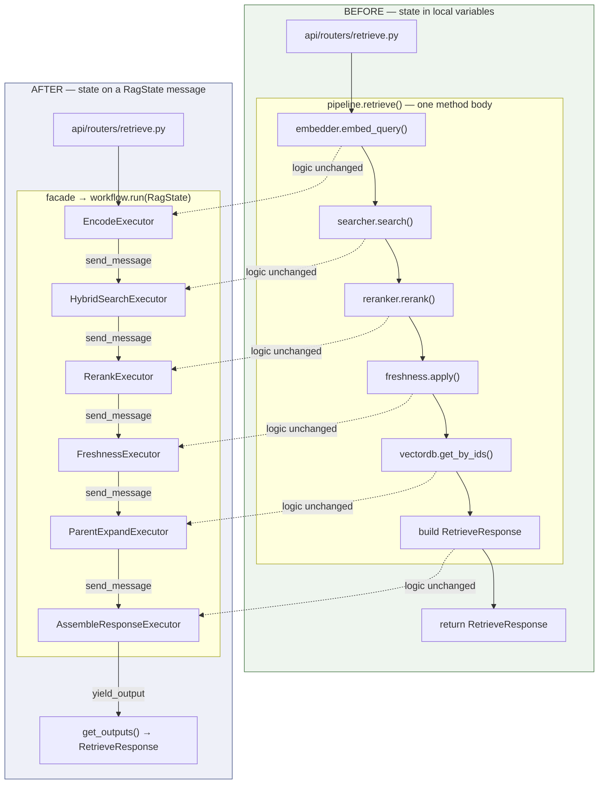
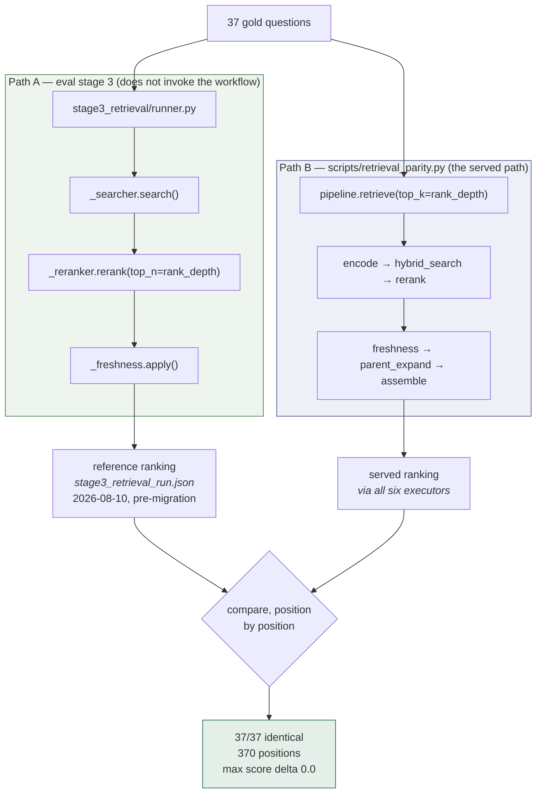
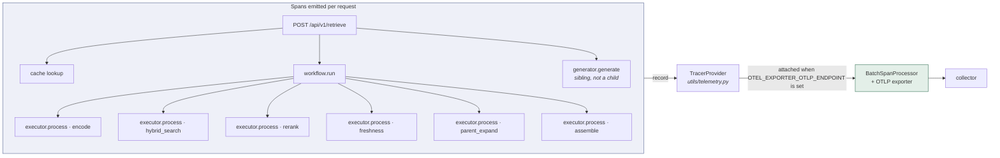

# Retrieval Pipeline Migration to Microsoft Agent Framework

|                       |                                                          |
| --------------------- | -------------------------------------------------------- |
| **Service**     | `rag-as-a-service` (package `gernas_rag`)            |
| **Branch**      | `feat/multimodal-rag-poc-maf`                          |
| **Framework**   | `agent-framework-core` 1.17.0                          |
| **Implemented** | 2026-09-08 · cutover 2026-09-09 · hardening 2026-09-10 |
| **Status**      | Complete. Behavioural equivalence validated              |

---

## Contents

1. [Purpose and scope](#1-purpose-and-scope)
2. [The pipeline before migration](#2-the-pipeline-before-migration)
3. [The pipeline after migration](#3-the-pipeline-after-migration)
4. [Implementation](#4-implementation)
5. [Behavioural equivalence](#5-behavioural-equivalence)
6. [Defect: concurrent request handling](#6-defect-concurrent-request-handling)
7. [Post-migration hardening](#7-post-migration-hardening)
8. [Impact assessment](#8-impact-assessment)
9. [Configuration reference](#9-configuration-reference)
10. [Verification procedure](#10-verification-procedure)
11. [Outstanding work](#11-outstanding-work)
12. [Rollback](#12-rollback)
13. [Change inventory](#13-change-inventory)

---

## 1. Purpose and scope

This document records the conversion of the retrieval pipeline from inline procedural code to
a Microsoft Agent Framework (MAF) workflow: what the pipeline was, what it became, the
evidence that retrieval behaviour is unchanged, and the defect the conversion introduced.

### 1.1 Correction to the original premise

| Assertion                     | Finding                                                                                                                                                       |
| ----------------------------- | ------------------------------------------------------------------------------------------------------------------------------------------------------------- |
| The service uses LangChain    | **Only as a text utility.** Two imports in `src/`, both `RecursiveCharacterTextSplitter` (`chunking/fixed_size.py`, `chunking/hierarchical.py`) |
| An orchestration layer exists | **No.** Retrieval was a deterministic sequence of `async` calls                                                                                       |

The work was therefore **the introduction of an orchestration layer to a pipeline that had
none**, not the replacement of an existing framework. The distinction matters when assessing
value: the usual justification for such a migration — retiring the incumbent framework — does
not apply, so the case rests entirely on what the new layer adds.

### 1.2 In scope

Query encoding, hybrid search, reranking, freshness penalty, parent expansion, and response
assembly.

### 1.3 Out of scope

| Area                                                                                 | Rationale                                                                                                                                                                                     |
| ------------------------------------------------------------------------------------ | --------------------------------------------------------------------------------------------------------------------------------------------------------------------------------------------- |
| Ingestion (`ingestion/pipeline.py`)                                                | Uses`asyncio.gather` with a `Semaphore` for bounded concurrency. MAF provides no equivalent primitive, so the semaphore would remain inside an executor and the wrapper would add nothing |
| Generation (`generation/generator.py`)                                             | Invoked by the router, not the pipeline. Moving it inside the workflow would relocate the response cache boundary and change caching behaviour                                                |
| Chunking, extraction, enrichment, embeddings, vector DB, LLM clients, cache, storage | No framework coupling                                                                                                                                                                         |

---

## 2. The pipeline before migration

`RetrievalPipeline.retrieve()` was a single `async` method of approximately 72 lines
executing five sequential steps. Local variables carried state between them, and stage
boundaries were marked only by comments.

```python
async def retrieve(self, request: RetrieveRequest) -> RetrieveResponse:
    start = time.perf_counter()

    # Step 1: Encode query (dense + sparse)
    embedding = await self._embedder.embed_query(request.query)

    # Step 2: Hybrid search (dense ANN + sparse BM25 + RRF merge)
    candidates = await self._searcher.search(...)

    # Step 3: Cross-encoder rerank
    if self._reranker and candidates:
        candidates = await self._reranker.rerank(...)
    else:
        candidates = candidates[: request.top_k]

    # Step 4: Freshness penalty
    candidates = self._freshness.apply(candidates)

    # Step 5: Parent chunk expansion
    ...
    return RetrieveResponse(...)
```

### 2.1 Characteristics

| Property                   | State before migration                     |
| -------------------------- | ------------------------------------------ |
| Stage boundaries           | Comments only; not addressable in code     |
| Execution order            | Implied by statement order                 |
| State between stages       | Local variables, private to the call frame |
| Per-stage instrumentation  | None. One`structlog` line at the end     |
| Per-stage timeout or retry | No insertion point                         |
| Testing one stage          | Only through the whole method              |
| Concurrent requests        | Safe — no object shared between requests  |

The pipeline was correct and simple. Its limitations were structural: no stage could be
observed, timed, or tested in isolation.

---

## 3. The pipeline after migration

The same six operations now run as MAF `Executor` classes connected by a declared edge chain.
Stage logic was transferred without modification; what changed is how one stage hands work to
the next.



The final transition differs from the preceding five: the terminal executor calls
`yield_output` rather than `send_message`, which is what makes its message visible to
`events.get_outputs()`.

### 3.1 Construct mapping

| Before                                                       | After                                             | Equivalence                                                                                                                              |
| ------------------------------------------------------------ | ------------------------------------------------- | ---------------------------------------------------------------------------------------------------------------------------------------- |
| Five numbered steps in one method                            | Six`Executor` classes                           | **Exact.** Six rather than five because response assembly became its own stage                                                     |
| Local variables (`candidates`, `parent_map`, `start`)  | Fields on a`RagState` dataclass                 | **Exact.** One instance per request, mutated in place, never cached or shared                                                      |
| Order implied by statement order                             | `.add_edge(a, b)` chain                         | **Exact.** Same linear order, declared rather than inferred                                                                        |
| `return RetrieveResponse(...)`                             | `output_from` + `events.get_outputs()`        | **Adapted.** MAF has no typed return value; the façade filters outputs by type and is the only place in the service aware of this |
| `time.perf_counter()` spanning the method                  | `RagState.started_at`                           | **Near-exact.** Now includes workflow dispatch in the measured span                                                                |
| Router`try/except` producing HTTP 500                      | Unchanged; the workflow re-raises                 | **Verified.** `workflow.run()` propagates the original exception with type and message intact                                    |
| `_searcher` / `_reranker` / `_freshness`               | Retained on the pipeline, injected into executors | **Required.** Stage 3 evaluation accesses all three directly                                                                       |
| Checkpointing, state reducers, thread IDs, human-in-the-loop | Not applicable                                    | These constructs never existed; the service is stateless per request                                                                     |

### 3.2 Execution state

`RagState` is created once per `retrieve()` call and mutated in place as it passes down the
edge chain. It is request-scoped and never cached, shared, or persisted.

It carries **no image bytes** — only `artifact_ref` strings. Image hydration occurs later, in
`generation/generator.py`, which is what keeps image data out of the Redis response cache.

---

## 4. Implementation

### 4.1 The six executors

Each executor is a class with a single `@handler` method. Components are **injected**, never
constructed inside the executor.

| Executor                     | Operation                                                              | Reads                                          | Writes                                                                  |
| ---------------------------- | ---------------------------------------------------------------------- | ---------------------------------------------- | ----------------------------------------------------------------------- |
| `EncodeExecutor`           | Dense and sparse query encoding; starts the latency clock              | `request.query`                              | `dense_vector`, `sparse_indices`, `sparse_values`, `started_at` |
| `HybridSearchExecutor`     | Dense ANN and sparse BM25 concurrently, merged by RRF                  | vectors,`request.filters`                    | `candidates`                                                          |
| `RerankExecutor`           | Cross-encoder rerank, or truncation when no reranker is configured     | `candidates`, `request.top_k`              | `candidates`                                                          |
| `FreshnessExecutor`        | Staleness penalty, re-sort, rank rewrite                               | `candidates`                                 | `candidates`                                                          |
| `ParentExpandExecutor`     | Parent chunk lookup, de-duplicated before fetch                        | `candidates`, `request.include_parent`     | `parent_map`                                                          |
| `AssembleResponseExecutor` | Maps results to chunks, computes latency and the global freshness flag | `candidates`, `parent_map`, `started_at` | `response`, yielded as workflow output                                |

### 4.2 Conditional logic retained inside executors

MAF supports conditional edges. Both branches in the original flow — `if self._reranker and candidates` and `if request.include_parent` — were kept as ordinary `if` statements inside
their executors.

The reranker also degrades internally, setting `_unavailable` and truncating when its model
fails to load. Expressing the condition as an edge would place the same fallback in two
locations. Retaining it inside the executor also means **every request emits an identical
event sequence** regardless of which branch is taken, which keeps traces comparable.

### 4.3 Dependency selection

The implementation plan specified installing both `agent-framework` and
`agent-framework-core`. `agent-framework` is an umbrella distribution. Resolving it before
installation produced the following comparison.

|                                                                             | `agent-framework` + core                                                              | `agent-framework-core` alone |
| --------------------------------------------------------------------------- | --------------------------------------------------------------------------------------- | ------------------------------ |
| Packages installed                                                          | 132                                                                                     | **2**                    |
| Packages removed                                                            | 14                                                                                      | **0**                    |
| `redis`                                                                   | **8.0.0 → 7.1.1 (downgrade)** — the service uses Redis for caching              | unchanged                      |
| `openai`                                                                  | **2.41.1 → 3.8.0 (major version)**                                               | unchanged                      |
| `wrapt`                                                                   | 2.2.1 → 1.17.3 (downgrade)                                                             | unchanged                      |
| Additional transitive dependencies                                          | Azure SDK, boto3, google-genai, mistralai, ollama, pythonnet/.NET interop, WASM sandbox | none                           |
| Supplies`Executor`, `WorkflowBuilder`, `WorkflowContext`, `handler` | Yes                                                                                     | **Yes**                  |

`agent-framework-core` alone was selected. Following the plan as written would have
downgraded the Redis client and applied a major version change to the OpenAI SDK in a banking
service, in order to add a workflow wrapper around six function calls.

A guard test (`test_umbrella_agent_framework_is_not_installed`) now asserts that
`agent-framework-core` is installed and the umbrella package is not.

---

## 5. Behavioural equivalence

The migration's central claim is that retrieval output is unchanged. This section records how
that was tested.

### 5.1 Method

The evaluation suite is organised by concern rather than by code path, and the stage named
"retrieval" does not exercise the retrieval *path*: `eval/stage3_retrieval/runner.py` drives
`_searcher`, `_reranker` and `_freshness` directly and never calls `retrieve()`. The workflow
is constructed and never run.

This is deliberate — it keeps evaluation runs inexpensive and allows recall to be measured
deeper than production returns — and it has a useful consequence. The stage 3 runner is
effectively an inlined copy of the pre-migration `retrieve()` body, which is why the migration
left it untouched, and why its recorded output remains a valid **pre-migration reference**.



`scripts/retrieval_parity.py` replays the gold questions through `retrieve()` and compares the
result against that reference. It requires **no LLM**: the pipeline imports no generator, and
generation is invoked by the router (`api/routers/retrieve.py:93`), never by `retrieve()`. The
two models involved — BGE-M3 and the cross-encoder — are local and deterministic, which is
what makes exact comparison meaningful.

Two alignment details make the comparison valid rather than merely favourable:

1. **Depth is matched.** Stage 3 reranks to `rank_depth` then applies the freshness penalty to
   that list; `retrieve()` reranks to `request.top_k` then applies it to its own list. Because
   `FreshnessFilter.apply` re-sorts by penalised score, `freshness(top10)[:3]` is not
   generally equal to `freshness(top3)`. The script reads `rank_depth` from the reference
   file's own configuration and supplies it as `top_k`.
2. **The 2026-08-10 reference remains applicable** because the current stage 3 run is
   byte-identical to it across all 37 questions. The components have not changed, so the
   earlier recording is a valid transitive reference.

### 5.2 Results

| Measure                   | Value                                                             |
| ------------------------- | ----------------------------------------------------------------- |
| Reference                 | `eval/baselines/stage3_retrieval_run.json`, recorded 2026-08-10 |
| Questions compared        | 37 of 37                                                          |
| Identical                 | **37**                                                      |
| Differing                 | **0**                                                       |
| Ranked positions verified | **370** (depth 10 per question)                             |
| Maximum score delta       | **0.0** — exact float equality, not a tolerance            |

> **Note.** This run predates the concurrency fix in §6. It remains valid evidence that the
> six executors reproduce the pre-migration ranking, because that fix changed *when* the
> workflow graph is constructed, not what any stage computes. A four-question re-check
> afterwards (questions 1, 6, 22, 32) returned identical results with delta `0.0`. The full 37
> have not been re-run since — see §11, item 1.

### 5.3 Coverage limitations

`RetrievedChunk` carries no `chunk_id`, so identity is established using
(`source`, `clause_reference`, `modality`, full `text`). `score` is compared separately, so an
ordering change and a numeric change are reported as distinct failures.

Fields absent from the stage 3 recording cannot be compared by this method.

| Field                                           | Covered by parity run                                   | Alternative coverage                         |
| ----------------------------------------------- | ------------------------------------------------------- | -------------------------------------------- |
| Chunk identity, ordering, depth                 | Yes — all 370 positions                                | —                                           |
| `score`                                       | Yes — exact equality                                   | —                                           |
| `modality`                                    | Yes                                                     | —                                           |
| `parent_text`                                 | No — run with`include_parent=False` to match stage 3 | Unit suite: parent expansion, both branches  |
| `artifact_ref`                                | No — not recorded by stage 3                           | Unit suite: multimodal metadata pass-through |
| `freshness_warning`                           | No — not recorded by stage 3                           | Unit suite: threshold behaviour              |
| `total_results`, `freshness_warning_global` | No — derived fields                                    | Unit suite: response well-formedness         |

> **Time dependence.** The freshness penalty is computed against `datetime.now()`
> (`retrieval/freshness.py:29`), so scores drift as documents age past
> `freshness_max_age_days`. No drift has occurred to date, which is why the August and
> September runs agree. If ordering holds and only scores move, the cause is the clock rather
> than a code change.

---

## 6. Defect: concurrent request handling

A test was written to verify a documented safety property. The property did not hold.

### 6.1 Description

`RetrievalPipeline` constructed one `Workflow` in `__init__` and reused it for every request.
Both `build.py` and the constructor documented this as safe on the basis that MAF workflows
are immutable and all per-request data travels on the `RagState` passed to `run()`.

MAF does not permit it:

```
agent_framework.exceptions.WorkflowException:
    Workflow is already running; concurrent runs are not allowed on the same instance.
```

The guard is explicit at `agent_framework/_workflows/_workflow.py:776`. It rejects a second
`run()` synchronously, keyed on a weak reference to the in-flight run's response stream.

### 6.2 Impact

For any two overlapping `POST /api/v1/retrieve` requests, the second raised
`WorkflowException`, which the router's exception handler converted to HTTP 500. Under
concurrent load this would have affected the majority of requests.

### 6.3 Why it was not detected earlier

Every verification mechanism available to the service executes sequentially.

| Verification                                   | Concurrent                                      |
| ---------------------------------------------- | ----------------------------------------------- |
| Unit and integration suites                    | No — one request at a time                     |
| `scripts/retrieval_parity.py` (37 questions) | No — sequential loop                           |
| Evaluation stage 3                             | No — and does not invoke`retrieve()` (§5.1) |
| Evaluation stage 4                             | No                                              |
| Staged production rollout                      | Not performed; skipped at cutover               |

The equivalence evidence in §5 was therefore collected entirely on a code path that could not
exhibit this failure. Sequential verification of a concurrent service demonstrates less than
it appears to.

### 6.4 Resolution

The workflow is now constructed per request in `RetrievalPipeline._build_workflow()`. Measured
cost: **1.9 ms** — six executor objects plus graph validation. The components those executors
wrap are not rebuilt; the embedder, cross-encoder and vector DB client remain on the pipeline
instance and load once.

### 6.5 Verification

`test_concurrent_requests_do_not_cross_contaminate` executes six queries sequentially, then
the same six concurrently, and asserts the results match. It substitutes a query-keyed
reranker because the suite's standard test double sorts by text length and is query-blind;
against that double the test would pass even if every request returned another request's
result.

A parity re-check after the change returned identical rankings with
score delta `0.0`, confirming the fix altered concurrency behaviour only.

---

## 7. Post-migration hardening

### 7.1 Observability

MAF emits OpenTelemetry spans for `workflow.run` and each `executor.process` automatically.
The service configured a `TracerProvider` but attached no span processor, so those spans were
recorded in memory and discarded.



`utils/telemetry.py` now attaches a `BatchSpanProcessor` when `OTEL_EXPORTER_OTLP_ENDPOINT` is
set, and logs a warning naming that variable when it is not. Batched rather than simple
export, so collector latency does not fall on the request path.

The exporter defaults to gRPC. The HTTP exporter is a separate distribution
(`opentelemetry-exporter-otlp-proto-http`) that is not currently installed; selecting it via
`OTEL_EXPORTER_OTLP_PROTOCOL` without adding that dependency produces a warning rather than a
startup failure.

**Trace topology.** Generation is invoked by the router, so `generator.generate` appears as a
sibling of `workflow.run` rather than a child. A request produces two span trees, not one.
This follows from keeping the response cache boundary unchanged (§1.3).

### 7.2 Per-stage timeouts

Four budgets were added to `RetrievalConfig`, applied by a `_within()` helper in
`workflow/executors.py`. Behaviour on expiry follows the degradation each component already
implements rather than introducing new policy.

| Stage             | On timeout                        | Rationale                                                                                                                                              |
| ----------------- | --------------------------------- | ------------------------------------------------------------------------------------------------------------------------------------------------------ |
| `rerank`        | Truncate to`top_k` and continue | Matches the reranker's existing fallback when its model fails to load. Candidates remain relevant, simply not reordered                                |
| `parent_expand` | Continue with no parents          | `parent_text` is optional on every chunk; the response remains well-formed and correctly ranked                                                      |
| `encode`        | Propagate                         | No safe degradation. Without a query vector there is nothing to search, and an empty result set would be indistinguishable from "no documents matched" |
| `hybrid_search` | Propagate                         | As above                                                                                                                                               |
| `assemble`      | No timeout                        | Pure CPU over an in-memory list; a hang indicates a defect that a timeout would conceal                                                                |

**All four budgets default to `None` (disabled).** The service's own evaluation runs take
90–150 seconds per query on CPU, so any shipped default would be incorrect for some
deployments and would convert working retrievals into failures. The mechanism and policy are
in place; the values are a per-deployment decision to be made once p99 latency is measured.

### 7.3 Configuration consolidation

`FRESHNESS_WARNING_THRESHOLD` was moved from `retrieval/pipeline.py` to `config/retrieval.py`.
It is now imported by `workflow/executors.py`, `tests/unit/test_retrieval_workflow.py` and
`eval/stage4_generation/retrieval_reuse.py` — the last of which had been duplicating the
value, with a comment explaining that it could not import a module-private name. The served
path and the evaluation path can no longer diverge on this threshold.

The import cycle this arrangement was working around proved to be at package level —
`retrieval/__init__` → `pipeline` → `workflow.build` → `retrieval.freshness`, which re-enters
the same `__init__` — rather than caused by the constant. `retrieve()` now imports within the
method, which the per-request workflow construction (§6.4) required in any case.

---

## 8. Impact assessment

| Dimension                         | Before                                  | After                                                                         | Assessment                                                      |
| --------------------------------- | --------------------------------------- | ----------------------------------------------------------------------------- | --------------------------------------------------------------- |
| Stage boundaries                  | Comments inside one method              | Six named classes with typed handoffs                                         | Improved                                                        |
| Adding a stage                    | Edit the method; risk to adjacent logic | New executor plus one`add_edge` call                                        | Improved                                                        |
| Testing one stage                 | Only through the whole method           | Executor constructed and driven directly                                      | Improved                                                        |
| Timeout / retry / instrumentation | No insertion point                      | Seam at every executor boundary, now used                                     | Improved                                                        |
| Traces                            | `structlog` lines only                | Native`workflow.run` / `executor.process` spans, exported when configured | Improved                                                        |
| Monorepo consistency              | Two orchestration styles                | Retrieval matches the`agent-mesh` pattern                                   | Improved                                                        |
| Retrieval quality                 | Baseline                                | Same components, configuration and order                                      | **Verified identical** — 37/37, delta 0.0                |
| Request / response contract       | Baseline                                | Byte-identical; MCP`search_documents` unchanged                             | No change, by design                                            |
| Concurrent requests               | Safe — no shared object                | One`Workflow` per request                                                   | **Regressed, then fixed** (§6)                           |
| Latency                           | Five inline awaits                      | Six executor dispatches plus 1.9 ms graph construction                        | Under 1% of a typical retrieval; not yet measured in production |
| Reading the flow end to end       | One method, top to bottom               | Four files: state, executors, builder, façade                                | More indirection for a linear flow                              |
| Rollback                          | —                                      | `git revert`                                                                | Feature flag removed at cutover (§12)                          |
| Framework neutrality              | No agent-framework coupling             | One vendor framework on the runtime path                                      | The service documents an anti-lock-in principle                 |
| Orchestration uniformity          | Inline throughout                       | Retrieval on MAF, ingestion inline                                            | Mixed; see §1.3                                                |

---

## 9. Configuration reference

All settings below are new. Defaults preserve pre-existing behaviour.

| Setting                               | Type         | Default  | Effect                                                                                                              |
| ------------------------------------- | ------------ | -------- | ------------------------------------------------------------------------------------------------------------------- |
| `OTEL_EXPORTER_OTLP_ENDPOINT`       | env          | unset    | When set, spans are exported to this collector. When unset, spans are recorded and dropped, and a warning is logged |
| `OTEL_EXPORTER_OTLP_PROTOCOL`       | env          | `grpc` | `grpc` or `http/protobuf`. The HTTP exporter distribution is not currently installed                            |
| `retrieval.encode_timeout_s`        | float\| None | `None` | Budget for query encoding. Propagates on expiry                                                                     |
| `retrieval.search_timeout_s`        | float\| None | `None` | Budget for hybrid search. Propagates on expiry                                                                      |
| `retrieval.rerank_timeout_s`        | float\| None | `None` | Budget for reranking. Degrades to fused order on expiry                                                             |
| `retrieval.parent_expand_timeout_s` | float\| None | `None` | Budget for parent lookup. Degrades to no parents on expiry                                                          |
| `FRESHNESS_WARNING_THRESHOLD`       | constant     | `0.7`  | Module constant in`config/retrieval.py`; below this freshness score a chunk is flagged                            |

---

## 10. Verification procedure

Ordered by cost, so the fastest check that can fail does so first.

| # | Check                   | Command                                                                              | Expected                       | Duration |
| - | ----------------------- | ------------------------------------------------------------------------------------ | ------------------------------ | -------- |
| 1 | Reference integrity     | `cd eval/baselines && sha256sum -c stage3_retrieval_run.json.sha256`               | `OK`                         | instant  |
| 2 | Workflow contract       | `pytest tests/unit/test_retrieval_workflow.py -q`                                  | `25 passed`                  | ~15 s    |
| 3 | Full suite              | `pytest tests/ -q`                                                                 | `183 passed`                 | 1–6 min |
| 4 | Telemetry               | §10.1                                                                               | two distinct log lines         | ~10 s    |
| 5 | Concurrency, end to end | §10.2                                                                               | ten HTTP 200 responses         | ~1 min   |
| 6 | Retrieval parity        | `python -u scripts/retrieval_parity.py --out data/eval/runs/retrieval_parity.json` | `37/37 identical, delta 0.0` | ~70 min  |

### 10.1 Telemetry

```bash
# Unset: logs "Span export disabled - spans are recorded and dropped"
python -c "import sys; sys.path.insert(0,'src'); \
  from gernas_rag.utils.telemetry import configure_telemetry; configure_telemetry('rag')"

# Set: logs "Span export enabled ... protocol=grpc"
OTEL_EXPORTER_OTLP_ENDPOINT=http://localhost:4317 python -c "import sys; sys.path.insert(0,'src'); \
  from gernas_rag.utils.telemetry import configure_telemetry; configure_telemetry('rag')"
```

Both paths are confirmed working. For end-to-end confirmation, point the endpoint at a
collector, issue one `POST /api/v1/retrieve`, and verify a single `workflow.run` span with
exactly six `executor.process` children.

### 10.2 Concurrency against a running service

```powershell
1..10 | ForEach-Object -Parallel {
  curl -s -o /dev/null -w "%{http_code}`n" -X POST http://localhost:8000/api/v1/retrieve `
    -H "Content-Type: application/json" -d '{\"query\":\"pricing floor\",\"top_k\":5}'
}
```

All ten should return `200`. Prior to the fix in §6, the majority returned `500`.

---

## 11. Change inventory

**12 files modified (+758 / −156), one directory added.**

| File                                             | Change                                                                                                         |
| ------------------------------------------------ | -------------------------------------------------------------------------------------------------------------- |
| `src/gernas_rag/retrieval/pipeline.py`         | `_build_workflow()` constructs a workflow per request; imports moved into methods to break the package cycle |
| `src/gernas_rag/workflow/executors.py`         | `_within()` timeout helper; four executors accept `timeout_s`; per-stage degradation policy                |
| `src/gernas_rag/workflow/build.py`             | Accepts`timeouts`; docstring corrected — it had asserted concurrency safety                                 |
| `src/gernas_rag/config/retrieval.py`           | `FRESHNESS_WARNING_THRESHOLD` relocated here; four timeout budgets added                                     |
| `src/gernas_rag/utils/telemetry.py`            | `BatchSpanProcessor` and OTLP exporter attached when configured                                              |
| `tests/unit/test_retrieval_workflow.py`        | 19 → 25 tests: concurrency, three timeout-policy tests, dependency guard, revised build test                  |
| `tests/integration/test_retrieve_endpoint.py`  | `app.state.search_history_store` added to the fixture                                                        |
| `tests/integration/test_ingestion_pipeline.py` | `get_extractor` patched before pipeline construction                                                         |
| `eval/stage4_generation/retrieval_reuse.py`    | Imports the freshness threshold rather than duplicating it                                                     |
| `eval/RAG_EVAL_README.md`                      | Stage 3 description corrected; it had stated the stage "runs the exact retrieval path used in production"      |
| `scripts/retrieval_parity.py`                  | Defaults to the frozen reference; writes results incrementally                                                 |
| `MAF_MIGRATION_EXPLAINED.md`                   | This document                                                                                                  |
