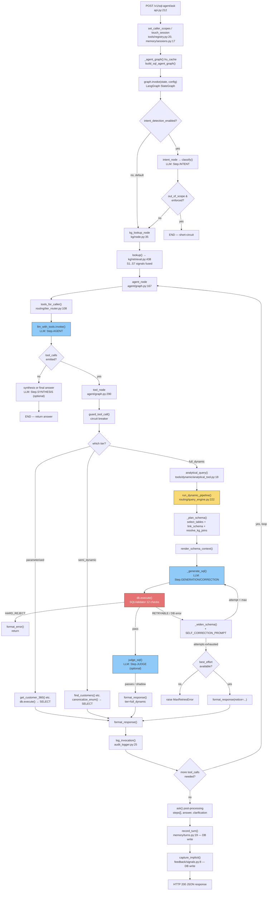

# SQL Agent — End-to-End Call Graph & Architecture Analysis

Analysis based on direct reading of `sql_agent/` (all subpackages), `scripts/`, `eval/`, and `tests/` on branch `feat/sqlagent-kg-metadata`. This is a **synchronous FastAPI microservice** wrapping a **LangGraph ReAct agent** that turns natural-language questions into governed SQL across three tool tiers (parameterised → semi-dynamic → full-dynamic), gated by a 12-check SQL validator and an optional metadata Knowledge Graph layer.

────────────────────────────────────────────────────────────────────
## 1. ENTRY POINTS
────────────────────────────────────────────────────────────────────

### HTTP endpoints (FastAPI, all **synchronous** `def`, not `async def`)
All in `sql_agent/service/api.py`:

| Method | Path | Handler | Line |
|---|---|---|---|
| POST | `/v1/sql-agent/invoke` | `invoke(req: InvokeRequest) -> dict` | api.py:96 |
| POST | `/v1/sql-agent/ask` | `ask(req: AskRequest) -> dict` | api.py:212 |
| POST | `/v1/sql-agent/feedback` | `feedback(req: FeedbackRequest) -> dict` | api.py:392 |
| GET | `/v1/sql-agent/sessions` | `sessions(user_id: str) -> dict` | api.py:404 |
| GET | `/v1/sql-agent/sessions/{session_id}/history` | `history(session_id: str) -> dict` | api.py:410 |
| PATCH | `/v1/sql-agent/sessions/{session_id}` | `rename(session_id, req: RenameSessionRequest) -> dict` | api.py:416 |
| DELETE | `/v1/sql-agent/sessions/{session_id}` | `delete(session_id, user_id) -> dict` | api.py:423 |
| GET | `/healthz` | `healthz() -> dict` | api.py:430 |

### Startup hook
- `@app.on_event("startup") def _prewarm()` — api.py:132 — compiles the LangGraph agent + checkpointer, and (if `schema_retrieval_enabled`) warms the embedding model + vector index, before the first real request arrives.

### Module-level code (runs on import)
- FastAPI app construction + CORS middleware — api.py:45-57
- `settings = Settings()` singleton, loaded from `.env` — config.py:337
- `ALL_TOOLS` master tool dict built by importing every tool module — tools/registry.py:79
- `TOOL_TIER_REGISTRY` built at import time from `ALL_TOOLS` — routing/tier_router.py:26
- `db = Executor()` singleton — db/executor.py:159

### Scheduled tasks / event listeners / MQ consumers
**None found.** No Celery, APScheduler, cron, WebSocket handler, SSE generator, or message-queue consumer exists anywhere in this codebase.

### CLI entry points (offline batch jobs, each with `if __name__ == "__main__"`)
These are the operational/maintenance surface, not part of the request-serving path:

| File | Purpose |
|---|---|
| scripts/init_agent_db.py | Create agent metadata + checkpointer tables |
| scripts/build_metadata_kg.py | Build & persist the metadata Knowledge Graph artifact |
| scripts/build_schema_index.py | Build/upsert the schema vector index |
| scripts/build_example_index.py | Build/upsert the few-shot example vector index |
| scripts/seed_examples.py | Batch-load curated few-shot examples |
| scripts/promote_example.py | Promote a question→SQL pair into approved examples |
| scripts/audit_example_corpus.py | Read-only audit of the approved example corpus |
| scripts/generate_example_metadata.py | Metadata generation for the seed example set |
| scripts/load_excel_to_db.py | Load the POC Excel workbook into MySQL/Postgres |
| scripts/agent_scenario_tests.py | End-to-end scenario test harness |
| eval/run_agent.py, eval/run_eval.py, eval/compare_llm.py, eval/deterministic_eval.py | Gold-set evaluation pipeline (run→score→compare) |
| eval/materialize_gold.py, eval/materialize_gold_v1_expected.py | Materialize gold results by executing gold SQL live |
| eval/check_table_retrieval.py, eval/check_example_retrieval.py, eval/correlate_retrieval_outcome.py | Standalone retrieval-quality diagnostics |

────────────────────────────────────────────────────────────────────
## 2. CALL CHAINS
────────────────────────────────────────────────────────────────────

## Flow A — `/v1/sql-agent/ask` (the primary, agent-mediated flow) [HOT PATH]

```
POST /v1/sql-agent/ask
  ask(req: AskRequest) → api.py:212
    └─ set_caller_scopes(scopes)              → tools/registry.py:20              [sync]
    └─ new_session_id()  (if no session_id)   → memory/sessions.py:13             [sync]
    └─ touch_session(session_id, user_id)     → memory/sessions.py:17             [DB write: agent_db.sessions, UPSERT]
    └─ _agent_graph()  (lru_cache singleton)  → api.py:122
         └─ build_sql_agent_graph(checkpointer=get_checkpointer())
              ├─ get_checkpointer()           → memory/checkpointer.py:50  (lru_cache)
              │    └─ InMemorySaver | SqliteSaver | PostgresSaver          [DB: sqlite file / pg pool, per CHECKPOINTER_BACKEND]
              └─ graph.compile(checkpointer=...) → langgraph.StateGraph    [COLD PATH — compiled once per process]
    └─ _merge_pending_clarification(graph, config, req.question) → api.py:198
         └─ graph.get_state(config)           → langgraph internal        [checkpointer read]
         └─ _pending_request_prefix(messages) → api.py:176
    └─ graph.invoke(state, config)            → langgraph StateGraph.invoke   ── THE AGENT TURN ──
         │
         ├─[node] intent_node(state)          → agent/graph.py:149    (no-op unless intent_detection_enabled)
         │    └─ classify(last_human.content)  → routing/intent_classifier.py:42
         │         └─ get_llm(Step.INTENT).invoke(prompt)  [LLM call — small/fast model]  [called from 1 site]
         │
         ├─[conditional edge] _after_intent(state) → agent/graph.py:313 → "kg_lookup" | END
         │
         ├─[node] kg_lookup_node(state)       → kg/node.py:35          (no-op unless kg_enabled) [runs ONCE per turn]
         │    └─ lookup(question, tables_hint) → kg/retrieval.py:438
         │         ├─ get_kg_client()          → kg/client.py:320  (lru_cache; loads JSON artifact or None)
         │         ├─ S1 match_template/run_template → kg/templates.py       [regex entity-id match]
         │         ├─ S2 _node_hits(question)  → kg/retrieval.py:219  [embedding search over :Term/:Scenario vectors]
         │         ├─ S3 _exact_literals(question) → kg/retrieval.py:279  [regex against column/enum names]
         │         ├─ S4 _lexical_tables(question) → kg/retrieval.py:301  [table name/purpose word match]
         │         ├─ S5 _ranked_tables(question) → kg/retrieval.py:308
         │         │    └─ ranked_core()       → semantic_layer/selector.py:108  [dense+BM25+RRF]
         │         ├─ _fuse(...) → kg/retrieval.py:396  [weighted score per table]
         │         ├─ S6 kg_join_closure()     → kg/retrieval.py:327  [+1 hop to base tables]
         │         └─ S7 resolve_kg_joins()    → kg/retrieval.py:348  [BFS join path via client.join_path]
         │    └─ set_kg_lookup(result)         → kg/context.py:27  [ContextVar — bridges node → tool below]
         │
         ├─[node] agent_node(state)           → agent/graph.py:167                        ── TOOL SELECTION ──
         │    ├─ tools_for_caller(caller_agent, auth_scopes) → routing/tier_router.py:108
         │    ├─ render_examples_block(approved_examples())  → memory/examples.py:67, memory/examples.py:12  [DB read: agent_db.examples]
         │    ├─ llm.bind_tools(tools, tool_choice="any"|"auto")
         │    └─ invoke(base_messages)  (inner closure) → agent/graph.py:196
         │         └─ llm_with_tools.invoke(messages)   [LLM call — Step.AGENT]  [sync, blocking]
         │              ├─ on tool_use_failure → retry once with a correction HumanMessage
         │              └─ if both fail → raise SQLAgentError [caught by ask() → format_error]
         │    └─ (if no tool_calls & response_synthesis_enabled) _synthesize_final_answer() → agent/graph.py:117
         │         └─ get_llm(Step.SYNTHESIS).invoke(prompt)  [LLM call — smaller model, writes final prose]
         │
         ├─[conditional edge] agent → "tools" if tool_calls else END  → agent/graph.py:333
         │
         ├─[node] tool_node(state)            → agent/graph.py:290                         ── TOOL DISPATCH ──
         │    ├─ _enforce_verbatim_question(messages, tool_calls) → agent/graph.py:55  (dynamic-only mode only)
         │    ├─ guard_tool_call(state, name)  → routing/tier_router.py:131  [circuit breaker; raises SQLAgentError]
         │    └─ ToolNode(tools).invoke(state) → langgraph.prebuilt.ToolNode  → dispatches to ONE of 3 branches:
         │
         │    ╔══ BRANCH 1: PARAMETERISED (fixed-shape lookup) [called from N sites — one per tool] ══╗
         │    ║  e.g. get_customer_360(customer_id) → tools/parameterised/semantic_view_tools.py:99  ║
         │    ║    └─ _resolve_customer_id(value)   → semantic_view_tools.py:39  [name→id best-effort]║
         │    ║    └─ db.execute(sql, params)        → db/executor.py:32               [DB SELECT]    ║
         │    ║         └─ SQLValidator.validate()   → validation/sql_validator.py:55  (checks 1-6,9) ║
         │    ║         └─ engine.connect().execute() → sqlalchemy → business DB (MySQL/Postgres)     ║
         │    ║    └─ format_response(rows, tier="parameterised", ...) → formatting/response_formatter.py:71 ║
         │    ╚══════════════════════════════════════════════════════════════════════════════════════╝
         │
         │    ╔══ BRANCH 2: SEMI-DYNAMIC (flexible-filter search) — find_customers/products/policies/deals ══╗
         │    ║  find_customers(segment, risk_category, ...) → tools/semi_dynamic/search_tools.py:17         ║
         │    ║    └─ canonicalize_enum(table, col, value)    → semantic_layer/loader.py  [wording→enum token]║
         │    ║    └─ db.execute(sql, params)                 → db/executor.py:32  [DB SELECT, checks 1-6,9]  ║
         │    ║    └─ format_response(..., tier="semi_dynamic")                                               ║
         │    ╚═══════════════════════════════════════════════════════════════════════════════════════════════╝
         │
         │    ╔══ BRANCH 3: FULL DYNAMIC (gated, free-text-to-SQL) — see Flow B below for full detail ══╗
         │    ║  analytical_query(question) → tools/dynamic/analytical_tool.py:18                       ║
         │    ║    └─ caller_has_scope("dynamic_sql")? → tools/registry.py:24  [else AuthError]          ║
         │    ║    └─ run_dynamic_pipeline(question)   → routing/query_engine.py:222   ▶▶▶ Flow B ▶▶▶    ║
         │    ╚══════════════════════════════════════════════════════════════════════════════════════════╝
         │
         │    └─ log_invocation(state, tool_calls, result) → formatting/audit_logger.py:25  [audit log write]
         │    └─ result["tool_call_count"] += len(tool_calls); result["dynamic_call_count"] += ...
         │
         └─[edge] tools → agent  (loop back; repeats until agent emits no tool_calls, or END, or
                                    guard_tool_call raises at MAX_TOOL_CALLS_PER_TURN=10 /
                                    MAX_DYNAMIC_CALLS_PER_TURN=2)
    │
    └─[back in ask()] parse `out["messages"]`, slice to this turn (after last HumanMessage)
    └─ build `steps[]` from ToolMessages, map tool_call args from AIMessage.tool_calls
    └─ compose `answer` = last AIMessage with no tool_calls
    └─[branch] if last step was ask_clarification (DISABLED tool, currently unreachable)
    └─[branch] if last_result is None → NoToolInvoked error path
         └─ capture_implicit(status="error") → feedback/signals.py:8 → record() → feedback/store.py:24  [DB write]
    └─[else] record_turn(...)  → memory/turns.py:19        [DB write: agent_db.turns]
    └─ capture_implicit(...)   → feedback/signals.py:8      [DB write, only on error/0-rows — implicit negative signal]
    └─ return last_result  (JSON envelope)  → HTTP 200
```

## Flow B — the DYNAMIC tier pipeline (`analytical_query` → `run_dynamic_pipeline`) [HOT PATH when fixed tiers are off; otherwise last-resort]

```
run_dynamic_pipeline(question, tables_hint=None) → routing/query_engine.py:222
  │
  ├─ _plan_schema(question, tables_hint)     → query_engine.py:160          ── RETRIEVAL + PLANNING ──
  │    ├─ _resolve_kg(question, tables_hint) → query_engine.py:105
  │    │    └─ get_kg_lookup()  → kg/context.py:31   (reuse the turn's node-published lookup)
  │    │    └─ else kg_lookup(question, tables_hint) → kg/retrieval.py:438  (direct-call fallback, e.g. eval harness)
  │    ├─ candidates = kg.tables  OR  select_tables(question, tables_hint, apply_closure=False)
  │    │    └─ select_tables()   → semantic_layer/selector.py:140
  │    │         ├─ ranked_core() → selector.py:108
  │    │         │    ├─ glossary_expand(question)  → semantic_layer/glossary.py:42
  │    │         │    ├─ _dense_ranking(q)  → selector.py:80  [embedding search — bge/e5 model, in-RAM/faiss/qdrant index]
  │    │         │    ├─ _sparse_ranking(q) → selector.py:92  [BM25Okapi]
  │    │         │    └─ _rrf(rankings, k)  → selector.py:99   [Reciprocal Rank Fusion]
  │    │         └─ base_join_closure(core) → semantic_layer/loader.py  [+bridge base tables]
  │    ├─ link_schema(question, candidates)  → semantic_layer/schema_link.py:74
  │    │    └─ get_llm(Step.PLAN).invoke(SCHEMA_LINK_PROMPT)  [LLM call]  (schema_link_enabled)
  │    │    └─ _violates_view_scope(tables)  → schema_link.py:46  [deterministic guard, rewrites illegal view-chain plans]
  │    ├─ _plan_with_kg(tables, pairs, kg)   → query_engine.py:120
  │    │    ├─ resolve_kg_joins(tables, pairs) → kg/retrieval.py:348   [KG-first: typed edges, BFS via client.join_path]
  │    │    └─ else resolve_joins(tables, pairs) → semantic_layer/joins.py:39  [BFS over schema.yaml relationship graph]
  │    │    └─ constraints_for(used_tables)  → kg/constraints.py:73   [KGConstraints bundle for validator checks #10-12]
  │    └─ render_schema_context(tables=used_tables) → semantic_layer/renderer.py:60
  │
  ├─ log_kg_lookup(question, plan.kg, plan.kg_constraints) → formatting/audit_logger.py:50  [audit log write, BEFORE any SQL]
  ├─ resolve_customer_hint(question)         → routing/entity_resolver.py:36               [DB read: SELECT customer_master]
  │
  └─ LOOP attempt = 1..max_self_correction_attempts (default 3):        ── GENERATE→VALIDATE→SELF-CORRECT ──
       ├─ _base_prompt(plan)  assembles DYNAMIC_SQL_GENERATION_PROMPT with:
       │    kg_block, join_hints_block, glossary_block (matched_terms → glossary.py),
       │    examples_block (relevant_examples() → memory/examples.py:45 → memory/example_index.py:rank_examples),
       │    entity_block, dialect_label()/dialect_notes() → db/dialect.py
       ├─ _generate_sql(prompt, step)        → query_engine.py:147
       │    └─ get_llm(step).invoke(prompt)   [LLM call — Step.GENERATION (attempt 1) or Step.CORRECTION (retries)]
       │
       ├─[branch] sql startswith "-- CANNOT_ANSWER"
       │    └─ if narrowed: _widen_schema() → query_engine.py:192, retry with wider candidate set
       │    └─ else: return format_error("ValidationError", ..., retryable=False)
       │
       ├─ db.execute(sql, allowed_join_pairs=plan.allowed_pairs, strict_columns=True,
       │             kg_constraints=plan.kg_constraints)  → db/executor.py:32
       │    └─ SQLValidator.validate(sql, ...)  → validation/sql_validator.py:55   ── 12 CHECKS ──
       │         #1 _check_1_parse (sqlglot.parse_one)               [raises ParseError]
       │         #2 _check_2_statement_type (SELECT only)            [raises StatementTypeError — HARD REJECT]
       │         #3 _check_3_table_whitelist (ALLOWED_TABLES)        [raises TableNotAllowedError — HARD REJECT]
       │         #4 _check_4_column_filter (BLOCKED_COLUMNS)         [raises ColumnBlockedError — HARD REJECT]
       │         #5 _check_5_injection_scan (regex patterns)         [raises InjectionDetectedError — HARD REJECT]
       │         #6 _check_6_row_cap (LIMIT injection, cap=50)
       │         #9 _check_9_view_join_scope (view join scope)       [raises JoinNotAllowedError]
       │         #7 _check_7_join_graph (allowed_pairs)               [if retrieval on] [raises JoinNotAllowedError]
       │         #8 _check_8_column_binding (col↔table)               [if strict_columns] [raises ColumnNotInTableError]
       │         #10 _check_10_kg_join_keys (declared FK column pair) [if kg_constraints] [raises KGJoinNotAllowedError]
       │         #11 _check_11_kg_columns (existence/type/enum)       [if kg_constraints] [raises KGColumnUnknownError/KGTypeMismatchError]
       │         #12 _check_12_kg_cardinality (fan-out guard, OFF by default) [raises CardinalityRiskError]
       │    └─[on HARD_REJECT] log_validator_decision("reject") → audit_logger.py:86 → return format_error(...)
       │    └─[on RETRYABLE]   log_validator_decision("retry")  → _widen_schema() → append SELF_CORRECTION_PROMPT → continue loop
       │    └─[pass] engine.connect() → conn.execute(text(safe_sql), params)   [DB SELECT — MySQL/Postgres/SQLite]  [ExternalCall: DB]
       │         └─[on OperationalError w/ "timeout"] raise QueryTimeoutError
       │         └─[on other SQLAlchemyError] → widen + retry (DB rejected despite passing validator)
       │    └─ (if execution_guard_enabled) _explain_guard() → EXPLAIN cost pre-flight  [DB EXPLAIN, best-effort]
       │
       ├─ judge_sql(question, result.sql, columns, row_count, schema_context) → validation/answer_validator.py:70
       │    └─ get_llm(Step.JUDGE).invoke(ANSWER_VALIDATION_PROMPT)  [LLM call]  (answer_validation_enabled, shadow by default)
       │    └─[if answer_validation_enforced and !verdict.passes] → retain as best_effort, retry with SELF_CORRECTION_PROMPT
       │
       └─[success] format_response(result, tier="full_dynamic", tool="analytical_query") → formatting/response_formatter.py:71
            └─ log_validator_decision(result.sql, "pass") → audit_logger.py:86
            └─ return response   [breaks the loop]
  │
  └─[loop exhausted] if best_effort: return format_response(best_effort, notice="...")   [caveated success]
                      else: raise MaxRetriesError(...)  [caught by tool_node → surfaces as error envelope]
```

## Flow C — `/v1/sql-agent/invoke` (direct tool call, bypasses the agent/LLM entirely) [COLD/lower-traffic path]

```
invoke(req: InvokeRequest) → api.py:96
  ├─ req.tool in TOOL_TIER_REGISTRY?          → routing/tier_router.py:26  [else ValidationError]
  ├─ set_caller_scopes(scopes)                → tools/registry.py:20
  ├─ gate check: tool in GATED_TOOLS and GATED_SCOPE not in scopes and not fixed_tiers_disabled()
  │      → routing/tier_router.py:79,96        [else AuthError]
  └─ tool = ALL_TOOLS[req.tool] → tool.invoke(req.args)   → same tool function bodies as Flow A's Branch 1/2/3
       [exceptions: AuthError / SQLAgentError / Exception → all caught → format_error(...)]
```

## Flow D — Startup prewarm [COLD PATH, runs once per process]

```
_prewarm() → api.py:132
  ├─ _agent_graph() → api.py:122  [compiles StateGraph + initialises checkpointer]
  └─ (if schema_retrieval_enabled) select_tables("warmup") → semantic_layer/selector.py:140
       └─ loads embedding model into RAM + builds/opens the vector index (lru_cached singletons)
  [both wrapped in try/except — a prewarm failure never blocks server startup; falls back to lazy init]
```

## Flow E — Feedback capture (explicit + implicit) [called from N sites]

```
Explicit: POST /v1/sql-agent/feedback → feedback() → api.py:392
  └─ record_feedback(...) → feedback/store.py:24 → insert into agent_db.feedback  [DB write]
       └─ _screen(correction_text) → store.py:15  [drops text mentioning a BLOCKED_COLUMNS token]

Implicit: called inline at the end of ask() → capture_implicit() → feedback/signals.py:8
  └─ record(signal_type="implicit", polarity="negative", stage=...) → feedback/store.py:24  [DB write]
       [fires only when status != "success" OR rows_returned == 0 — never on a clean success]
```

────────────────────────────────────────────────────────────────────
## 3. DATA FLOW SUMMARY
────────────────────────────────────────────────────────────────────

**`/ask` request → response, layer by layer:**

```
Raw HTTP JSON {question, user_id, session_id, envelope}
  │  [validation]
  ▼
AskRequest (Pydantic model, api.py:74) — envelope.auth_scope: list[str], question: str
  │  [session/identity resolution]
  ▼
session_id (new or existing) + user_id + correlation_id (cid)
  │  [business logic — LangGraph]
  ▼
AgentState (TypedDict, agent/state.py:8):
  messages: list[BaseMessage] (add_messages-reduced), caller_agent, auth_scopes: set,
  tool_call_count, dynamic_call_count, correlation_id, user_id, session_id,
  intent: dict (optional), kg_context: dict (optional)
  │  [LLM tool selection → LangChain tool_calls]
  ▼
AIMessage.tool_calls: [{"name": str, "args": dict, "id": str}]
  │  [tool dispatch — per-tool Pydantic arg validation via @tool decorator]
  ▼
   ┌─ parameterised/semi-dynamic: dict of column=value filters → parameterised SQL string + params dict
   └─ dynamic: question:str → QueryPlan (schema_link.py) → SQL string (LLM-generated)
  │  [persistence / DB]
  ▼
SQLAlchemy `text(sql)` + params:dict → business DB rows: list[sqlalchemy.Row] → list[dict] (db/executor.py:65)
  │  [formatting]
  ▼
QueryResult(rows, latency_ms, truncated, sql, params) → format_response() envelope (dict):
  {status, tool, query_tier, rows_returned, data: list[dict] (_json_safe'd),
   calculated, truncated, latency_ms, cache_hit, audit_id, sql, sql_params}
  │  [ToolMessage — serialized to JSON string by langgraph]
  ▼
ToolMessage.content: str(JSON) → re-parsed by _parse_tool_content() (api.py:157)
  │  [aggregation across the turn's tool calls]
  ▼
steps: list[dict] {tool, query_tier, status, rows_returned, sql, args, sql_params, calc_explain}
last_result: dict (the primary envelope, enriched with `answer` and `steps`)
  │  [persistence — readable history]
  ▼
turns table row (memory/db.py:43): session_id, user_id, turn_ref, question, answer, tier, tool,
                                     validated_sql, rows_returned
  │  [response]
  ▼
HTTP 200 JSON = last_result  (or a `format_error()` envelope / `{"status": "clarification", ...}`)
```

**Schema/model inventory:**
- `Envelope`, `AskRequest`, `InvokeRequest`, `FeedbackRequest`, `RenameSessionRequest` — Pydantic, api.py:60-92
- `AgentState` — TypedDict, agent/state.py:8
- `SchemaPlan`, `QueryPlan` — frozen dataclasses carrying retrieval/planning state, query_engine.py:74, schema_link.py:30
- `KGLookup`, `KGConstraints` — frozen dataclasses, the KG audit/constraint bundles, kg/retrieval.py:76, kg/constraints.py:25
- `QueryResult` — plain class, DB row carrier, db/executor.py:139
- SQLAlchemy `Table` objects: `sessions`, `turns`, `feedback`, `examples` — memory/db.py:30-88

────────────────────────────────────────────────────────────────────
## 4. CROSS-MODULE DEPENDENCY MAP
────────────────────────────────────────────────────────────────────

| Module A | → calls → | Module B | Functions used |
|---|---|---|---|
| `service/api.py` | → | `agent/graph.py` | `build_sql_agent_graph` |
| `service/api.py` | → | `memory/*` | `get_checkpointer`, `new_session_id`, `touch_session`, `list_sessions`, `list_turns`, `rename_session`, `delete_session`, `record_turn` |
| `service/api.py` | → | `routing/tier_router.py` | `TOOL_TIER_REGISTRY`, `GATED_TOOLS`, `GATED_SCOPE`, `fixed_tiers_disabled` |
| `service/api.py` | → | `tools/registry.py` | `ALL_TOOLS`, `set_caller_scopes` |
| `service/api.py` | → | `feedback/*` | `capture_implicit`, `record` |
| `service/api.py` | → | `formatting/response_formatter.py` | `format_error` |
| `agent/graph.py` | → | `kg/node.py` | `kg_lookup_node` |
| `agent/graph.py` | → | `routing/tier_router.py` | `fixed_tiers_disabled`, `guard_tool_call`, `tier_of`, `tools_for_caller` |
| `agent/graph.py` | → | `routing/intent_classifier.py` | `classify` |
| `agent/graph.py` | → | `memory/examples.py` | `approved_examples`, `render_examples_block` |
| `agent/graph.py` | → | `llm/factory.py` | `Step`, `get_llm`, `log_usage` |
| `agent/graph.py` | → | `formatting/audit_logger.py` | `log_invocation` |
| `routing/tier_router.py` | → | `tools/registry.py` | `ALL_TOOLS`, `set_caller_scopes` |
| `tools/dynamic/analytical_tool.py` | → (lazy) | `routing/tier_router.py`, `routing/query_engine.py` | `fixed_tiers_disabled`, `run_dynamic_pipeline` |
| `routing/query_engine.py` | → | `kg/constraints.py`, `kg/context.py`, `kg/retrieval.py` | `constraints_for`, `get_kg_lookup`, `lookup`, `resolve_kg_joins`, `kg_join_closure` |
| `routing/query_engine.py` | → | `semantic_layer/{glossary,joins,renderer,schema_link,selector}.py` | `matched_terms`, `resolve_joins`, `render_schema_context`, `link_schema`, `select_tables` |
| `routing/query_engine.py` | → | `validation/{answer_validator,exceptions}.py` | `judge_sql`, typed exceptions |
| `routing/query_engine.py` | → | `memory/examples.py`, `routing/entity_resolver.py` | `relevant_examples`, `resolve_customer_hint` |
| `kg/retrieval.py` | → | `kg/client.py`, `kg/schema.py`, `kg/templates.py`, `semantic_layer/glossary.py` | `get_kg_client`, `ForeignKeyEdge`, `match_template`/`run_template`, `matched_terms` |
| `kg/retrieval.py` | → (lazy) | `semantic_layer/selector.py` | `ranked_core` (S5 signal — reuses the table ranker) |
| `kg/node.py` | → | `kg/context.py`, `kg/retrieval.py` | `set_kg_lookup`, `lookup` |
| `kg/client.py` | → (lazy) | `kg/builder.py` | `artifact_path`, `read_artifact` |
| `semantic_layer/selector.py` | → | `semantic_layer/{catalog,loader}.py` | `glossary_expand`, `ALLOWED_TABLES`, `base_join_closure`, `join_closure`, `load_semantic_layer` |
| `semantic_layer/selector.py` | → (lazy) | `semantic_layer/{embeddings,vector_index}.py` | `get_backend`, `get_vector_index` |
| `semantic_layer/schema_link.py` | → | `agent/prompts.py`, `llm/factory.py`, `semantic_layer/{loader,renderer}.py` | `SCHEMA_LINK_PROMPT`, `get_llm`, `render_schema_context` |
| `validation/sql_validator.py` | → | `semantic_layer/loader.py` | `ALLOWED_TABLES`, `BLOCKED_COLUMNS`, `VIEW_TABLES`, `table_columns` |
| `validation/sql_validator.py` | → (lazy) | `db/dialect.py` | `sqlglot_dialect` |
| `db/executor.py` | → | `validation/sql_validator.py`, `db/connection.py` | `SQLValidator`, `get_engine` |
| `formatting/audit_logger.py` | → (lazy) | `routing/tier_router.py` | `tier_of` |
| `tools/registry.py` | → | `tools/{parameterised/*, semi_dynamic/*, dynamic/analytical_tool, kg/metadata_tools}` | every `@tool`-decorated function |
| `feedback/store.py` | → | `memory/db.py`, `semantic_layer/loader.py` | `feedback` table, `BLOCKED_COLUMNS` |
| `memory/examples.py` | → (lazy) | `memory/example_index.py` | `rank_examples` |

### Circular imports — explicitly designed around (not accidental)

1. **`tools/registry.py` ↔ `tools/dynamic/analytical_tool.py`** — `analytical_tool.py` needs `caller_has_scope` from `registry.py`, but `registry.py` also imports `analytical_tool` (to populate `ALL_TOOLS`). Broken by defining the `ContextVar` and `caller_has_scope` at the **top** of `registry.py` before the tool imports (registry.py:11-25), and by `analytical_tool.py` lazily importing `routing.tier_router`/`routing.query_engine` **inside the function body** (analytical_tool.py:27-33).
2. **`formatting/audit_logger.py` ↔ `routing/tier_router.py`** — broken via a lazy import inside `_tier_of()` (audit_logger.py:19-22).
3. **`validation/sql_validator.py` ↔ `db` package** — broken via a lazy import of `sql_agent.db.dialect` inside `_check_1_parse` (sql_validator.py:99-101).

────────────────────────────────────────────────────────────────────
## 5. EXTERNAL INTEGRATIONS
────────────────────────────────────────────────────────────────────

| Direction | Protocol | Target | Auth method | Called from |
|---|---|---|---|---|
| outbound | HTTPS (LangChain `ChatGroq`) | Groq API | `GROQ_API_KEY` (+ optional per-step keys: agent/generation/correction/judge/intent/plan/synthesis) | llm/factory.py:90 |
| outbound | HTTPS (`ChatOpenAI`) | OpenAI API | `OPENAI_API_KEY` | llm/factory.py:107 |
| outbound | HTTPS (`AzureChatOpenAI`) | Azure OpenAI | `AZURE_OPENAI_API_KEY` + endpoint + deployment | llm/factory.py:115 |
| outbound | HTTPS (`ChatAnthropic`) | Anthropic API | `ANTHROPIC_API_KEY` | llm/factory.py:130 |
| outbound | SQL (SQLAlchemy) | Business DB (MySQL/Postgres/SQLite), `DB_DSN` | SELECT-only DB credential | db/connection.py:19, every `db.execute()` call |
| outbound | SQL (SQLAlchemy) | Agent metadata DB, `AGENT_DB_DSN` | read-write DB credential (separate from business DB) | memory/db.py:93 |
| outbound | Bolt (neo4j driver) | Neo4j (optional, `KG_BACKEND=neo4j`) | `NEO4J_USER`/`NEO4J_PASSWORD` | kg/client.py:171 |
| outbound | HTTP/local (Qdrant) | Qdrant (optional, `VECTOR_BACKEND=qdrant`) | `QDRANT_API_KEY` (server mode) or local on-disk path | config only — `vector_index.py` (not fully read) |
| outbound | filesystem | KG JSON artifact (`KG_ARTIFACT_PATH`), FAISS index files, log files | n/a | kg/client.py:332, logging_config.py:63 |
| inbound | HTTP (FastAPI/uvicorn) | `/v1/sql-agent/*`, `/healthz` | **application-level only**: `envelope.auth_scope` is a caller-supplied claim checked against `GATED_SCOPE`/`GATED_TOOLS` — no bearer-token/signature verification is performed on the envelope itself. CORS defaults to `*` with credentials off. | service/api.py |

No inbound WebSocket, SSE, or message-queue consumer exists.

────────────────────────────────────────────────────────────────────
## 6. ASYNC CONCURRENCY MAP
────────────────────────────────────────────────────────────────────

**The entire request path is synchronous.** Every FastAPI route (`invoke`, `ask`, `feedback`, `sessions`, `history`, `rename`, `delete`, `healthz`) and the `_prewarm` startup hook are defined with plain `def`, not `async def`. FastAPI (via Starlette/anyio) offloads each sync handler to a worker thread, so the process-wide event loop is never blocked, but:

- No `asyncio.gather()` call sites exist — dense-ranking, sparse-ranking, KG signal lookups (S1-S5), and the LLM calls for the ReAct loop, schema-link planner, judge, and synthesis step all run **sequentially within one thread**, never in parallel.
- No `asyncio.create_task()` — no fire-and-forget work anywhere.
- No `ThreadPoolExecutor` / `run_in_executor` — no explicit thread pool usage beyond FastAPI's own sync-endpoint offload and SQLAlchemy's connection pool.
- ⚠ Every LLM `.invoke()` call (Groq/OpenAI/Azure/Anthropic HTTP round-trip) and every `db.execute()` call (network round-trip to MySQL/Postgres) is a **blocking synchronous call** inside the request-handling thread. Since the handler itself is sync, this is safe with respect to the event loop, but it does mean a single `/ask` turn's total latency is the **sum** of every LLM call + every DB call in its chain (intent → kg embedding search → agent tool-selection LLM → schema-link LLM → generation LLM → DB execute → judge LLM → possibly repeated for self-correction), with **zero internal parallelism**.
- Connection pooling provides the only bounded concurrency: business DB engine `pool_size=5, max_overflow=5` (db/connection.py:40); Postgres checkpointer pool `max_size=agent_db_pool_max` (default 10) (memory/checkpointer.py:78).
- Several heavy objects are `@lru_cache`d as process-wide singletons to avoid repeated cold-start cost per request: `get_engine()`, `get_checkpointer()`, `_agent_graph()`, `_dense_index()`, `_bm25_index()`, `_node_index()`, `get_kg_client()`, and every LLM client in `_get_cached()`.

────────────────────────────────────────────────────────────────────
## 7. CONFIGURATION & ENVIRONMENT WIRING
────────────────────────────────────────────────────────────────────

All config lives in one `pydantic_settings.BaseSettings` class — config.py:16 — loaded once from `.env` into the module-level `settings` singleton, imported directly (`from sql_agent.config import settings`) by every consumer (no dependency injection).

| Env var(s) | Module that reads it | Consumed by |
|---|---|---|
| `DB_DSN`, `DB_DIALECT` | `db/connection.py`, `db/dialect.py` | `get_engine()`, `current_dialect()` → SQL generation prompt + sqlglot parsing |
| `LLM_PROVIDER`/`LLM_MODEL`/`LLM_*_PROVIDER`/`LLM_*_MODEL` (per-step) | `llm/factory.py` | `_resolve(step)` → `get_llm(Step.X)` throughout agent/graph.py, query_engine.py, schema_link.py, intent_classifier.py, answer_validator.py |
| `GROQ_API_KEY`, `GROQ_API_KEY_{AGENT,GENERATION,CORRECTION,JUDGE,INTENT,PLAN,SYNTHESIS}` | `llm/factory.py` | `_resolve_groq_key(step)` |
| `RESPONSE_SYNTHESIS_ENABLED`, `LLM_SYNTHESIS_*` | `config.py` → `agent/graph.py` | `_synthesize_final_answer()` |
| `ROW_CAP`, `STATEMENT_TIMEOUT_SECONDS`, `MAX_TOOL_CALLS_PER_TURN`, `MAX_DYNAMIC_CALLS_PER_TURN`, `MAX_SELF_CORRECTION_ATTEMPTS` | `config.py` | `validation/sql_validator.py` (row cap), `db/executor.py` (timeout), `routing/tier_router.py` (circuit breaker), `routing/query_engine.py` (self-correction loop bound) |
| `PARAMETERISED_TOOLS_ENABLED`, `SEMI_DYNAMIC_TOOLS_ENABLED`, `DYNAMIC_ENTITY_RESOLUTION_ENABLED` | `config.py` | `routing/tier_router.py` (`tools_for_caller`, `fixed_tiers_disabled`), `routing/query_engine.py` (entity hint) |
| `AGENT_DB_DSN`, `CHECKPOINTER_BACKEND`, `SHORT_TERM_MAX_MESSAGES`, `AGENT_DB_POOL_MAX` | `memory/{checkpointer,db}.py` | `get_checkpointer()`, `agent_node`'s history-window trim |
| `FEEDBACK_ENABLED`, `EXAMPLES_ENABLED`, `MAX_FEWSHOT_EXAMPLES`, `EXAMPLES_TOP_K`, `EXAMPLES_*_WEIGHT` | `config.py` | `feedback/store.py`, `memory/examples.py`, `memory/example_index.py`/`example_ranker.py` (not fully read) |
| `INTENT_DETECTION_ENABLED/ENFORCED`, `LLM_INTENT_*`, `LLM_PLAN_*` | `config.py` | `agent/graph.py:intent_node`, `_after_intent` conditional edge |
| `SCHEMA_RETRIEVAL_ENABLED`, `EMBEDDING_*`, `RRF_K`, `SCHEMA_LINK_ENABLED`, `SCHEMA_RETRIEVAL_WIDEN_TOP_K`, `VECTOR_BACKEND`, `VECTOR_INDEX_PATH`, `QDRANT_*` | `config.py` | `semantic_layer/selector.py`, `semantic_layer/schema_link.py`, `semantic_layer/{embeddings,vector_index}.py` |
| `KG_ENABLED`, `KG_BACKEND`, `KG_ARTIFACT_PATH`, `NEO4J_*`, `KG_RETRIEVAL_STRATEGY`, `KG_WEIGHT_*`, `KG_*_TOP_K`, `KG_JOIN_CLOSURE_ENABLED`, `KG_*_CHECK_ENABLED`, `KG_TOOLS_ENABLED` | `config.py` | `kg/client.py`, `kg/retrieval.py`, `kg/node.py`, `validation/sql_validator.py` (checks #10-12), `tools/kg/metadata_tools.py` binding |
| `JOIN_GRAPH_CHECK_ENABLED`, `COLUMN_BINDING_CHECK_ENABLED`, `EXECUTION_GUARD_ENABLED`, `EXECUTION_COST_MAX`, `ANSWER_VALIDATION_ENABLED/ENFORCED`, `ANSWER_VALIDATION_MIN_CONFIDENCE` | `config.py` | `validation/sql_validator.py` (checks #7,#8), `db/executor.py` (`_explain_guard`), `validation/answer_validator.py` (`judge_sql`) |
| `CORS_ALLOW_ORIGINS` | `service/api.py:50` | `CORSMiddleware` |
| `LOG_LEVEL`, `LOG_FILE`, `LOG_FILE_MAX_BYTES`, `LOG_FILE_BACKUP_COUNT` | `logging_config.py` | `setup_logging()` — one handler tree for every `sql_agent.<area>` logger |

────────────────────────────────────────────────────────────────────
## MERMAID — most important flow: `/v1/sql-agent/ask` → dynamic-tier pipeline
────────────────────────────────────────────────────────────────────



---

**Notable architectural observations:**
1. **Single validation choke point** — every SQL string, from every tier, passes through `db.execute()` → `SQLValidator.validate()` before touching the database; there is no fast path, explicitly by design.
2. **Shadow-first feature flags** — nearly every "production upgrade" (intent detection, schema retrieval, KG, answer validation) defaults to a no-op/shadow mode and only changes runtime behavior when a second `_enforced` flag is also set — a deliberate rollout pattern visible throughout `config.py`.
3. **ContextVars bridge graph state into tool calls** — `_current_caller_scopes` (registry.py) and `_current_kg_lookup` (kg/context.py) exist specifically because LangGraph's `ToolNode` dispatches tools with only their declared arguments, not full graph state.
4. **No internal parallelism** — the whole pipeline is a strictly sequential chain of blocking LLM/DB calls; this is the most impactful place to look if `/ask` latency becomes a concern.
